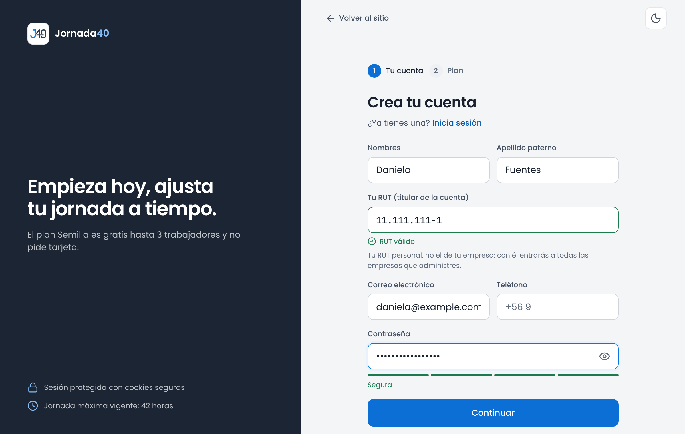
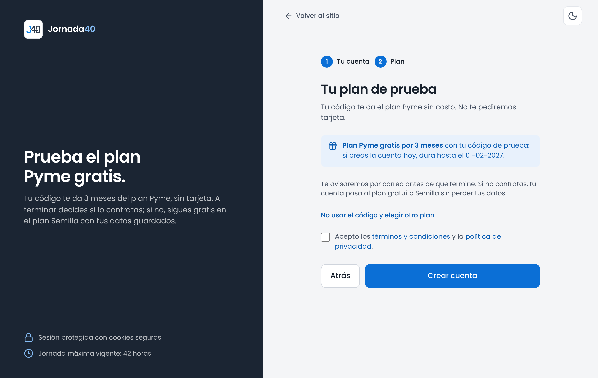
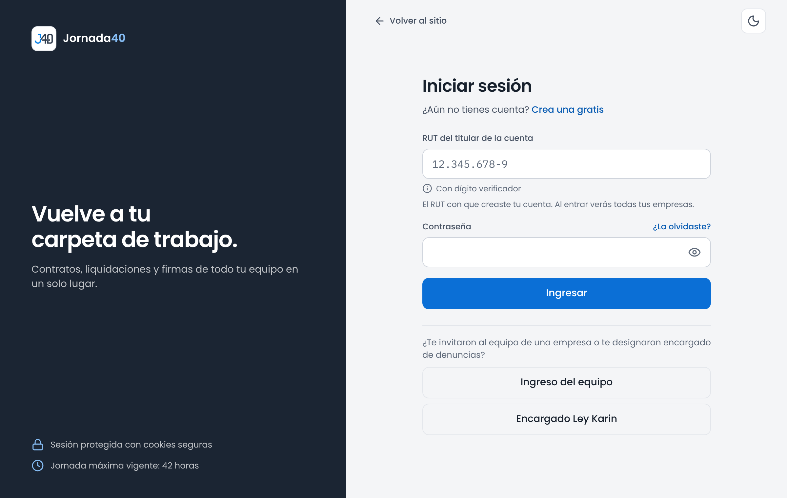
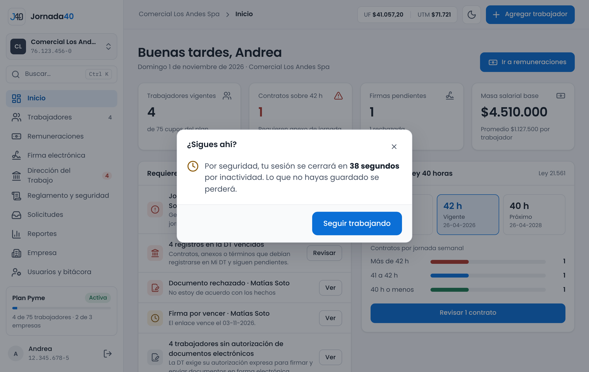
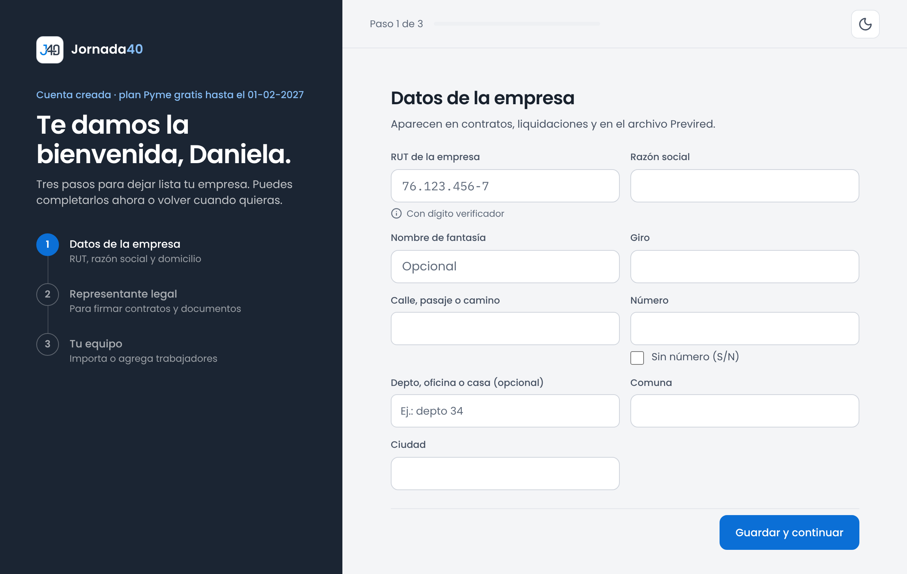
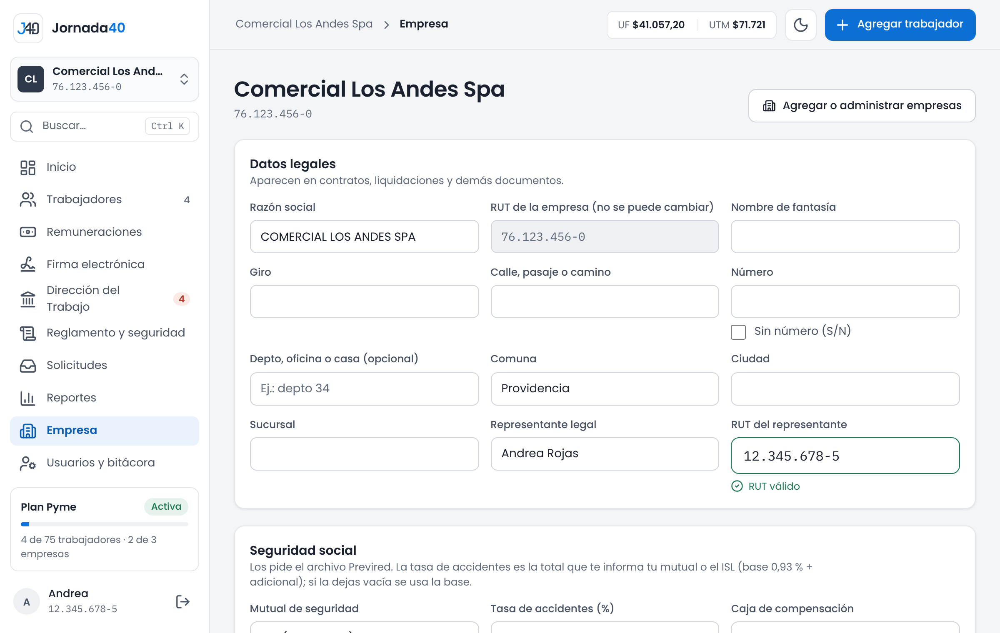

# Tu cuenta y tu empresa {#sec-cuenta}

## Crear la cuenta {#sec-crear-cuenta}

La cuenta es tuya, como persona: la creas con tu RUT personal y con ese mismo RUT entras a todas las empresas que administres. Las empresas se agregan después, en la bienvenida (sección 2.4).

1. En www.jornada40.cl, presiona **Crear cuenta** o **Comenzar gratis**.
2. En el paso **Tu cuenta**, completa **Nombres**, **Apellido paterno**, **Tu RUT (titular de la cuenta)**, **Correo electrónico**, **Contraseña** y, si quieres, **Teléfono**. Presiona **Continuar**.
3. En el paso **Plan**, elige el plan. En los planes pagados puedes elegir pago **Mensual** o **Anual**.
4. Marca la casilla de aceptación de los términos y condiciones y de la política de privacidad, y presiona **Crear cuenta**.
5. Si elegiste el plan Semilla, entras directo a la bienvenida. Si elegiste un plan pagado, Jornada40 te lleva a Reveniu, el servicio de pagos, donde inscribes tu tarjeta. Tu plan se activa cuando Reveniu confirma el pago; mientras tanto, la cuenta funciona en el plan Semilla.

{width=100%}

> **Importante:** usa tu RUT personal, no el de tu empresa. Si escribes el RUT de una empresa, verás el mensaje "Ese RUT es de una empresa. Usa tu RUT personal: las empresas se agregan después."

La contraseña debe tener al menos 8 caracteres, no puede tener solo números ni ser una contraseña común, y debe combinar mayúsculas y minúsculas, números o símbolos (o tener 12 caracteres o más). Bajo el campo, un medidor indica si es **Débil**, **Aceptable**, **Buena** o **Segura**.

Si el pago no se puede iniciar, verás **Tu cuenta está lista**: la cuenta quedó creada en el plan Semilla y puedes cambiar de plan más tarde desde **Plan y facturación**. Presiona **Continuar** para seguir con la bienvenida.

### Con un código de prueba

Un código de prueba te da un plan pagado sin costo durante un período, por ejemplo el plan Pyme por 3 meses. Tiene una forma como `PYME-XXXX-XXXX-XXXX`, sirve una sola vez y se usa al crear la cuenta: no se puede aplicar a una cuenta que ya existe.

1. Si recibiste un enlace con el código, ábrelo: el código se aplica solo y verás un aviso como "Plan Pyme gratis por 3 meses con tu código de prueba: si creas la cuenta hoy, dura hasta el…".
2. Si recibiste solo el código, completa el paso **Tu cuenta** y, en el paso **Plan**, presiona **Tengo un código de prueba**. Escríbelo en **Código de prueba** y presiona **Aplicar**.
3. Con el código aplicado, el paso 2 muestra **Tu plan de prueba**. No se pide tarjeta. Marca la casilla de los términos y presiona **Crear cuenta**.

{width=100%}

Si el código no existe, ya se usó, venció o fue anulado, verás el motivo bajo el campo. Puedes crear la cuenta igual, sin código, eligiendo un plan. Si prefieres no usarlo, presiona **No usar el código y elegir otro plan**.

Cuando faltan 15 días y cuando faltan 3 días para el fin de la prueba, te avisamos por correo. Para seguir con el plan, contrátalo en **Plan y facturación** (sección 16.2); si lo contratas antes, la prueba termina y empieza el plan pagado. Si no lo contratas, al terminar la prueba tu cuenta pasa al plan Semilla: no se borra nada, pero las funciones que Semilla no incluye dejan de estar disponibles.

## Ingresar, salir y cierre por inactividad {#sec-ingresar}

### Ingresar

1. En www.jornada40.cl, presiona **Iniciar sesión**.
2. Escribe tu RUT en **RUT del titular de la cuenta** y tu **Contraseña**.
3. Presiona **Ingresar**.

{width=100%}

Si el RUT o la contraseña no coinciden, verás "Revisa tu RUT y tu contraseña." Después de varios intentos fallidos, el ingreso se detiene por unos minutos: espera y vuelve a intentarlo, o recupera tu contraseña (sección 2.3).

En la misma página, bajo "¿Te invitaron al equipo de una empresa o te designaron encargado de denuncias?", están las puertas de las otras personas: **Ingreso del equipo**, para los usuarios del equipo (capítulo 14), y **Encargado Ley Karin** (anexo B). El titular siempre entra por **Ingresar**.

> **Importante:** si ves "Entraste, pero tu navegador no guardó la sesión", revisa que tu navegador permita las cookies de jornada40.cl e inténtalo de nuevo.

### Salir

Presiona **Cerrar sesión**, el ícono junto a tu nombre al pie del menú. En el celular, está en **Más › Cerrar sesión**. También puedes salir desde **Mi cuenta**.

### Cierre por inactividad

Por seguridad, si pasan 5 minutos sin que uses el panel (sin mover el mouse, escribir, tocar la pantalla ni desplazarte), la sesión se cierra.

1. Un minuto antes aparece **¿Sigues ahí?**, con una cuenta regresiva.
2. Para continuar, presiona **Seguir trabajando**.
3. Si la sesión se cierra, vuelves a **Iniciar sesión** con el aviso "Tu sesión se cerró por inactividad. Ingresa de nuevo para continuar." Al ingresar, vuelves a la página en que estabas.

{width=80%}

La actividad se comparte entre las pestañas del navegador: si trabajas en una, las demás siguen abiertas. Si cierras todas y vuelves después de 5 minutos, tendrás que ingresar de nuevo.

> **Importante:** si la sesión se cierra mientras editas un contrato o una liquidación, al volver verás "Tienes cambios sin guardar del… ¿Quieres recuperarlos?". Presiona **Recuperar** para seguir donde estabas o **Descartar** para empezar de nuevo. El borrador se guarda 24 horas, solo en ese navegador, y se borra si cierras sesión desde el menú.

## Recuperar la contraseña {#sec-recuperar}

1. En **Iniciar sesión**, presiona **¿La olvidaste?**.
2. Escribe tu RUT en **RUT del titular de la cuenta** y presiona **Enviar enlace**.
3. Revisa tu correo. Si el RUT está registrado, te enviamos un enlace al correo de la cuenta. Puede tardar unos minutos y a veces llega a la carpeta de spam.
4. Abre el enlace, escribe la **Nueva contraseña**, repítela en **Repite la contraseña** y presiona **Guardar y volver a iniciar sesión**.
5. Ingresa con la contraseña nueva.

El enlace vence en 24 horas y sirve una sola vez. Puedes pedir hasta 2 enlaces por hora: usa siempre el del último correo. Si el enlace venció o ya se usó, la página dice **El enlace ya no sirve**; presiona **Pedir un enlace nuevo**.

> **Importante:** el enlace llega al correo registrado en tu cuenta. Si ya no tienes acceso a ese correo, escríbenos a contacto.jornada40@gmail.com.

Para cambiar la contraseña cuando ya ingresaste, usa **Mi cuenta** (sección 15.1).

## La bienvenida {#sec-bienvenida-pasos}

Después de crear la cuenta, la bienvenida te guía en tres pasos para dejar lista tu empresa. El panel necesita al menos una empresa: mientras no la registres, cada vez que ingreses volverás a la bienvenida.

{width=100%}

1. **Datos de la empresa.** Completa **RUT de la empresa** y **Razón social**, que son obligatorios, y **Nombre de fantasía**, **Giro**, la dirección, **Comuna** y **Ciudad**. Presiona **Guardar y continuar**.
2. **Representante legal.** Completa **Nombre completo**, **RUT** y **Cargo**, y dibuja la firma en el recuadro con el mouse o el dedo (**Limpiar** la borra para volver a dibujarla). La firma es opcional en este paso; puedes configurarla después en **Empresa** (sección 2.5). Presiona **Guardar y continuar**.
3. **Tu equipo.** Elige cómo cargar a tus trabajadores: **Importar desde Excel** (disponible desde el plan Pyme; sección 4.2) o **Agregar uno por uno** (sección 4.1). También puedes presionar **Ir a mi panel** y hacerlo después.

La dirección se escribe por partes: **Calle, pasaje o camino**, **Número** y **Depto, oficina o casa (opcional)**. Si la dirección no tiene número, marca **Sin número (S/N)** y, si quieres, escribe la **Altura o kilómetro (opcional)**. Así sale bien en los documentos y en los trámites ante la Dirección del Trabajo.

Una vez guardados los datos de la empresa, aparece **Completar después**, arriba a la derecha, para ir al panel y terminar los demás pasos más tarde.

## Datos de la empresa, seguridad social y firma del empleador {#sec-empresa}

*Solo el titular.*

En el menú, presiona **Empresa**. La página reúne los datos de la empresa que tienes seleccionada (sección 3.2).

{width=100%}

| Sección                                | Qué contiene                                                                                                                                       |
|----------------------------------------|----------------------------------------------------------------------------------------------------------------------------------------------------|
| **Datos legales**                      | Razón social, nombre de fantasía, giro, dirección, comuna, ciudad, sucursal, representante legal y su RUT. Aparecen en los contratos, las liquidaciones y los demás documentos. El RUT de la empresa no se puede cambiar. |
| **Seguridad social**                   | Mutual de seguridad, tasa de accidentes, sucursal para el pago de la mutual y caja de compensación. Los usa el archivo de Previred.               |
| **Firma del empleador**                | La firma que se estampa en los documentos firmados electrónicamente.                                                                              |
| **Plan y suscripción**                 | Tu plan y cuántos trabajadores vigentes tienes en todas tus empresas, con el enlace **Gestionar plan**.                                          |
| **Parámetros previsionales vigentes**  | Ingreso mínimo, topes imponibles, UF y UTM del día, jornada máxima legal y tasas de cotización. Los actualiza Jornada40 con los indicadores oficiales y no se editan. |

: Secciones de la página Empresa

### Datos legales y seguridad social

1. Cambia los campos que necesites. Al editar, aparecen **Guardar** y **Descartar**.
2. Presiona **Guardar**. **Descartar** vuelve a los datos guardados.

En **Seguridad social**:

- **Mutual de seguridad:** ISL (sin mutual), ACHS, Mutual de Seguridad CChC o IST.
- **Tasa de accidentes (%):** la tasa total que te informa tu mutual o el ISL, es decir, la base de 0,93 % más la adicional. Si la dejas vacía, se usa la base.
- **Sucursal para pago mutual:** aparece cuando eliges una mutual.
- **Caja de compensación:** sin caja de compensación, Los Andes, La Araucana, Los Héroes o 18 de Septiembre.

Si la dirección de la empresa quedó escrita en un solo campo, verás "Dirección registrada: …" con la indicación de completarla por partes. Inicio también lo recuerda como tarea (sección 3.1).

### Firma del empleador

1. En **Firma del empleador**, presiona **Configurar firma** (o **Cambiar firma**, si ya tienes una).
2. Completa **Nombre de quien firma** y **Cargo**.
3. Dibuja la firma en el recuadro y presiona **Guardar firma**.

La firma se estampa en todos los documentos de la empresa que se firman electrónicamente. Dibujar una nueva reemplaza la anterior para los documentos que se firmen desde ese momento; los ya firmados no cambian.

> **Importante:** sin firma configurada no se puede enviar ningún documento a firma, y los trabajadores no pueden emitir certificados desde su portal (sección 13.3). Configúrala antes de empezar.

Para agregar otra empresa o cambiar entre ellas, presiona **Agregar o administrar empresas**, arriba a la derecha (sección 16.1).
