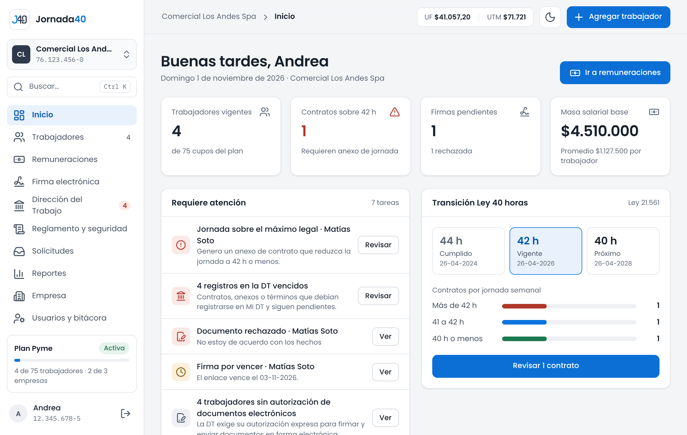
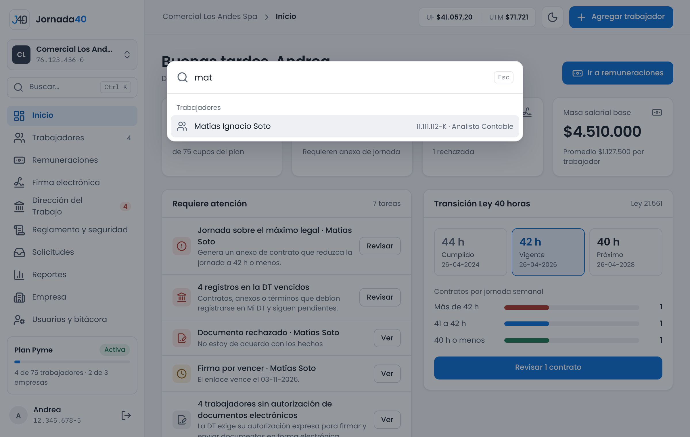

# El panel {#sec-panel}

Al ingresar llegas al panel. A la izquierda está el menú; arriba, el encabezado con el camino de la página en que estás, la UF y la UTM del día y los botones principales; al centro, el contenido. En el celular, el menú pasa a una barra al pie de la pantalla.

## Inicio {#sec-inicio}

**Inicio** es la primera página del panel. Resume la empresa seleccionada y te dice qué requiere atención.

{width=100%}

Arriba ves el saludo, la fecha y la empresa, y el botón **Ir a remuneraciones**. Debajo, cuatro indicadores:

- **Trabajadores vigentes.**
- **Contratos sobre 42 h:** contratos con una jornada sobre el máximo legal vigente, que requieren un anexo de jornada (sección 5.3).
- **Firmas pendientes:** documentos enviados a firma que el trabajador aún no firma, y cuántos rechazó.
- **Masa salarial base:** la suma de los sueldos base, con el promedio por trabajador.

### Requiere atención

Es la lista de tareas pendientes de la empresa. Cada tarea explica qué pasa y tiene un botón que lleva a resolverla. Si no hay pendientes, dice "Todo en orden: no hay pendientes."

| Tarea                                                                  | Botón                         | Dónde se explica |
|------------------------------------------------------------------------|-------------------------------|------------------|
| Un trabajador no tiene contrato                                        | **Crear contrato**            | Sección 5.1      |
| Un contrato tiene un aviso grave, como una jornada sobre el máximo     | **Revisar**                   | Sección 5.1      |
| Un contrato a plazo fijo está por vencer                               | **Revisar**                   | Sección 5.1      |
| Registros en la Dirección del Trabajo vencidos o que vencen en 3 días hábiles o menos | **Revisar**    | Sección 11.1     |
| Trabajadores sin autorización para documentos electrónicos            | **Ver**                       | Sección 11.3     |
| Solicitudes de vacaciones, permisos o conciliación por responder       | **Responder**                 | Sección 13.2     |
| Documentos que los trabajadores pidieron desde su portal               | **Atender**                   | Sección 13.2     |
| Un trabajador rechazó un documento, o un enlace de firma está por vencer | **Ver**                     | Sección 8.2      |
| Liquidaciones del mes sin enviar a firma                               | **Enviar a firma**            | Sección 7.3      |
| La dirección de la empresa o de trabajadores está por completar        | **Completar**                 | Secciones 2.5 y 4.3 |
| Denuncias de la Ley Karin en curso o con un plazo vencido (solo el titular, solo la cifra) | **Ver**   | Sección 12.3     |

: Tareas de Inicio

Un usuario del equipo ve solo las tareas de las secciones a las que tiene acceso.

### Las demás tarjetas

- **Transición Ley 40 horas:** muestra la etapa de la reducción de jornada (44 horas, cumplida; 42 horas, vigente; 40 horas, la próxima, desde el 26-04-2028) y cuántos contratos hay en cada tramo de jornada semanal. Los contratos del artículo 22, que no tienen horario, no se cuentan. Si hay contratos sobre el máximo, el botón **Revisar** lleva a ellos; si no hay, dice **Ver trabajadores**.
- **Remuneraciones:** las liquidaciones emitidas en el mes y cuántas firmó el trabajador. **Ir al proceso** abre **Remuneraciones** (capítulo 7).
- **Ausencias:** las vacaciones y los permisos en curso o próximos, con su estado (**Por aprobar**, **En curso** o **Próxima**). *Disponible desde el plan Starter.*
- **Composición del equipo:** cuántos trabajadores hay por tipo de contrato, modalidad, sistema de salud, sexo y nacionalidad. Si la empresa tiene más de 25 trabajadores y los extranjeros superan el 15 %, avisa que se excede el límite del artículo 19 del Código del Trabajo, para que revises las excepciones que aplican.

## Menú, cambio de empresa y buscador {#sec-menu}

### Menú

| Menú                       | Para qué sirve                                                                 | Dónde se explica      |
|----------------------------|--------------------------------------------------------------------------------|-----------------------|
| **Inicio**                 | Resumen de la empresa y tareas pendientes.                                     | Sección 3.1           |
| **Trabajadores**           | Lista de trabajadores y la carpeta de cada uno: datos, contrato y documentos.  | Capítulos 4 a 6, 9 y 10 |
| **Remuneraciones**         | Liquidaciones, conceptos, Previred, Libro de Remuneraciones y Certificado N°6. | Capítulo 7            |
| **Firma electrónica**      | Seguimiento de los documentos enviados a firma.                                | Capítulo 8            |
| **Dirección del Trabajo**  | Registro electrónico laboral, consentimiento y fiscalizaciones.                | Capítulo 11           |
| **Reglamento y seguridad** | Reglamento interno, información de riesgos y Ley Karin.                        | Capítulo 12           |
| **Solicitudes**            | Lo que piden los trabajadores desde su portal.                                 | Capítulo 13           |
| **Reportes**               | Reportes de varias empresas y expedientes.                                     | Sección 7.7           |
| **Empresa**                | Datos de la empresa, empresas, y plan y facturación. *Solo el titular.*        | Secciones 2.5 y 16    |
| **Usuarios y bitácora**    | Usuarios del equipo y registro de acciones. *Solo el titular.*                 | Capítulo 14           |

: Opciones del menú

Algunas opciones muestran una cifra: **Trabajadores**, cuántos trabajadores vigentes hay; **Dirección del Trabajo**, los registros vencidos o por vencer, y **Solicitudes**, las que esperan respuesta.

Al pie del menú está la tarjeta de tu plan, con su estado (**Activa**, **Prueba** o **Cancelada**) y cuántos trabajadores y empresas usas del máximo del plan; al presionarla se abre **Plan y facturación**. Debajo está tu nombre, que abre **Mi cuenta** (capítulo 15), y el ícono **Cerrar sesión**. Un usuario del equipo ve, en lugar de la tarjeta del plan, la indicación "Usuario del equipo".

En el encabezado, arriba a la derecha, están la UF y la UTM del día, el botón para cambiar entre el tema claro y el oscuro, y **Agregar trabajador** (sección 4.1).

En el celular, la barra inferior tiene **Inicio**, **Personal** (Trabajadores), **Sueldos** (Remuneraciones), **Firmas** y **Más**, que abre las demás opciones, **Plan y facturación**, **Mi cuenta** y **Cerrar sesión**.

### Cambio de empresa

Todo lo que ves en el panel corresponde a la empresa seleccionada, cuyo nombre aparece arriba del menú.

1. Presiona el nombre de la empresa, arriba del menú.
2. Elige otra empresa de la lista "Tus empresas".
3. El panel cambia a esa empresa.

Al final de la lista, **Agregar o administrar empresas** permite agregar otra empresa (sección 16.1). Un usuario del equipo ve la lista "Empresas que puedes ver", con las empresas que le asignó el titular.

### Buscador

El buscador encuentra trabajadores y abre cualquier sección sin pasar por el menú.

1. Presiona **Buscar…**, arriba del menú, o usa el atajo **Ctrl + K** (en Mac, **Comando + K**). En el celular, presiona la lupa del encabezado.
2. Escribe el nombre, el apellido, el cargo o al menos 3 dígitos del RUT de un trabajador, o una acción, como "Nueva liquidación", "Agregar trabajador" o "Plan y facturación".
3. Elige un resultado con el mouse, o con las flechas y **Enter**. Si eliges un trabajador, se abre su carpeta.

**Esc** cierra el buscador. Busca entre los trabajadores de la empresa seleccionada.

{width=100%}

## Avisos del plan {#sec-avisos-plan}

Algunos avisos aparecen en una franja arriba del contenido, en todas las páginas del panel, mientras corresponda:

| Aviso                                         | Cuándo aparece                                                                                         | Qué hacer                                                                                       |
|-----------------------------------------------|--------------------------------------------------------------------------------------------------------|-------------------------------------------------------------------------------------------------|
| "Prueba del plan Pyme: quedan 10 días"         | Durante los últimos 15 días de una prueba con código (sección 2.1). Indica la fecha en que termina.     | Si quieres seguir con el plan, presiona **Ver plan** y contrátalo.                               |
| "Terminó tu prueba del plan Pyme"              | Cuando terminó la prueba y la cuenta pasó al plan Semilla.                                             | **Ver planes** para contratar un plan. Puedes cerrar el aviso.                                   |
| "Tu plan pagado terminó"                       | Cuando terminó la suscripción pagada y la cuenta volvió al plan gratuito.                               | **Ver planes** para volver a contratar. Puedes cerrar el aviso.                                  |

: Avisos del plan

En todos los casos, tus datos siguen guardados: nada se borra al cambiar de plan.

Además, dentro de cada página:

- Una función que tu plan no incluye aparece con un aviso que indica desde qué plan está disponible, muchas veces con el enlace **Ver planes**.
- Si ocupas todos los trabajadores que permite tu plan, al agregar otro verás "Tu plan permite N trabajadores y ya los ocupas todos". Los trabajadores desvinculados en el mes siguen ocupando su cupo hasta fin de mes (sección 4.6).
