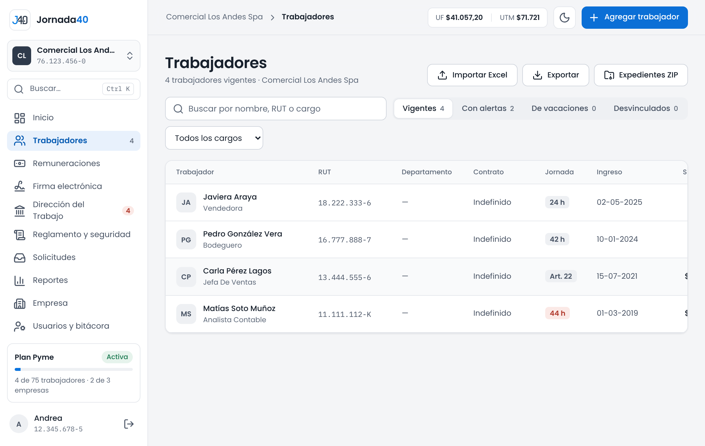
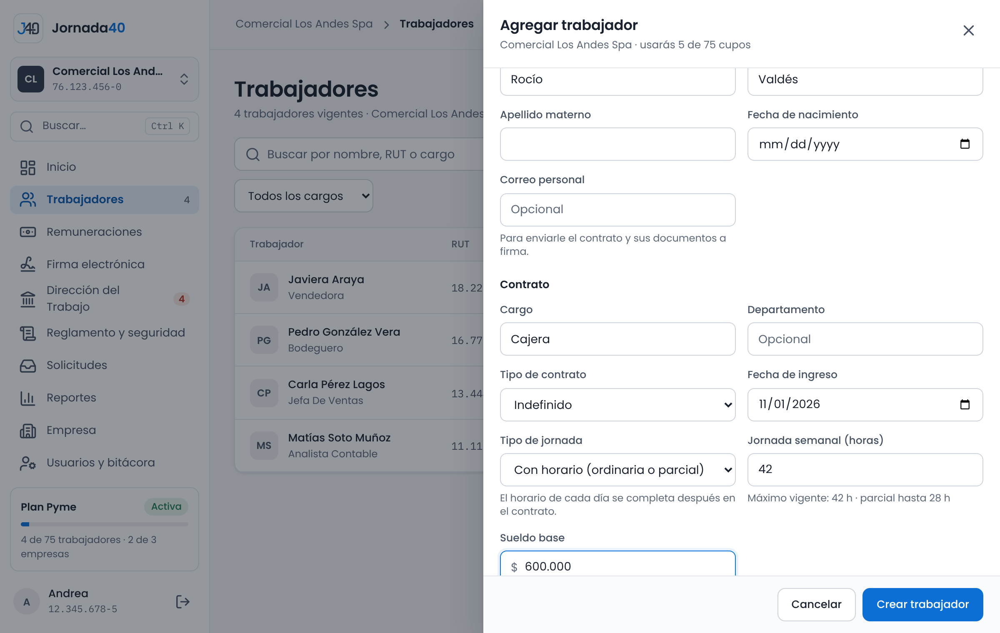
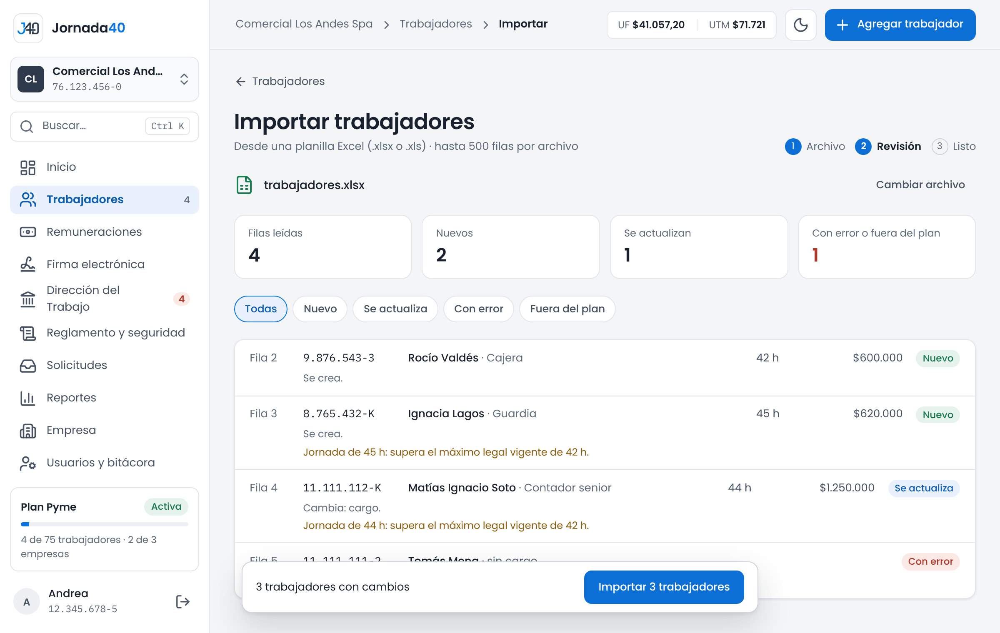
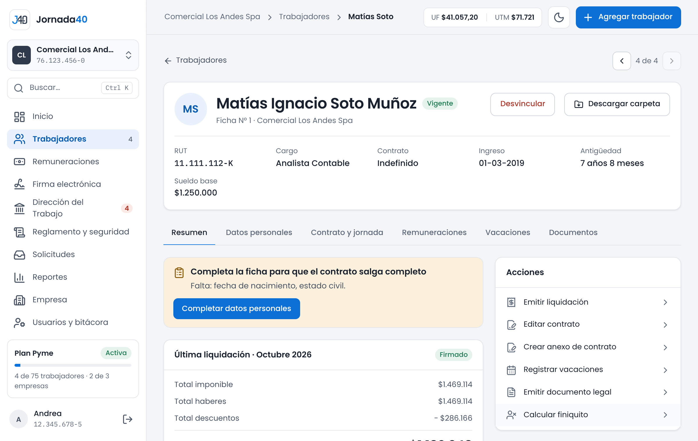

# Trabajadores {#sec-trabajadores}

En el menú, **Trabajadores** muestra la lista de trabajadores de la empresa seleccionada. Desde ahí se agregan, se importan y se abre la carpeta de cada uno.

{width=100%}

La lista tiene un buscador ("Buscar por nombre, RUT o cargo") y estos filtros:

- **Vigentes**, **Con alertas**, **De vacaciones** y **Desvinculados**, cada uno con su cantidad;
- **Todos los cargos** y **Todos los departamentos**, para ver uno en particular.

Cada fila muestra el trabajador, su RUT, departamento, tipo de contrato, jornada, fecha de ingreso, sueldo base y estado (**Vigente**, **De vacaciones** o **Desvinculado**). Si el trabajador no tiene contrato o su contrato tiene avisos, aparece una etiqueta, por ejemplo **Sin contrato** o **Jornada**.

Arriba están los botones:

- **Importar Excel:** carga o actualiza trabajadores desde una planilla (sección 4.2).
- **Exportar:** descarga en Excel la lista que estás viendo.
- **Expedientes ZIP:** descarga los documentos de varios trabajadores (sección 4.7).
- **Agregar trabajador**, en el encabezado del panel (en el celular, **Agregar**): sección 4.1.

## Agregar un trabajador {#sec-agregar}

Agregar a un trabajador pide lo mínimo para crear su ficha y su contrato. Lo demás se completa después en su carpeta (sección 4.4).

1. Presiona **Agregar trabajador**. Arriba verás cuántos cupos de tu plan usarás, por ejemplo "usarás 8 de 10 cupos".
2. En **Identificación**, completa **RUT**, **Nombres**, **Apellido paterno** y, si los tienes, **Apellido materno**, **Fecha de nacimiento** y **Correo personal**. El correo sirve para enviarle el contrato y sus documentos a firma.
3. En **Contrato**, completa **Cargo**, **Departamento** (opcional), **Tipo de contrato** (**Indefinido**, **Plazo fijo** o **Por obra o faena**), **Fecha de ingreso** y, en plazo fijo y obra o faena, **Fecha de término**.
4. Elige el **Tipo de jornada**: **Con horario (ordinaria o parcial)** o **Art. 22 (sin límite de jornada)**, que corresponde a gerentes, administradores o quienes trabajan sin fiscalización superior inmediata.
5. Con horario, escribe la **Jornada semanal (horas)**. Bajo el campo se indica el máximo vigente y hasta cuántas horas la jornada es parcial; con 28 horas o menos, se registra como parcial.
6. Escribe el **Sueldo base** y presiona **Crear trabajador**.

{width=100%}

Se abre la carpeta del trabajador con el aviso "Trabajador creado. Completa su ficha para que el contrato salga completo." El horario de cada día se completa después, en el contrato (sección 5.1).

En una jornada con horario, mientras completas los datos, Jornada40 revisa la jornada y el sueldo y muestra avisos, por ejemplo si la jornada supera el máximo legal o el sueldo es menor que el ingreso mínimo. Son avisos: puedes crear al trabajador igual.

Si el RUT ya está en la empresa, verás "Este trabajador ya está registrado en esta empresa." Si ocupas todos los cupos de tu plan, verás "Tu plan permite N trabajadores y ya los ocupas todos" (sección 3.3).

## Carga desde Excel {#sec-importar}

*Disponible desde el plan Pyme.*

Carga o actualiza hasta 500 trabajadores de una vez desde una planilla Excel (.xlsx o .xls).

1. En **Trabajadores**, presiona **Importar Excel**.
2. En **1 · Descarga la planilla**, presiona **Descargar planilla .xlsx**. Completa una fila por trabajador.
3. En **2 · Sube el archivo**, arrastra la planilla o elígela. Jornada40 revisa cada fila antes de guardar.
4. Revisa el resultado de cada fila: **Nuevo**, **Se actualiza**, **Con error** o **Fuera del plan**, con la explicación. Si necesitas corregir la planilla, presiona **Cambiar archivo**.
5. Presiona **Importar N trabajadores**.
6. En **Importación terminada** ves cuántos se crearon, se actualizaron o se omitieron, y cuántos tienen la jornada sobre el máximo. **Descargar filas omitidas** baja en Excel las filas que no se guardaron, para corregirlas.

{width=100%}

| Columnas obligatorias para crear                                                     | Columnas opcionales                                                                                                                |
|--------------------------------------------------------------------------------------|------------------------------------------------------------------------------------------------------------------------------------|
| rut, nombres, apellido_paterno, cargo, fecha_ingreso, sueldo_base, horas_laborales   | apellido_materno, email, sexo, nacionalidad, fecha_nacimiento, departamento, sucursal, forma_pago, banco, tipo_cuenta, numero_cuenta |

: Columnas de la planilla de trabajadores

Las fechas van en formato DD-MM-AAAA y los encabezados no distinguen mayúsculas ni espacios. Si el RUT ya existe en la empresa, solo se actualizan las columnas que traen dato. El banco debe ser uno de la lista de Jornada40; si no se reconoce, la fila queda con error.

> **Importante:** los trabajadores nuevos quedan sin contrato. Créalo desde su carpeta (sección 5.1) para poder emitir sus liquidaciones.

## La carpeta del trabajador {#sec-carpeta}

La carpeta reúne todo lo de un trabajador. Se abre al presionar su nombre en la lista o al buscarlo (sección 3.2).

{width=100%}

Arriba están su nombre y sus datos principales (RUT, cargo, contrato, ingreso, antigüedad y sueldo base), las flechas para pasar al trabajador anterior o siguiente y los botones **Desvincular** (sección 4.6) y **Descargar carpeta** (sección 4.7).

| Pestaña                 | Qué contiene                                                                                                   | Dónde se explica |
|-------------------------|----------------------------------------------------------------------------------------------------------------|------------------|
| **Resumen**             | La última liquidación, las protecciones especiales, la jornada, el contacto y los documentos recientes.         | Esta sección     |
| **Datos personales**    | La ficha: identificación, contacto, datos laborales, protecciones especiales y previsión y pago.                | Esta sección     |
| **Contrato y jornada**  | Las condiciones del contrato, la jornada y el horario.                                                          | Capítulo 5       |
| **Remuneraciones**      | Las liquidaciones del trabajador.                                                                               | Capítulo 7       |
| **Vacaciones**          | Las vacaciones y los permisos, con el saldo de días.                                                            | Capítulo 9       |
| **Documentos**          | Los documentos emitidos, su estado de firma y el menú para generar otros nuevos.                                | Capítulo 6       |

: Pestañas de la carpeta

Al costado de la carpeta están el estado del trabajador en su portal (sección 13.1) y tres bloques:

- **Acciones:** accesos rápidos a **Emitir liquidación**, **Editar contrato**, **Crear anexo de contrato**, **Registrar vacaciones**, **Emitir documento legal** y **Calcular finiquito**.
- **Pendientes:** lo que falta resolver con ese trabajador, como un contrato por crear, un fuero, una solicitud de conciliación por responder o una firma rechazada. Si no hay nada, dice "Nada pendiente con este trabajador."
- **Actividad reciente:** los últimos documentos emitidos.

### Datos personales

La pestaña **Datos personales** se divide en secciones. Para cambiar una, presiona **Editar**, corrige los datos y presiona **Guardar** (o **Cancelar**).

| Sección                     | Datos                                                                                                                         |
|-----------------------------|-------------------------------------------------------------------------------------------------------------------------------|
| **Identificación**          | Nombres, apellidos, fecha de nacimiento, sexo, nacionalidad y estado civil.                                                  |
| **Contacto**                | Correo, teléfono y dirección por partes (calle, número o sin número, depto) y comuna.                                         |
| **Datos laborales**         | N° de ficha, departamento, sucursal, centro de costo, modalidad (presencial, remoto o híbrido), fecha de ingreso y años con otros empleadores para el feriado progresivo. |
| **Protecciones especiales** | Responsabilidades de cuidado, hijo o hija con enfermedad grave y fuero (sección 4.5).                                         |
| **Previsión y pago**        | AFP, salud (Fonasa o Isapre, con plan y N° FUN), tramo de asignación familiar y cargas, discapacidad, pensión, impuesto a la renta y forma de pago con banco, tipo y número de cuenta. |

: Secciones de los datos personales

Si el correo del trabajador parece corporativo, verás un aviso: la Dirección del Trabajo pide enviar los documentos al correo personal, que el trabajador conserva al terminar la relación laboral. Si es su correo personal, presiona **Es su correo personal**.

Al final de la pestaña está el bloque **Documentos electrónicos**, con la autorización del trabajador para recibir y firmar documentos en forma electrónica (sección 11.3).

## Datos que faltan para el contrato {#sec-faltantes}

Si a la ficha le falta algo para que el contrato salga completo, la carpeta muestra el aviso "Completa la ficha para que el contrato salga completo", con la lista de lo que falta. Aparece en el **Resumen**, en **Contrato y jornada** y en el editor del contrato.

Lo que se revisa:

- de la ficha: fecha de nacimiento, nacionalidad, estado civil, dirección (calle y número), comuna, correo personal, AFP y salud;
- del contrato: que exista y, en jornadas ordinarias y parciales, el horario de trabajo (días y horas de entrada y salida); en una jornada **Otra (describir)**, su descripción.

Los botones **Completar datos personales** y **Completar el contrato** (o **Crear contrato**) llevan a cada lugar. Es un aviso: puedes emitir el contrato igual, pero saldrá con espacios en blanco.

## Protecciones especiales y conciliación {#sec-protecciones}

En **Datos personales › Protecciones especiales** se registran las situaciones que la ley protege. Jornada40 las usa para avisarte cuando una decisión las toca.

| Campo                                                          | Opciones                                                                                                                                                         |
|----------------------------------------------------------------|------------------------------------------------------------------------------------------------------------------------------------------------------------------|
| **Responsabilidades de cuidado (Ley 21.645)**                  | No tiene; niño o niña menor de 14 años; adolescente menor de 18 años con discapacidad o dependencia; persona adulta con discapacidad; persona adulta en situación de dependencia severa o moderada. |
| **Hijo o hija menor de 18 con enfermedad grave (Ley SANNA)**   | Sí o no.                                                                                                                                                         |
| **Fuero laboral**                                              | No tiene; maternidad; padre que usa el postnatal parental; dirigente o candidato sindical; delegado del personal o sindical; representante del Comité Paritario; negociación colectiva en curso. |
| **Fecha del parto**                                            | Solo con fuero de maternidad. Se deja vacía durante el embarazo.                                                                                                |
| **Fuero hasta**                                                | Fecha en que termina el fuero. Vacía, el fuero sigue vigente o, en maternidad, se calcula desde el parto: 12 semanas de postnatal más un año.                     |

: Protecciones especiales

Los avisos que generan aparecen en el bloque **Protecciones especiales** del **Resumen**, en **Pendientes** y donde corresponde:

- **Fuero:** "Trabajador con fuero". No se le puede despedir sin autorización judicial previa (desafuero). El aviso aparece también al preparar una carta de término y al calcular el finiquito.
- **Cuidado:** "Trabajador con responsabilidades de cuidado". Indica su derecho preferente a teletrabajo y, si cuida a menores, la preferencia para tomar su feriado en las vacaciones escolares, con las fechas de las próximas. Aparece también al registrar vacaciones.
- **Enfermedad grave de un hijo o hija:** sus ausencias con licencia del Seguro SANNA se registran como licencia médica, no como ausencia.

### Solicitudes de conciliación

Si el trabajador tiene responsabilidades de cuidado, la pestaña **Datos personales** muestra **Solicitudes por responsabilidades de cuidado (Ley 21.645)**. Ahí registras lo que el trabajador pidió por escrito y tu respuesta.

1. Presiona **Registrar solicitud**.
2. En **¿Qué pidió?**, elige **Teletrabajo o trabajo a distancia** o **Cambio transitorio de turnos o jornada en vacaciones escolares**. Indica la **Fecha en que lo pidió por escrito** y, en el cambio de jornada, el período (**Desde** y **Hasta**).
3. Presiona **Registrar**. La solicitud queda pendiente, con la fecha límite para responder: 15 días para el teletrabajo y 10 días para el cambio de jornada, contados desde que la pidió.
4. Cuando decidas, presiona **Registrar respuesta** y elige **Aceptar**, **Otra fórmula** o **Rechazar**. Para ofrecer otra fórmula o rechazar, elige el **Motivo** de la lista y explica qué le ofreces o las circunstancias que lo justifican.
5. Indica la **Fecha de la respuesta** y presiona **Guardar respuesta**.

> **Importante:** entrégale la respuesta al trabajador por escrito. Jornada40 guarda el registro con su fecha y avisa si la solicitud está por vencer, si se respondió fuera de plazo o si el cambio de jornada se pidió con menos de 30 días de anticipación.

Desde el plan Pyme, los trabajadores también pueden hacer estas solicitudes desde su portal; aparecen en el mismo lugar (sección 13.2).

## Desvincular y reactivar {#sec-desvincular}

Desvincular a un trabajador lo saca de los procesos del mes. No se borra nada: su carpeta y sus documentos se conservan.

1. En la carpeta, presiona **Desvincular**.
2. Lee el aviso **Desvincular al trabajador** y presiona **Desvincular**.

El trabajador sigue ocupando su cupo del plan hasta fin de mes y se libera el mes siguiente. Desvincular no reemplaza la carta de término ni el finiquito: si aún no los haces, prepáralos (capítulo 10).

Para reactivarlo, búscalo con el filtro **Desvinculados**, abre su carpeta y presiona **Reactivar**. Si se desvinculó este mes, reactivarlo no usa un cupo extra; si fue antes, ocupa un cupo nuevo del plan.

## Expedientes en ZIP {#sec-zip}

*Disponible desde el plan Pyme.*

Descarga en un archivo ZIP los documentos de uno o varios trabajadores, por ejemplo para entregarlos en una fiscalización o guardar un respaldo. Los documentos firmados se descargan en su versión firmada.

**De varios trabajadores:**

1. En **Trabajadores**, presiona **Expedientes ZIP**.
2. Elige los trabajadores (**Todos**, **Ninguno** o uno por uno, con el buscador). Se pueden descargar hasta 50 por vez.
3. En **Documentos**, marca los tipos que quieres: contrato, anexo Ley 40 horas, anexos de contrato, liquidaciones (las últimas que indiques, hasta 12), amonestaciones, constancias, cartas de término, términos por mutuo acuerdo, comprobantes de vacaciones y finiquitos.
4. Presiona **Descargar**. El ZIP trae una carpeta por trabajador.

**De un trabajador:** en su carpeta, presiona **Descargar carpeta**. El ZIP incluye todos sus documentos y sus últimas 12 liquidaciones.
