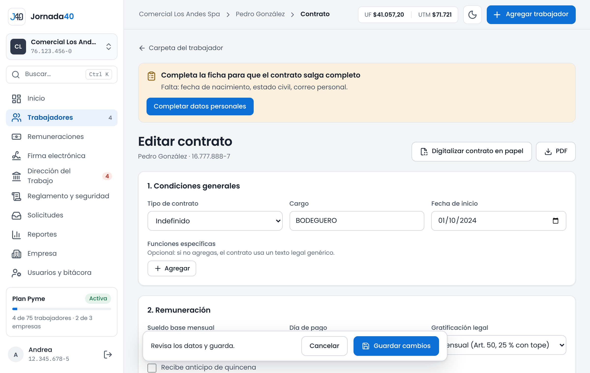
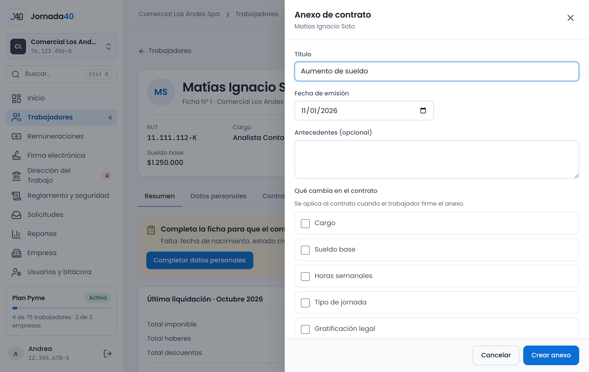

# Contratos y Ley 40 horas {#sec-contratos}

Cada trabajador tiene un contrato vigente. Jornada40 lo redacta con los datos de la ficha y del contrato, revisa la jornada contra el máximo legal y lo envía a firma. Una vez firmado, sus condiciones cambian solo con un anexo.

## Crear y editar el contrato {#sec-contrato}

El contrato se ve en la carpeta del trabajador, pestaña **Contrato y jornada**. Ahí están las condiciones del contrato con su estado de firma, la jornada y la distribución semanal, y los botones **Enviar a firma**, **Descargar contrato**, **Editar contrato** y **Crear anexo**. Si el trabajador no tiene contrato, presiona **Crear contrato**.

El editor del contrato se organiza en cuatro partes.

{width=100%}

1. **1. Condiciones generales:** **Tipo de contrato** (**Indefinido**, **Plazo fijo** u **Obra o faena**), **Cargo**, **Fecha de inicio** y, si corresponde, **Fecha de término** o **Término estimado**. En plazo fijo, marca **Profesional o técnico titulado** si corresponde: el plazo puede durar hasta 2 años en vez de 1. En **Funciones específicas** puedes agregar las tareas del cargo; si no agregas ninguna, el contrato usa un texto legal genérico.
2. **2. Remuneración:** **Sueldo base mensual**, **Día de pago** y **Gratificación legal**, **Mensual (Art. 50, 25 % con tope)** o **Anual (Art. 47)**. Si corresponde, marca **Recibe anticipo de quincena**, con su día y monto, o **Recibe comisiones por venta**, con cada categoría y su porcentaje sobre lo vendido.
3. **3. Jornada:** **Tipo de jornada** (**Ordinaria**, **Parcial (Art. 40 bis)**, **Art. 22 (sin límite de jornada)**, **Turnos rotativos**, **Bisemanal** u **Otra (describir)**) y **Horas semanales**, con el máximo vigente a la vista. En las jornadas ordinarias y parciales, completa la **Distribución semanal**: marca los días que trabaja y escribe la hora de entrada, la de salida y los minutos de colación de cada uno; al lado ves las horas del día. En **Otra (describir)**, describe la jornada.
4. **4. Cláusulas especiales:** acuerdos adicionales, uno por línea, con **Agregar**.

Al final, presiona **Crear contrato** o **Guardar cambios**. **PDF**, arriba, descarga el contrato.

El contrato incluye una cláusula en que el trabajador autoriza que su documentación laboral se genere, firme, envíe y conserve por medios electrónicos (sección 11.3).

> **Importante:** si la sesión se cierra mientras editas, el borrador se guarda en ese navegador por 24 horas. Al volver, presiona **Recuperar** (sección 2.2).

### Avisos de jornada

Mientras editas, Jornada40 revisa la jornada y el sueldo y muestra avisos con su explicación y una recomendación. Si hay avisos graves, verás "Hay avisos de jornada: revísalos antes de guardar.", pero puedes guardar igual.

| Aviso                                              | Cuándo aparece                                                                                 |
|----------------------------------------------------|------------------------------------------------------------------------------------------------|
| Jornada sobre el máximo legal                      | Las horas semanales superan el máximo vigente (42 horas).                                      |
| La jornada máxima baja a 40 h                      | Faltan 180 días o menos para la reducción del 26-04-2028 y el contrato supera las 40 horas.    |
| El horario no calza con la jornada pactada         | Las horas de la distribución semanal suman más que las pactadas.                               |
| Días con más de 10 horas                           | Algún día de la distribución supera 10 horas.                                                  |
| Jornada distribuida en más de seis días            | La distribución usa más de seis días a la semana.                                              |
| Distribución semanal con muy pocos días            | La jornada se reparte en menos días de los que permite la ley.                                 |
| No califica como jornada parcial                   | Una jornada parcial supera dos tercios del máximo.                                             |
| Artículo 22 con horario fijo o con horas pactadas  | El contrato excluye al trabajador del límite de jornada, pero le fija un horario o unas horas.  |
| Sueldo base bajo el ingreso mínimo                 | El sueldo base es menor que el ingreso mínimo que corresponde.                                 |

: Avisos de jornada del contrato

### Enviar el contrato a firma

1. En **Contrato y jornada**, presiona **Enviar a firma**.
2. Confirma tu identidad con tu contraseña, si Jornada40 te la pide (sección 8.1).
3. El trabajador recibe un correo para firmar. El contrato queda **Pendiente de firma**.

Si el trabajador no recibió el correo, presiona **Reenviar correo de firma**. Si rechazó la firma o el enlace venció, presiona **Enviar de nuevo a firma**. El trabajador debe tener un correo registrado en su ficha.

Desde el plan Pyme, si la empresa tiene un reglamento interno vigente, junto con el contrato se envía la constancia de entrega del reglamento (sección 12.1).

> **Importante:** mientras el contrato está en firma, o una vez firmado, sus condiciones no se editan. El editor lo indica y ofrece **Crear anexo**: los cambios se pactan con un anexo firmado por ambas partes (sección 5.4).

## Digitalizar un contrato en papel {#sec-digitalizar}

Si el trabajador ya tiene un contrato en papel, Jornada40 puede leerlo y completar el editor por ti.

1. Abre el editor del contrato y presiona **Digitalizar contrato en papel**.
2. Elige el archivo: un PDF, una foto JPG o PNG, de hasta 20 MB.
3. Espera mientras dice **Leyendo…**. Verás "Documento leído: revisa los datos antes de guardar".
4. Revisa cada campo que se completó y corrige lo que haga falta.
5. Presiona **Crear contrato** o **Guardar cambios**.

Si el documento trae datos personales distintos a los de la ficha, Jornada40 te los muestra y puedes elegir **Actualizar datos personales** o **Ignorar**. Si el documento es de otro RUT, verás un aviso para que revises que sea el contrato correcto.

El archivo solo se usa para leer los datos: no queda guardado en la carpeta. Si la lectura automática no está disponible o no logra leer el documento, verás un mensaje y puedes completar el contrato a mano.

## Anexo Ley 40 horas {#sec-anexo-40h}

La Ley 21.561 reduce la jornada máxima en etapas: 44 horas desde el 26-04-2024, 42 horas desde el 26-04-2026 y 40 horas desde el 26-04-2028. Si un contrato supera el máximo vigente, la carpeta lo marca con el aviso "Jornada sobre el máximo legal" y Jornada40 te propone el anexo de adecuación.

El anexo Ley 40 horas fija la jornada ordinaria en el máximo vigente, mantiene la distribución en los días pactados y deja expresamente igual la remuneración. Se genera con los datos del contrato.

1. En la carpeta del trabajador, abre la pestaña **Documentos**. Si el contrato supera el máximo, aparece **Anexo Ley 40 horas**, "Reducción de jornada al máximo legal".
2. Presiona **PDF** para revisarlo o **Enviar a firma** para que el trabajador lo firme.

También se descarga desde el editor del contrato, en el bloque **Anexo Ley 40 horas**, con **Descargar anexo 40 horas**. Desde el plan Pyme, puedes descargar los anexos de varios trabajadores en **Expedientes ZIP**, marcando **Anexo Ley 40 horas** (sección 4.7).

> **Importante:** el anexo Ley 40 horas no cambia el contrato guardado en Jornada40. Si también quieres que el contrato quede con las horas nuevas y que el aviso desaparezca, ajusta las horas en el editor (si el contrato no se ha firmado) o crea un anexo de contrato que cambie las **Horas semanales** (sección 5.4).

Una vez firmado, el anexo debe registrarse en la Dirección del Trabajo; Jornada40 lo muestra en **Dirección del Trabajo** con su plazo (capítulo 11).

## Anexos y pacto de teletrabajo {#sec-anexos}

### Anexo de contrato

Un anexo modifica el contrato con el acuerdo de ambas partes. Los cambios se aplican al contrato cuando el trabajador lo firma.

1. En la carpeta, presiona **Crear anexo de contrato** (en **Acciones**) o, en **Contrato y jornada**, **Crear anexo**. Junto al sueldo base también está **Cambiar con anexo**.
2. Escribe el **Título** del anexo, por ejemplo "Aumento de sueldo", y la **Fecha de emisión**.
3. En **Qué cambia en el contrato**, marca lo que cambia y escribe el valor nuevo: **Cargo**, **Sueldo base**, **Horas semanales**, **Tipo de jornada**, **Gratificación legal** o **Anticipo quincenal**. Indica desde cuándo rige el cambio en **Rige desde**.
4. Si el cambio no está en esa lista, escríbelo en **Otras cláusulas modificadas (texto libre)**, con **Agregar cláusula**. Puedes explicar el contexto en **Antecedentes (opcional)**.
5. Presiona **Crear anexo**. Verás "Anexo creado: envíalo a firma desde Documentos".
6. En **Documentos**, busca el anexo y presiona **Enviar a firma**.

{width=100%}

Firmado el anexo, el contrato queda con los valores nuevos. Los anexos firmados también deben registrarse en la Dirección del Trabajo (capítulo 11).

### Pacto de teletrabajo

*Disponible desde el plan Starter.*

El pacto de teletrabajo (Ley 21.220) se crea como un anexo de contrato.

1. En la carpeta, abre **Documentos** y, en **Generar documento**, elige **Pacto de teletrabajo**.
2. Elige la **Modalidad**: **Total**, toda la jornada a distancia, o **Parcial**, que combina días presenciales y a distancia. En la parcial, marca los **Días presenciales**.
3. Elige el **Lugar de trabajo a distancia** (el domicilio del trabajador o un lugar que elija libremente), la fecha de inicio (**Desde**) y la **Duración** (indefinida, 3, 6 o 12 meses).
4. En **Desconexión (12 horas continuas)**, elige desde qué hora el trabajador no debe responder comunicaciones.
5. Marca los **Equipos que entrega el empleador** (computador, teléfono celular, conexión a internet, silla y escritorio ergonómicos) y, si corresponde, la **Compensación mensual de gastos**.
6. Presiona **Crear documento** y envíalo a firma desde **Documentos**.

Al firmarse, la ficha del trabajador pasa a modalidad remota o híbrida y el pacto aparece en **Dirección del Trabajo** para registrarlo. Cuando el pacto vence, el trabajador vuelve a la modalidad presencial; Jornada40 avisa 30 días antes. También avisa si la ficha dice remoto o híbrido y no hay un pacto firmado.

### Anexo de autorización de documentos electrónicos

Para los trabajadores cuyo contrato no incluye la autorización para recibir y firmar documentos en forma electrónica, Jornada40 prepara un anexo que se envía desde **Dirección del Trabajo** (sección 11.3).
