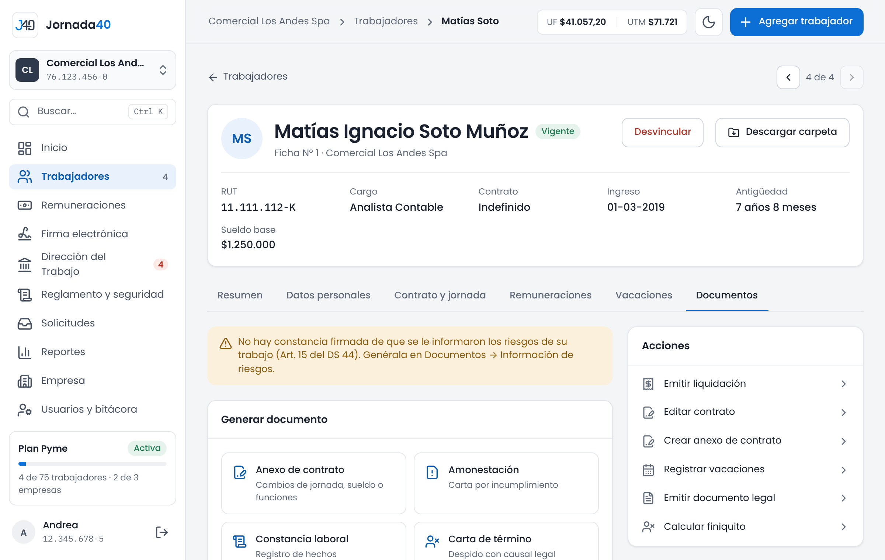
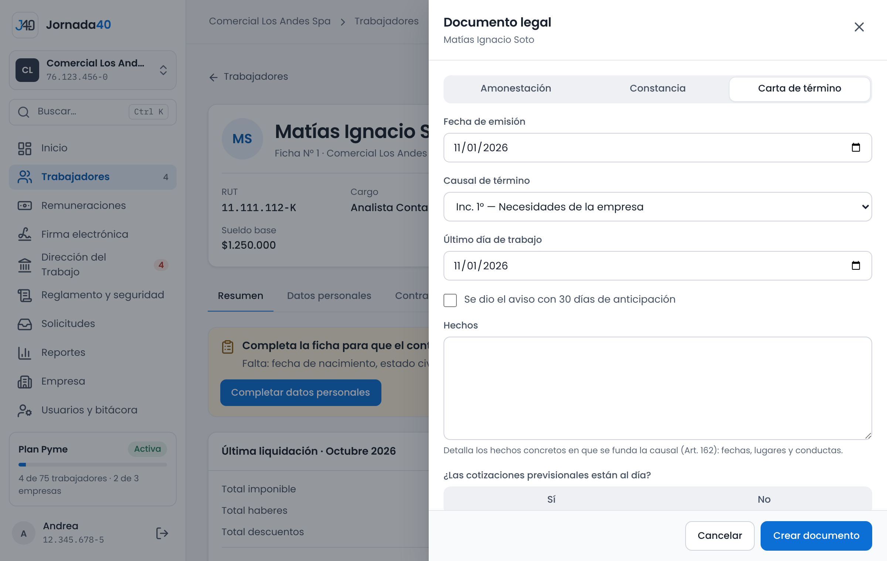
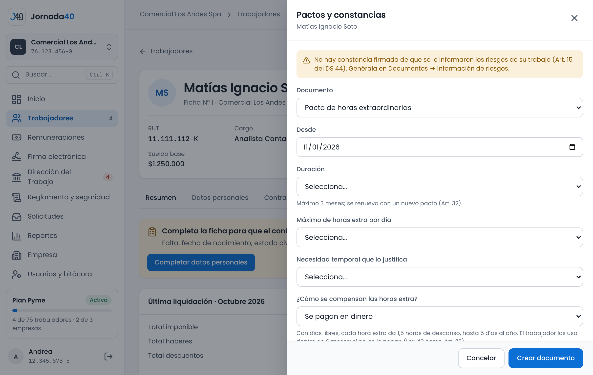

# Documentos y cartas {#sec-documentos}

Los documentos de cada trabajador se generan desde su carpeta, pestaña **Documentos**. Jornada40 los redacta con listas cerradas y los datos de la ficha: tú eliges las opciones y el sistema aplica las reglas de la ley, calcula fechas y montos y escribe las cláusulas.

{width=100%}

La pestaña tiene dos partes:

- **Generar documento:** el menú de documentos que puedes crear. Los que tu plan no incluye aparecen con un candado.
- **Historial de documentos:** todos los documentos del trabajador, con su estado de firma: **Sin enviar**, **Pendiente**, **Procesando**, **Firmado**, **Rechazado**, **Expirado** o **Cancelado**.

En cada documento del historial puedes:

- descargar el **PDF**; si ya está firmado, el botón dice **PDF firmado** y descarga la versión firmada por el trabajador;
- **Enviar a firma**, o **Reenviar a firma** si fue rechazado, venció o se canceló (capítulo 8);
- en una autorización de descuento firmada, **Registrar revocación** (sección 6.5).

Arriba de la pestaña aparecen los avisos del trabajador que tienen que ver con sus documentos, por ejemplo un pacto de teletrabajo por vencer o una capacitación en el uso de sus elementos de protección que se hizo hace más de un año.

| Documento                        | Para qué sirve                                       | Plan     | Dónde se explica |
|----------------------------------|------------------------------------------------------|----------|------------------|
| Anexo de contrato                | Cambios de jornada, sueldo o funciones.              | Semilla  | Sección 5.4      |
| Amonestación                     | Carta por un incumplimiento.                         | Semilla  | Sección 6.1      |
| Constancia laboral               | Registro de un hecho.                                | Semilla  | Sección 6.1      |
| Carta de término                 | Despido con causal legal.                            | Starter  | Sección 6.2      |
| Finiquito                        | Cálculo y documento del término.                     | Starter  | Capítulo 10      |
| Pacto de horas extra             | Autoriza horas extraordinarias, hasta 3 meses.       | Starter  | Sección 6.4      |
| Pacto de teletrabajo             | Anexo de trabajo a distancia (Ley 21.220).           | Starter  | Sección 5.4      |
| Autorización de descuento        | Descuento voluntario de la remuneración (Art. 58).   | Starter  | Sección 6.5      |
| Permiso legal con goce           | Fallecimiento, nacimiento o matrimonio.              | Starter  | Sección 6.6      |
| Entrega de EPP                   | Entrega de elementos de protección, sin costo.       | Semilla  | Sección 6.8      |
| Información de riesgos           | Riesgos del puesto, al ingresar o cambiar de puesto. | Pyme     | Sección 12.2     |
| Indemnización a todo evento      | Pacto del Art. 164, desde el séptimo año.            | Starter  | Sección 6.7      |

: Documentos que se generan desde la carpeta

Los pactos y las autorizaciones rigen en Jornada40 desde que el trabajador los firma: recién entonces se toman en cuenta en las liquidaciones. Un documento en firma o firmado no se puede modificar.

## Amonestaciones y constancias {#sec-amonestaciones}

1. En **Documentos › Generar documento**, elige **Amonestación** o **Constancia laboral**. También puedes usar **Emitir documento legal**, en **Acciones**.
2. En **Tipo de documento**, confirma **Amonestación** o **Constancia**.
3. Indica la **Fecha de emisión**.
4. En **Hechos**, describe lo ocurrido: fechas, lugares y conductas. Es la base del documento y es obligatorio.
5. Presiona **Crear documento**.

El documento queda en el historial. Descárgalo con **PDF** o envíalo a firma con **Enviar a firma**.

## Carta de término {#sec-carta-termino}

*Disponible desde el plan Starter.*

La carta de término comunica el despido y su causal. Jornada40 calcula las indemnizaciones que informa.

1. En **Documentos › Generar documento**, elige **Carta de término**.
2. Elige la **Causal de término**. La lista agrupa las causales del Art. 159 (objetivas), del Art. 160 (disciplinarias), del Art. 161 (necesidades de la empresa y desahucio) y del Art. 163 bis (liquidación concursal del empleador).
3. Indica la **Fecha de emisión** y el **Último día de trabajo**. En las causales del Art. 161 y del 163 bis, marca **Se dio el aviso con 30 días de anticipación** si corresponde.
4. En **Hechos**, detalla los hechos concretos en que se funda la causal: fechas, lugares y conductas (Art. 162).
5. Responde **¿Las cotizaciones previsionales están al día?** con **Sí** o **No**.
6. Elige la **Modalidad del finiquito**: **Finiquito electrónico** o **Ante ministro de fe** (sección 10.2).
7. Marca **Se enviará copia a la Inspección del Trabajo (obligatorio, Art. 162)**.
8. Si la causal da derecho a indemnización, revisa las **Indemnizaciones que informará la carta**. Presiona **Crear documento**.

{width=100%}

En las causales que dan derecho a indemnización (Art. 161 y 163 bis), la carta muestra la indemnización por años de servicio y la sustitutiva del aviso previo. Las calcula el sistema según la ley y no se editan.

> **Importante:** si el trabajador tiene fuero, la carta muestra el aviso: no se le puede despedir sin autorización judicial previa. Si respondes que las cotizaciones no están al día, verás que el despido no pone término al contrato mientras no se paguen (Art. 162). Son avisos: tú decides, pero revísalos antes de seguir.

## Renuncia o mutuo acuerdo {#sec-renuncia}

El panel no genera la carta de renuncia ni el documento de mutuo acuerdo. Cuando la relación laboral termina por renuncia del trabajador (Art. 159 N°2) o por mutuo acuerdo (Art. 159 N°1), registra el término al calcular el finiquito, eligiendo esa causal (sección 10.1).

## Pactos de horas extra {#sec-horas-extra}

*Disponible desde el plan Starter.*

El pacto de horas extra autoriza al trabajador a trabajar horas extraordinarias por una necesidad temporal de la empresa.

1. En **Documentos › Generar documento**, elige **Pacto de horas extra**.
2. Indica desde cuándo rige (**Desde**) y su **Duración**: hasta 3 meses. Para seguir después, se firma un pacto nuevo.
3. Elige el **Máximo de horas extra por día**: 1 o 2 horas.
4. Elige la **Necesidad temporal que lo justifica**: aumento temporal de la demanda o de la producción; inventario, cierre contable o auditoría; situación imprevista que requiere dar continuidad a la operación, o proyecto o entrega con plazo acotado.
5. En **¿Cómo se compensan las horas extra?**, elige **Se pagan en dinero**. Desde el plan Pyme también puedes elegir **Se cambian por días libres** o **Mitad en dinero y mitad en días libres** (sección 7.4).
6. Presiona **Crear documento** y envíalo a firma.

{width=100%}

No se puede crear un pacto que se cruce con otro vigente: verás "Ya hay un pacto de horas extra que cubre parte de ese período". Elige otras fechas. Si el contrato es del artículo 22, verás un aviso: sin límite de jornada no hay horas extra.

Al emitir una liquidación con horas extra, Jornada40 avisa si no hay un pacto firmado vigente en ese mes (sección 7.2).

## Autorización de descuento y revocación {#sec-descuento}

*Disponible desde el plan Starter.*

La autorización de descuento es el acuerdo escrito con el que el trabajador permite descontar de su remuneración un monto voluntario, por ejemplo la cuota de un préstamo (Art. 58). Los descuentos legales o judiciales no la requieren.

1. En **Documentos › Generar documento**, elige **Autorización de descuento**.
2. Elige el **Concepto de descuento**, de los conceptos de descuento de la empresa (sección 7.1).
3. Elige la **Finalidad**: pago de un préstamo otorgado por el empleador, pago de la prima de un seguro, ahorro o aporte voluntario, o pago de bienes o servicios adquiridos al empleador.
4. Escribe el **Monto de cada cuota (pesos)** y elige el **Número de cuotas**, o **Mensual, hasta que el trabajador lo revoque**.
5. Indica el **Primer mes del descuento** y presiona **Crear documento**. Envíalo a firma.

Si la cuota supera el 15 % del sueldo base, verás un aviso.

La autorización no descuenta sola: cada mes, el descuento se ingresa en la liquidación con su concepto. Jornada40 avisa si descuentas sin una autorización firmada o más de la cuota autorizada (sección 7.2).

### Revocar una autorización

El trabajador puede revocar su autorización. Para registrarlo:

1. En el historial, junto a la autorización firmada, presiona **Registrar revocación**.
2. Indica la **Fecha en que el trabajador la revocó**, entre el inicio de la autorización y hoy.
3. Presiona **Registrar revocación**.

Desde esa fecha la autorización deja de regir y el historial la muestra con "Revocada el…". Jornada40 crea una constancia de revocación: envíala a firma. La revocación no extingue la deuda que el trabajador tenga con la empresa. Si el concepto se sigue descontando después, la liquidación lo advierte.

## Permiso legal con goce {#sec-permiso-legal}

*Disponible desde el plan Starter.*

La constancia de permiso legal deja registro de un permiso pagado que da la ley. Los días los calcula el sistema.

| Permiso                                            | Días             | Norma            |
|----------------------------------------------------|------------------|------------------|
| Fallecimiento de un hijo                           | 10 días corridos | Art. 66          |
| Fallecimiento del cónyuge o conviviente civil      | 7 días corridos  | Art. 66          |
| Fallecimiento de un hijo en período de gestación   | 7 días hábiles   | Art. 66          |
| Fallecimiento del padre o de la madre              | 4 días hábiles   | Art. 66          |
| Fallecimiento de un hermano o hermana              | 4 días hábiles   | Art. 66          |
| Nacimiento o adopción de un hijo                   | 5 días corridos  | Art. 195         |
| Matrimonio o acuerdo de unión civil                | 5 días hábiles   | Art. 207 bis     |

: Permisos legales con goce de remuneraciones

1. En **Documentos › Generar documento**, elige **Permiso legal con goce**.
2. Elige el **Permiso** e indica la fecha del hecho: del fallecimiento, del nacimiento o del matrimonio.
3. En los fallecimientos, salvo el de un hijo en gestación, el permiso corre desde el día del fallecimiento. En los demás, indica el **Primer día del permiso**.
4. Presiona **Crear documento** y envíalo a firma.

Los días hábiles son de lunes a sábado, sin feriados. El sistema revisa las fechas: el permiso por nacimiento se usa dentro del primer mes, el de un hijo en gestación dentro del mes siguiente al certificado y el de matrimonio en los días inmediatamente anteriores o posteriores (hasta 7 días). Un permiso en días hábiles debe comenzar en un día hábil.

Desde el plan Pyme, el trabajador también puede pedir el permiso desde su portal (sección 13.2).

## Indemnización a todo evento {#sec-indemnizacion}

*Disponible desde el plan Starter.*

Con este pacto (Art. 164), el empleador aporta cada mes un porcentaje de la remuneración del trabajador para su indemnización, que el trabajador recibe al terminar la relación por cualquier causa.

1. En **Documentos › Generar documento**, elige **Indemnización a todo evento**.
2. Elige el **Aporte mensual del empleador**: 4,11 % (el mínimo legal), 5 %, 6 %, 7 % u 8,33 % de la remuneración imponible.
3. Indica el **Primer mes del aporte** y presiona **Crear documento**. Envíalo a firma.

El pacto se celebra desde el inicio del séptimo año de servicio, es decir, con seis años cumplidos, y cada trabajador puede tener uno solo.

Una vez firmado, el aporte se calcula solo en cada liquidación, con un tope de 90 UF, hasta el undécimo año de servicio, y se informa en Previred y en el Libro de Remuneraciones Electrónico. Es un costo del empleador: no cambia el líquido del trabajador. En el finiquito ya no se indemnizan los años cubiertos por el pacto.

## Entrega de EPP {#sec-epp}

La constancia de entrega de elementos de protección personal (EPP) registra qué se entregó, cuándo y si el trabajador recibió la capacitación sobre su uso. Los elementos se entregan sin costo para el trabajador.

1. En **Documentos › Generar documento**, elige **Entrega de EPP**.
2. En **Elementos entregados (sin costo para el trabajador)**, marca cada elemento y su cantidad. Vienen marcados los sugeridos para el rubro de la empresa.
3. Elige el **Motivo de la entrega**: ingreso del trabajador, reposición por desgaste, reposición por deterioro o falla, reposición por pérdida, o cambio de puesto o de tareas.
4. Indica la **Fecha de entrega**, que no puede ser futura.
5. Responde **¿Recibió la capacitación de al menos 1 hora sobre su uso?**: **Sí**, con la **Fecha de la capacitación**, o **Todavía no**.
6. Presiona **Crear documento** y envíalo a firma.

Si la capacitación está pendiente, el documento lo advierte. La capacitación se refuerza cada año y al cambiar de elementos: si la última fue hace más de un año, la pestaña **Documentos** lo avisa.
