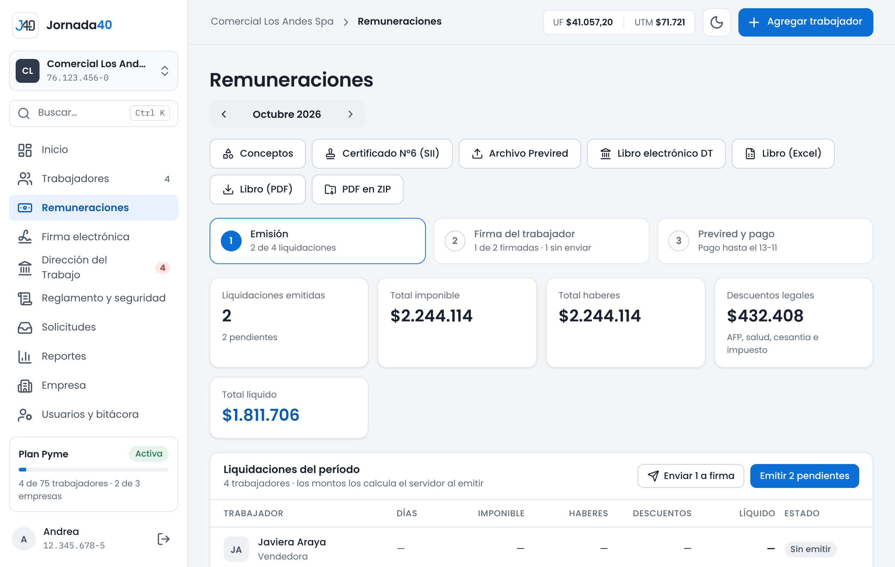
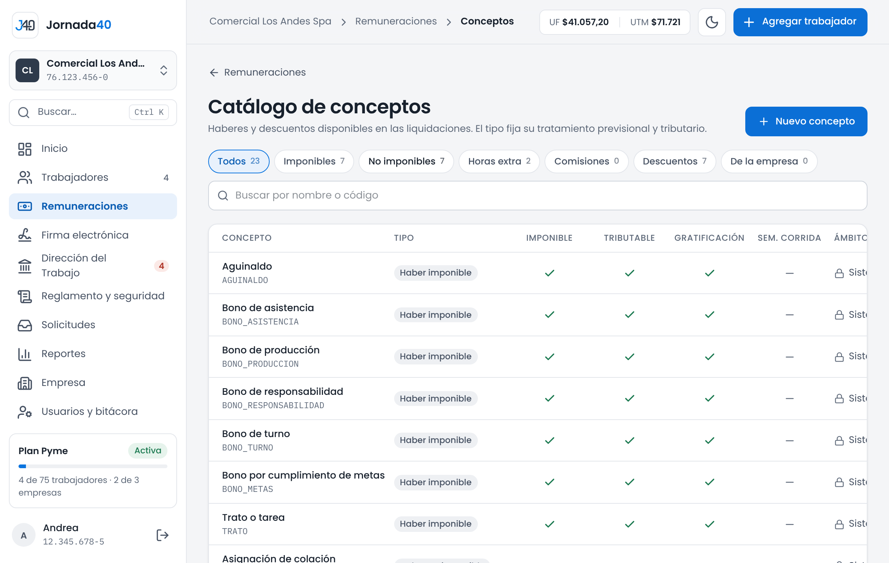
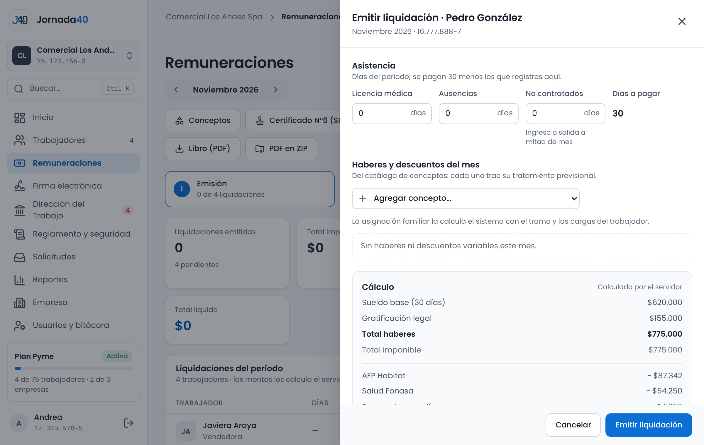
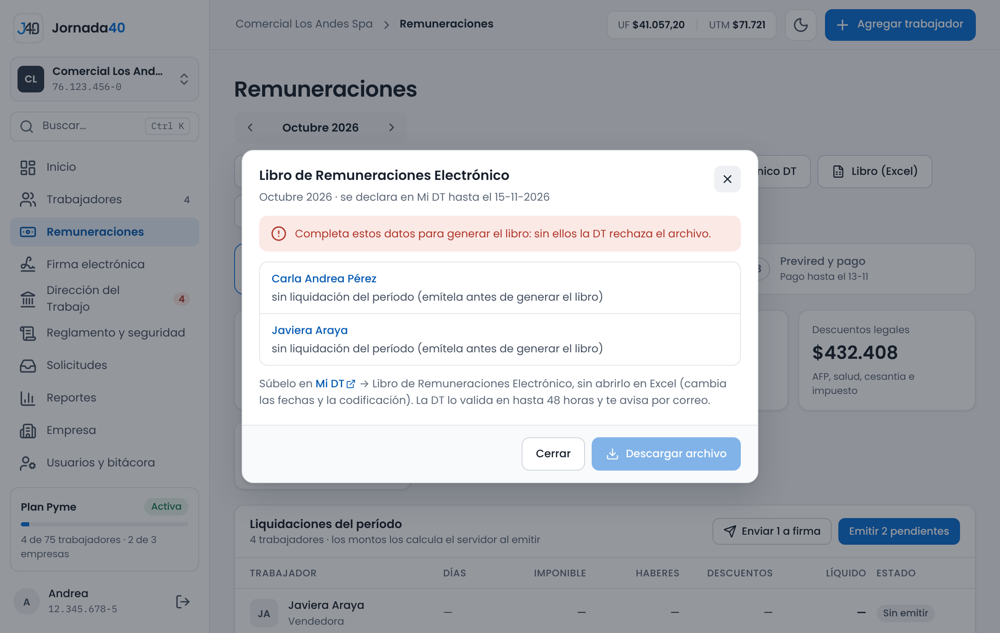
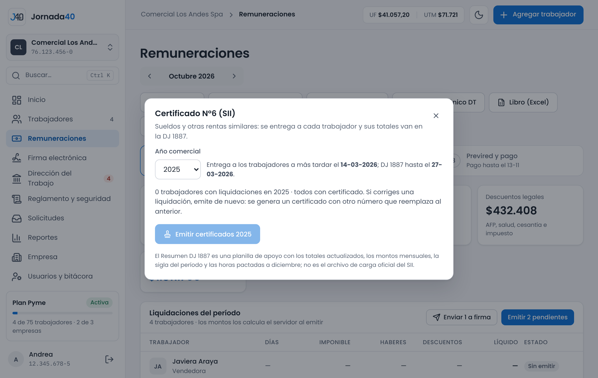
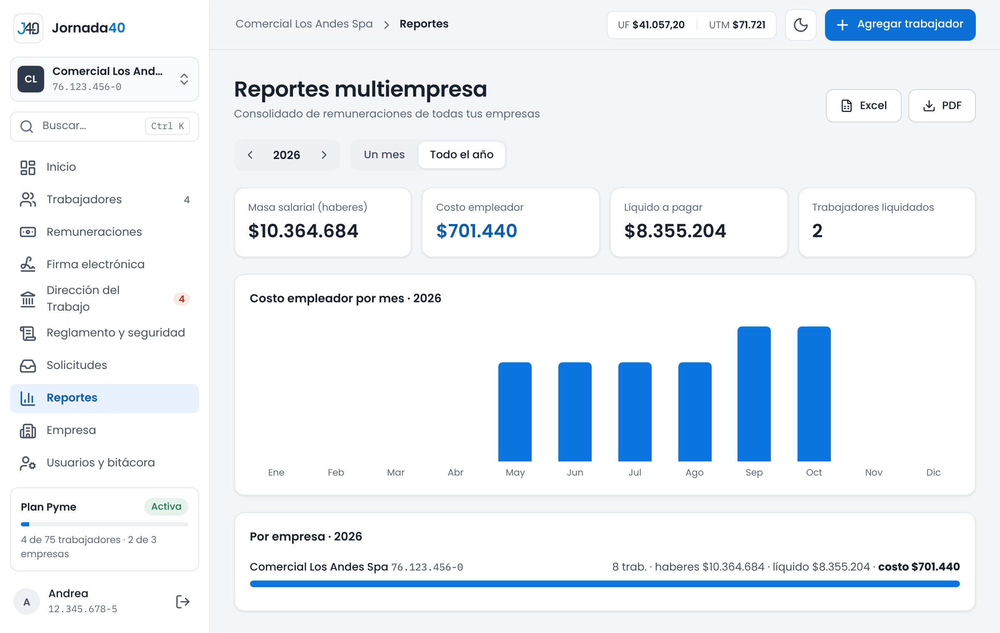

# Remuneraciones {#sec-remuneraciones}

En el menú, **Remuneraciones** reúne el proceso mensual de sueldos de la empresa seleccionada: emitir las liquidaciones, enviarlas a firma y preparar los archivos para Previred, la Dirección del Trabajo y el SII. Todos los montos los calcula Jornada40 con los parámetros previsionales vigentes (sección 2.5); no se escriben a mano.

{width=100%}

Arriba eliges el mes con las flechas **Período anterior** y **Período siguiente**. Debajo, tres pasos muestran el avance del mes:

1. **Emisión:** cuántas liquidaciones se emitieron.
2. **Firma del trabajador:** cuántas firmaron los trabajadores y cuántas falta enviar.
3. **Previred y pago:** el día hasta el que se pagan las cotizaciones.

Luego vienen los totales del mes (liquidaciones emitidas, total imponible, total haberes, descuentos legales y total líquido) y la tabla **Liquidaciones del período**, con una fila por trabajador: días, imponible, haberes, descuentos, líquido y estado (**Sin emitir**, **Emitida**, **Pendiente de firma**, **Firmada** o **Rechazada**). Si una liquidación tiene avisos, la fila lo indica (por ejemplo, "2 avisos").

Los botones de arriba llevan a las demás tareas del capítulo:

| Botón                          | Para qué sirve                                                       | Plan     | Sección |
|--------------------------------|----------------------------------------------------------------------|----------|---------|
| **Conceptos**                  | Catálogo de haberes y descuentos.                                    | Semilla  | 7.1     |
| **Certificado N°6 (SII)**      | Certificados de sueldos del año y resumen para la DJ 1887.           | Semilla  | 7.6     |
| **Archivo Previred**           | Archivo para declarar y pagar las cotizaciones.                      | Pyme     | 7.5     |
| **Libro electrónico DT**       | Libro de Remuneraciones Electrónico para Mi DT.                      | Pyme     | 7.5     |
| **Libro (Excel)** y **Libro (PDF)** | Libro de remuneraciones del mes, para tus registros.            | Pyme     | 7.5     |
| **PDF en ZIP**                 | Todas las liquidaciones del mes en un ZIP.                           | Pyme     | 7.3     |

: Botones de Remuneraciones

## Conceptos {#sec-conceptos}

Los conceptos son los haberes y descuentos que se agregan a las liquidaciones, como un bono, la colación o la cuota de un préstamo. En **Remuneraciones**, presiona **Conceptos** para abrir el **Catálogo de conceptos**.

{width=100%}

El catálogo trae los conceptos del sistema, marcados con **Sistema**, que no se modifican. Además, puedes crear los de tu empresa. Cada concepto muestra su tipo y su efecto: si es imponible, si es tributable, si entra en la gratificación y si entra en la semana corrida.

| Tipo                   | Para qué                                              |
|------------------------|-------------------------------------------------------|
| **Haber imponible**    | Bonos y asignaciones que cotizan y pagan impuesto.    |
| **Haber no imponible** | Colación, movilización, viáticos y similares.         |
| **Hora extra**         | Se valoriza con el sueldo y la jornada del contrato.  |
| **Comisión**           | Porcentaje del contrato sobre lo vendido.             |
| **Descuento**          | Préstamos, anticipos y otros descuentos voluntarios.  |

: Tipos de concepto

Para crear un concepto:

1. Presiona **Nuevo concepto**.
2. Escribe el **Nombre**, por ejemplo "Bono de turno noche". El **Código** se genera a partir del nombre y no se puede cambiar después.
3. Elige el tipo. El tratamiento previsional y tributario lo fija el tipo según la ley.
4. Si quieres, elige el **Concepto en el Libro de Remuneraciones Electrónico**. Solo aparecen los de la DT que calzan con el tipo; si lo dejas sin asignar, se usa uno genérico.
5. Presiona **Crear concepto**.

Para cambiar un concepto de tu empresa, presiona el lápiz. Para que deje de aparecer al emitir liquidaciones, desactívalo con el interruptor; no se borra, porque las liquidaciones emitidas lo usan. Puedes filtrar el catálogo por tipo o ver solo los **De la empresa**.

## Emitir una liquidación y sus avisos {#sec-liquidacion}

1. En **Remuneraciones**, busca al trabajador en la tabla y presiona **Emitir** (o **Abrir**, si ya está emitida). También puedes usar **Emitir liquidación** en su carpeta.
2. En **Asistencia**, registra los días que no se pagan: **Licencia médica**, **Ausencias** y **No contratados** (por ingreso o salida a mitad de mes). Se pagan 30 días menos los que registres; el total aparece en **Días a pagar**.
3. En **Haberes y descuentos del mes**, elige cada concepto en **Agregar concepto…** y completa su valor:
   - una hora extra pide las **Horas** y el **Recargo** (el mínimo legal es 50 %);
   - una comisión pide el **Monto vendido** y usa el porcentaje del contrato;
   - los demás conceptos piden el **Monto**.
4. Revisa el **Cálculo**. Se actualiza mientras escribes y lo hace el servidor: sueldo base por los días pagados, gratificación, semana corrida si corresponde, cada haber, total haberes, total imponible, AFP, salud, seguro de cesantía, impuesto único, anticipo, descuentos y **Líquido a pagar**.
5. Presiona **Emitir liquidación** (o **Guardar cambios**).

{width=100%}

La asignación familiar se calcula sola, con el tramo y las cargas de la ficha del trabajador (sección 4.3). Si el trabajador tiene un pacto de indemnización a todo evento, el cálculo muestra el aporte del empleador, que no se le descuenta (sección 6.7).

Un recargo de horas extra bajo el 50 % no se acepta: la ley lo prohíbe. Si el trabajador no tiene contrato, primero hay que crearlo (sección 5.1).

> **Importante:** si la sesión se cierra mientras completas una liquidación, el borrador se guarda en ese navegador por 24 horas. Al volver, presiona **Recuperar** (sección 2.2).

### Avisos de respaldo documental

Al calcular, Jornada40 revisa que lo que pagas o descuentas tenga su documento firmado y muestra avisos bajo los conceptos. Son avisos: puedes emitir igual.

- Horas extra sin un pacto de horas extraordinarias firmado y vigente en el mes (sección 6.4).
- Un descuento voluntario sin autorización firmada y vigente, que supera la cuota autorizada o que se sigue descontando después de revocado (sección 6.5).
- Descuentos voluntarios que en total superan el 15 % de la remuneración.
- Ausencias en un mes con un permiso legal con goce firmado: esos días se pagan y no deben registrarse como ausencia (sección 6.6).

### Cuándo no se puede modificar

Una liquidación firmada por el trabajador no se puede modificar. Si tiene una firma pendiente, primero cancela la solicitud en **Firma electrónica** (capítulo 8).

## Emitir el período {#sec-periodo}

En vez de emitir una por una, puedes emitir todas las liquidaciones pendientes del mes y enviarlas a firma de una vez.

1. En **Liquidaciones del período**, presiona **Emitir N pendientes** y luego **Emitir**. Se emiten con asistencia completa (30 días) y sin haberes variables.
2. Abre las que tengan licencias, ausencias, horas extra o bonos, registra esos datos y guarda: la liquidación se recalcula.
3. Presiona **Enviar N a firma** y luego **Enviar a firma**. Confirma tu identidad si Jornada40 te la pide (sección 8.1).

Cada trabajador recibe un correo para revisar y firmar su liquidación. Las ya firmadas o con firma pendiente no se reenvían. Si a alguien le falta el correo, Jornada40 te lo indica al terminar.

> **Importante:** antes de enviar, revisa las liquidaciones con avisos: el mensaje de confirmación las nombra. Una vez firmadas, no se pueden corregir.

Quien se desvinculó en el mes no se incluye en la emisión masiva: emite su liquidación desde su fila, con los días que trabajó. La fila de cada trabajador también indica si no tiene contrato (con el enlace **Crear contrato**), si se desvinculó o si su contrato empieza después.

Desde el plan Pyme, **PDF en ZIP** descarga todas las liquidaciones del mes.

## Horas extra compensadas {#sec-horas-compensadas}

*Disponible desde el plan Pyme.*

Si el pacto de horas extra del trabajador dice que las horas se cambian por días libres, o mitad y mitad (sección 6.4), y ese pacto está firmado y vigente en el mes, la liquidación no paga esas horas: las guarda como horas de descanso.

- Cada hora extra con recargo del 50 % da 1,5 horas de descanso. Bajo el concepto, la liquidación lo indica, por ejemplo "4 h compensadas con 6 h de descanso (Art. 32): van a su bolsa de días libres en vez de pagarse."
- Por cada año de contrato, se pueden compensar hasta 5 días de jornada. Lo que pase de ese tope se paga en dinero, y la liquidación lo avisa.
- El trabajador usa sus horas como días libres completos (sección 9.3). Las horas de cada mes vencen al final del sexto mes siguiente. Si no las usó, se pagan en la liquidación de ese mes como "Horas de descanso no usadas".
- Al terminar la relación laboral, las horas pendientes se pagan en el finiquito (sección 10.1).

El resumen por correo te avisa de las horas que vencen en los próximos 30 días (sección 15.2).

## Previred y Libro de Remuneraciones Electrónico {#sec-previred-lre}

*Disponible desde el plan Pyme.*

### Archivo Previred

En **Remuneraciones**, con el mes elegido, presiona **Archivo Previred**. Se descarga un archivo de texto con las cotizaciones de las liquidaciones emitidas, en el formato que Previred recibe para declarar y pagar.

Para que el archivo salga completo, revisa los datos de **Seguridad social** de la empresa (sección 2.5) y la **Previsión y pago** de cada trabajador (sección 4.3). Si falta un dato sin el cual Previred rechazaría el archivo, como el sexo, la AFP, la Isapre o el tramo de asignación familiar, Jornada40 no lo genera y te muestra **Faltan datos para el archivo Previred**, con lo que falta por trabajador.

> **Importante:** el archivo informa a trabajadores afiliados a una AFP. No incluye el ahorro previsional voluntario (APV), a quienes cotizan en el antiguo régimen del IPS ni a los pensionados, ni las licencias médicas con sus fechas. Esos casos se informan directamente en Previred.

### Libro de Remuneraciones Electrónico

El Libro de Remuneraciones Electrónico se declara en Mi DT dentro de los primeros 15 días del mes siguiente.

1. En **Remuneraciones**, con el mes elegido, presiona **Libro electrónico DT**.
2. Jornada40 revisa las liquidaciones del período. Si falta un dato sin el cual la DT rechaza el archivo, verás "Completa estos datos para generar el libro", con la lista por trabajador. Entre ellos, cada trabajador con contrato en el mes debe tener su liquidación.
3. Revisa los avisos, que no impiden descargar. Por ejemplo, los conceptos propios sin código del libro: se asignan en **Conceptos** (sección 7.1).
4. Presiona **Descargar archivo**.
5. Súbelo en Mi DT, en **Libro de Remuneraciones Electrónico**, sin abrirlo antes en Excel: Excel cambia las fechas y la codificación. La DT lo valida en hasta 48 horas y te avisa por correo.

{width=100%}

**Libro (Excel)** y **Libro (PDF)** descargan el libro de remuneraciones del mes en formato de planilla y de documento, para tus registros. No reemplazan al libro electrónico.

## Certificado N°6 y DJ 1887 {#sec-certificado6}

El Certificado N°6 (sueldos y otras rentas similares) se entrega a cada trabajador con lo que ganó y lo que se le retuvo en el año. Sus totales van en la declaración jurada 1887 que el empleador presenta al SII. Está en todos los planes.

1. En **Remuneraciones**, presiona **Certificado N°6 (SII)**.
2. Elige el **Año comercial**. Verás los plazos: la entrega a los trabajadores, hasta el 14 de marzo, y la DJ 1887, hasta el 27 de marzo del año siguiente.
3. Presiona **Emitir certificados**.
4. Descarga cada certificado con **PDF** o todos con **Todos en ZIP**.

{width=100%}

Solo se emiten certificados de años cerrados y con los factores de actualización del SII cargados. El SII publica esos factores en enero y Jornada40 los carga; mientras tanto, verás un aviso. Los certificados se numeran en forma correlativa por empresa. Si corriges una liquidación del año, emite de nuevo: se genera un certificado con otro número que reemplaza al anterior.

**Resumen DJ 1887** descarga una planilla con los totales por trabajador para ayudarte a llenar la declaración jurada. No es el archivo de carga del SII.

Desde el plan Pyme, los trabajadores también descargan su certificado en su portal (sección 13.3).

## Reportes multiempresa {#sec-reportes}

*Disponible desde el plan Pyme.*

En el menú, **Reportes** consolida las remuneraciones de todas tus empresas.

1. En **Período**, elige **Un mes** o **Todo el año**, y el mes o el año.
2. Revisa los totales: **Masa salarial (haberes)**, **Costo empleador**, **Líquido a pagar** y **Trabajadores liquidados**.
3. Con **Todo el año**, verás el costo empleador por mes. En ambos casos, la tabla **Por empresa** muestra el detalle de cada una.
4. Descarga el reporte con **Excel** o **PDF**.

{width=100%}
