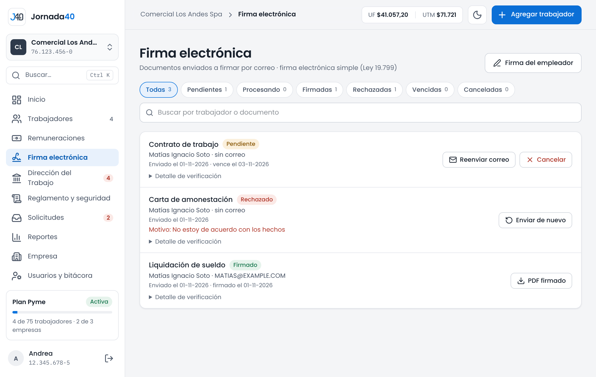
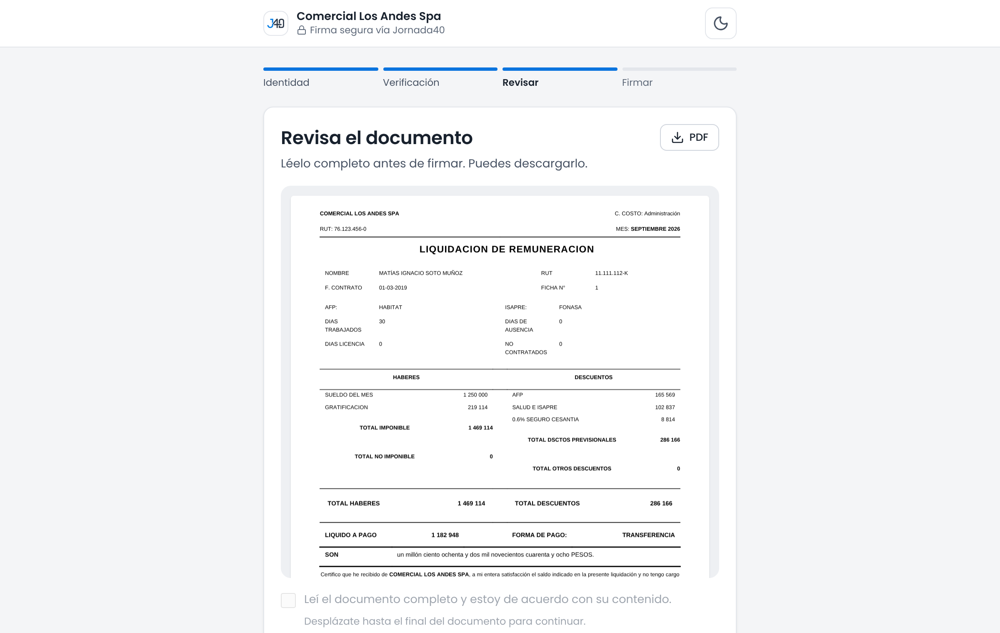

# Firma electrónica {#sec-firma}

Jornada40 firma los documentos laborales con firma electrónica simple (Ley 19.799). El trabajador recibe un correo con un enlace, confirma su identidad y firma desde el celular o el computador. El documento lleva también la firma del empleador configurada en **Empresa** (sección 2.5).

Para que el trabajador firme:

- primero se confirma que es él o ella, con un código que llega a su correo o con su clave del portal del trabajador;
- después, la firma es su aceptación expresa del contenido más el trazo que dibuja.

## Enviar a firma y confirmar identidad {#sec-enviar-firma}

Los documentos se envían a firma desde donde se crean:

- el contrato, desde **Contrato y jornada** (sección 5.1);
- los anexos, cartas, pactos, constancias y comprobantes, desde la pestaña **Documentos** de la carpeta, con **Enviar a firma** (capítulo 6);
- las liquidaciones del mes, todas juntas, desde **Remuneraciones** con **Enviar N a firma** (sección 7.3);
- los finiquitos, desde su pantalla, como firma de recepción (sección 10.2).

Antes de enviar, revisa dos cosas:

- que el trabajador tenga un correo registrado en su ficha; si no lo tiene, Jornada40 te lo pide;
- que la empresa tenga configurada la firma del empleador: sin ella no se puede enviar nada a firma. Si falta, **Firma electrónica** muestra "Falta la firma del empleador." y el botón **Configurar ahora** (solo el titular).

### Confirmar tu identidad

Al enviar un documento a firma, firmas como empleador. Por eso, Jornada40 te pide tu contraseña:

1. Se abre **Confirma tu identidad**.
2. Escribe **Tu clave de Jornada40**: la misma con que ingresas al panel.
3. Presiona **Confirmar y firmar**.

La confirmación queda registrada en cada documento que envíes y vale por 10 minutos: durante ese tiempo no se vuelve a pedir. Si eres usuario del equipo, confirmas con tu propia clave y el documento registra que lo enviaste tú.

El trabajador recibe un correo con el enlace para firmar, que vence en 7 días. Si el correo no se pudo enviar, verás que el documento quedó listo para firma, pero que el correo no salió. Usa **Reenviar correo** en **Firma electrónica** unos minutos después.

## Seguimiento {#sec-seguimiento-firma}

En el menú, **Firma electrónica** muestra todos los documentos enviados a firma. Por defecto muestra los **Pendientes**.

{width=100%}

Filtra por estado (**Todas**, **Pendientes**, **Procesando**, **Firmadas**, **Rechazadas**, **Vencidas** o **Canceladas**) o busca por trabajador o documento. Cada solicitud muestra el documento, el trabajador, su estado y la fecha en que vence, venció o se firmó. Si el trabajador rechazó el documento, aparece su motivo.

| Estado        | Qué significa                                                                         | Qué puedes hacer                     |
|---------------|---------------------------------------------------------------------------------------|--------------------------------------|
| **Pendiente** | El trabajador aún no firma.                                                           | **Reenviar correo** o **Cancelar**.  |
| **Procesando**| La firma del trabajador se está registrando.                                          | Esperar unos minutos.                |
| **Firmado**   | El trabajador firmó.                                                                  | **PDF firmado**.                     |
| **Rechazado** | El trabajador no estuvo de acuerdo e indicó un motivo.                                | Corregir y **Enviar de nuevo**.      |
| **Vencida**   | Pasaron 7 días sin firma.                                                             | **Enviar de nuevo**.                 |
| **Cancelado** | Cancelaste la solicitud.                                                              | **Enviar de nuevo**.                 |

: Estados de una solicitud de firma

Para cancelar una solicitud pendiente, presiona **Cancelar** y luego **Cancelar solicitud**. El enlace que recibió el trabajador deja de funcionar y puedes enviarlo de nuevo cuando quieras. Cancelar es la forma de liberar un documento en firma para corregirlo, por ejemplo una liquidación o un contrato.

En cada solicitud, **Detalle de verificación** muestra el registro de la firma:

- quién la envió como empleador y cuándo confirmó su clave, con su IP;
- el token del enlace y el correo verificado del trabajador;
- la IP del trabajador, la fecha y hora de firma (hora de Chile), el folio y la huella SHA-256 del PDF firmado.

## Cómo firma el trabajador {#sec-como-firma}

El trabajador abre el enlace del correo, o el que aparece en su portal, y sigue cuatro pasos. No necesita una cuenta. El anexo A trae una guía para compartirle.

1. **Identidad:** escribe su RUT y presiona **Enviar código**. Si tiene clave del portal del trabajador, puede elegir **Usar mi clave del portal del trabajador**.
2. **Verificación:** escribe el código de 6 dígitos que llegó a su correo. Vale por 10 minutos y tiene 3 intentos.
3. **Revisar:** lee el documento completo hasta el final, marca **Leí el documento completo y estoy de acuerdo con su contenido.** y presiona **Continuar a la firma**. También puede descargarlo en **PDF**.
4. **Firmar:** dibuja su firma con el dedo o el mouse y presiona **Firmar documento**.

{width=80%}

Al terminar, ve **Documento firmado** con el comprobante: el documento, su nombre, la fecha y hora, cómo se verificó su identidad y la huella del PDF. El trabajador y la empresa reciben una copia por correo.

Si no está de acuerdo, el trabajador presiona **No estoy de acuerdo: rechazar** y elige un motivo: los datos personales no son correctos, los montos o condiciones no son los acordados, no reconoce el documento, quiere revisarlo con el empleador antes de firmar u otro motivo. Recibes el motivo y el documento queda **Rechazado**.

## Documentos firmados y verificación {#sec-documentos-firmados}

Una vez firmado, un documento se entrega siempre en su versión firmada: desde la carpeta (**PDF firmado**), desde **Firma electrónica**, en los expedientes ZIP y en el portal del trabajador. El nombre del archivo termina en `_firmado.pdf`. Un documento firmado no se puede modificar; los cambios al contrato se hacen con un anexo (sección 5.4).

El PDF firmado termina con una hoja **Certificado de firma electrónica**, que incluye:

- el documento y las firmas del empleador y del trabajador;
- quién lo envió como empleador y cuándo confirmó su identidad;
- los datos de verificación: folio, token, fecha y hora de firma, IP y correo del trabajador;
- cómo se verificó la identidad del trabajador (código a su correo o clave del portal) y el acto de firma (aceptación expresa del contenido y trazo de su firma);
- la huella SHA-256 del documento.

Para comprobar que una copia no fue alterada, compara su huella SHA-256 con la que aparece en **Detalle de verificación**, en **Firma electrónica**.

La página pública www.jornada40.cl/verificar comprueba otros documentos: los certificados que emiten los trabajadores desde su portal (sección 13.3) y las copias de la bitácora (sección 14.2), con el código que traen impreso.
