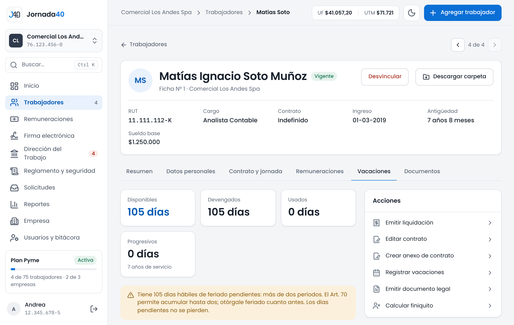

# Vacaciones {#sec-vacaciones}

*Disponible desde el plan Starter.*

Las vacaciones y los permisos de cada trabajador se registran en su carpeta, pestaña **Vacaciones**. Ahí están su saldo de días, el registro de lo que ha tomado y, desde el plan Pyme, sus días libres por horas extra.

{width=100%}

## Registrar vacaciones y permisos sin goce {#sec-registrar-vacaciones}

1. En la carpeta, presiona **Registrar vacaciones** (en **Acciones** o en la pestaña **Vacaciones**).
2. Elige el **Tipo**: **Feriado legal**, **Feriado progresivo**, **Permiso sin goce de sueldo** o, desde el plan Pyme, **Día libre por horas extra** (sección 9.3).
3. Indica las fechas en **Desde** y **Hasta**. Jornada40 calcula los días hábiles: sábados, domingos y feriados no cuentan (Art. 69).
4. Revisa el saldo disponible que aparece bajo las fechas.
5. Elige el **Estado**: **Aprobado** o **Pendiente**. Si quieres, agrega **Observaciones (opcional)**.
6. Presiona **Registrar**.

Si las vacaciones superan el saldo disponible, verás "Supera el saldo disponible. Puedes registrarlo igual si lo acordaron (feriado anticipado)." Si el trabajador tiene responsabilidades de cuidado de menores, el formulario recuerda su preferencia para tomar el feriado en las vacaciones escolares, con las fechas de las próximas (sección 4.5).

Cada registro genera un comprobante. Descárgalo con **PDF** en la pestaña **Vacaciones** o envíalo a firma desde **Documentos** (capítulo 8).

Desde el plan Pyme, el trabajador también puede pedir sus vacaciones desde su portal. Esas peticiones llegan a **Solicitudes** para que las apruebes o rechaces (sección 13.2).

## Saldo {#sec-saldo}

El bloque de arriba de la pestaña **Vacaciones** muestra el saldo del trabajador:

| Dato            | Qué es                                                                                                  |
|-----------------|---------------------------------------------------------------------------------------------------------|
| **Disponibles** | Días hábiles que le quedan por tomar.                                                                   |
| **Devengados**  | Días ganados: 15 días hábiles por cada año completo de servicio, más los progresivos.                   |
| **Usados**      | Días de feriado aprobados.                                                                              |
| **Progresivos** | Días adicionales del feriado progresivo (Art. 68), con sus años de servicio.                            |

: Saldo de vacaciones

El feriado progresivo suma un día más por cada tres años de trabajo sobre los primeros diez. Para contarlo, se pueden considerar hasta diez años con otros empleadores, con su certificado: regístralos en **Datos personales › Datos laborales**, en **Años con otros empleadores** (sección 4.3).

Si el trabajador acumula dos períodos de feriado, Jornada40 avisa hasta cuándo debe tomar al menos el primero. Si acumula más de dos, avisa que se le otorgue feriado cuanto antes (Art. 70). Los días pendientes no se pierden.

## Días libres por horas extra {#sec-dias-libres}

*Disponible desde el plan Pyme.*

Si el pacto de horas extra del trabajador las cambia por días libres (secciones 6.4 y 7.4), la pestaña **Vacaciones** muestra **Días libres por horas extra**:

- cuántas horas de descanso tiene y para cuántos días de jornada alcanzan;
- cuántas horas vencen y cuándo; si no las usa, se le pagan en la liquidación de ese mes;
- cuántas horas lleva en el año de contrato, del máximo de 5 días.

Para darle un día libre:

1. Presiona **Registrar vacaciones** y elige **Día libre por horas extra**.
2. Indica el día o los días en **Desde** y **Hasta**. Cada día libre descuenta las horas de su jornada de ese día, según su horario, y debe haber horas suficientes.
3. Presiona **Registrar**.

Solo se dan días completos, y el trabajador avisa con 48 horas de anticipación (Art. 32); si el aviso es más corto, Jornada40 lo advierte. Desde su portal, el trabajador ve sus horas de descanso y puede pedir el día libre.
