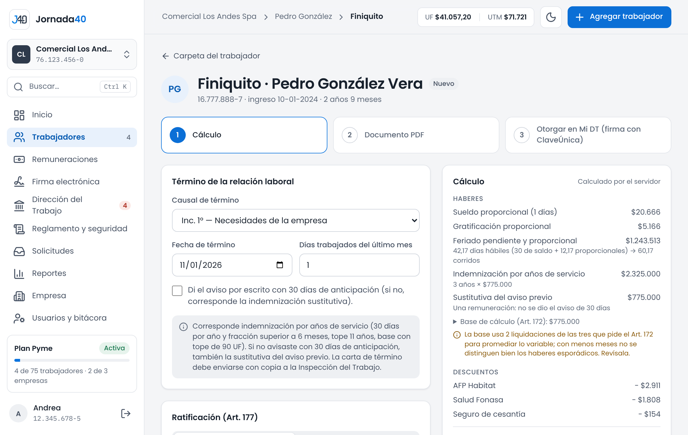

# Término {#sec-termino}

*Disponible desde el plan Starter.*

Cuando termina la relación laboral, Jornada40 calcula el finiquito según la causal, genera el documento y te guía para ratificarlo, en Mi DT o ante un ministro de fe. Si la causal lo exige, primero prepara la carta de término (sección 6.2).

## Calcular el finiquito {#sec-calcular-finiquito}

1. En la carpeta del trabajador, presiona **Calcular finiquito** (en **Acciones**) o, en **Documentos › Generar documento**, **Finiquito**.
2. En **Término de la relación laboral**, elige la **Causal de término** e indica la **Fecha de término** y los **Días trabajados del último mes**.
3. En las causales del Art. 161, marca **Di el aviso por escrito con 30 días de anticipación** si lo diste; si no, corresponde la indemnización sustitutiva del aviso previo.
4. En **Ratificación (Art. 177)**, elige la **Modalidad**: **Electrónica en Mi DT** o **Ante ministro de fe** (sección 10.2).
5. Si hay montos voluntarios o pactados, agrégalos en **Otros haberes** u **Otros descuentos**. Los montos legales los calcula el sistema.
6. Revisa el **Cálculo** y presiona **Guardar borrador**.

{width=100%}

Al elegir la causal, una nota explica qué corresponde pagar. Por ejemplo, con las causales del Art. 161 corresponde la indemnización por años de servicio (30 días por año y fracción superior a 6 meses, con tope de 11 años y una base con tope de 90 UF); con las del Art. 160, no. Si la causal exige comunicar el término por escrito, el bloque **Carta de término** lo recuerda, con el enlace **Emitir carta** (sección 6.2).

El **Cálculo** lo hace el servidor y muestra:

- **Haberes:** sueldo proporcional por los días del último mes, gratificación proporcional, feriado pendiente y proporcional, indemnización por años de servicio y sustitutiva del aviso previo, si corresponden, y otros haberes;
- **Descuentos:** AFP, salud, seguro de cesantía, impuesto único y otros descuentos;
- el **Total a pagar**.

El cálculo de la indemnización detalla la base: incluye lo que se paga cada mes, también colación y movilización, y promedia lo variable; excluye horas extra, asignación familiar, aguinaldos y bonos esporádicos.

Si el trabajador tiene horas de descanso por horas extra sin usar, se pagan con el feriado (sección 7.4). Si tiene un pacto de indemnización a todo evento, los años desde el pacto no se indemnizan en el finiquito: el trabajador retira lo aportado en su AFP (sección 6.7).

> **Importante:** si el trabajador tiene fuero a la fecha de término, el cálculo muestra el aviso: no se le puede despedir sin autorización judicial previa (sección 4.5).

Hasta que el finiquito se envíe a firma o se ratifique, puedes cambiarlo y presionar **Guardar cambios**. Arriba, su estado indica en qué va: **Borrador**, **En firma**, **Recepción firmada** o **Ratificado**.

## Finiquito en Mi DT o ante ministro de fe {#sec-modalidad-finiquito}

El finiquito se ratifica de una de dos formas. Las dos se registran en Jornada40 (sección 10.3).

**Electrónica en Mi DT.** Lo otorgas en el portal Mi DT y el trabajador lo firma allí con su ClaveÚnica: así queda ratificado. Para el trabajador es voluntario: puede preferir un ministro de fe.

1. Guarda el finiquito y presiona **Ficha para Mi DT**.
2. Se abre **Otorgar el finiquito en Mi DT**, con los datos que pide el formulario de finiquito electrónico de Mi DT. Mi DT no tiene conexión automática: copia cada dato con su botón **Copiar** y pégalo en Mi DT.
3. Cuando el trabajador lo firme en Mi DT, registra la ratificación (sección 10.3).

**Ante ministro de fe.** Se imprime y se ratifica ante un ministro de fe: un inspector del trabajo, un notario, un oficial del Registro Civil o un secretario municipal.

1. Guarda el finiquito y presiona **Descargar para ratificar**.
2. Ratifícalo ante el ministro de fe.
3. Registra la ratificación (sección 10.3).

**Copia con firma de recepción.** Además, con **Enviar copia (firma de recepción)**, el trabajador recibe una copia en Jornada40 y firma que la recibió (capítulo 8). Esa firma solo acredita la recepción: no ratifica el finiquito.

## Registrar la ratificación {#sec-ratificacion}

1. En la pantalla del finiquito, presiona **Registrar ratificación**.
2. Si se ratificó ante ministro de fe, elige **Ante quién**: inspector del trabajo, notario público, oficial del Registro Civil o secretario municipal. Si fue en Mi DT, no hace falta: el trabajador lo firmó allí con su ClaveÚnica.
3. Indica la **Fecha de la ratificación**, que no puede ser futura.
4. Presiona **Registrar**. Verás "Ratificación registrada: el finiquito quedó cerrado".

Desde ese momento el finiquito queda cerrado y no se puede modificar.

Con el finiquito, Jornada40 calcula el plazo para registrar el término del contrato en la Dirección del Trabajo (sección 11.1). Si la empresa tiene el portal del trabajador, quien se desvincula sigue entrando a su portal por 3 meses, contados desde la ratificación del finiquito (o, si no se ha registrado, desde la firma de recepción o la fecha de desvinculación; sección 13.1).
