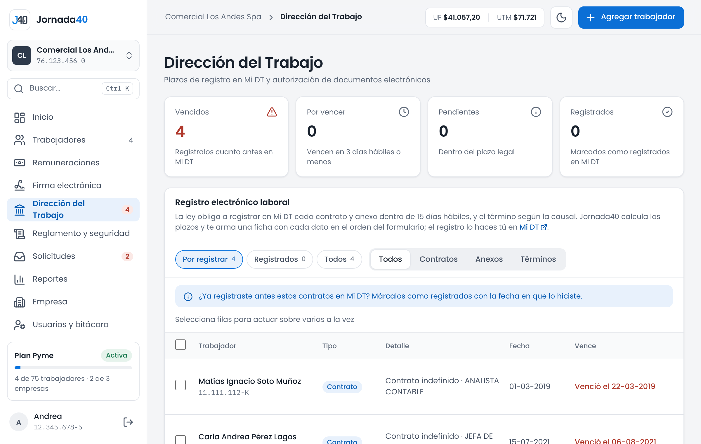
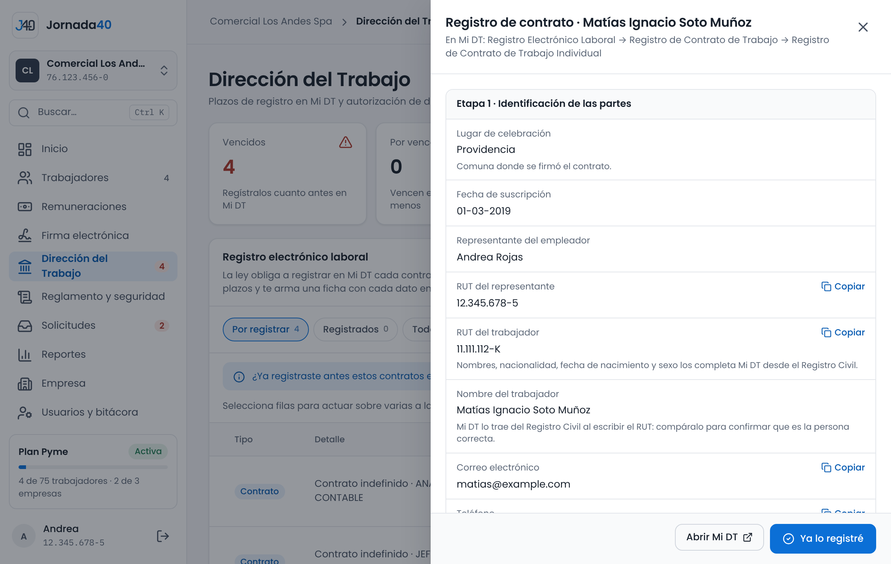

# Dirección del Trabajo {#sec-dt}

En el menú, **Dirección del Trabajo** reúne lo que la empresa debe informar a la Dirección del Trabajo (DT): el registro de contratos, anexos y términos en Mi DT, la autorización de los trabajadores para recibir documentos electrónicos y el registro de los accesos de fiscalización.

Mi DT no tiene una conexión automática con otros sistemas. Por eso, Jornada40 calcula qué registrar y hasta cuándo, te arma una ficha con los datos en el orden del formulario de Mi DT y lleva la cuenta de lo que ya registraste. El registro lo haces tú en Mi DT.

## Registro electrónico laboral {#sec-registro-dt}

La ley obliga a registrar en Mi DT cada contrato y cada anexo, y el término de cada relación laboral, dentro de un plazo. Jornada40 los lista con su plazo en **Registro electrónico laboral**.

{width=100%}

Arriba ves cuántos registros están **Vencidos**, **Por vencer** (en 3 días hábiles o menos), **Pendientes** y **Registrados**. La lista se filtra por estado (**Por registrar**, **Registrados** o **Todos**) y por tipo (**Contratos**, **Anexos** o **Términos**). Cada fila muestra el trabajador, el tipo, el detalle, la fecha y cuándo vence.

| Qué se registra                        | Plazo                                                                                     |
|----------------------------------------|-------------------------------------------------------------------------------------------|
| Contrato                               | 15 días hábiles desde su celebración: la fecha de firma electrónica o, sin ella, la de inicio. |
| Anexo de contrato                      | 15 días hábiles desde que el trabajador lo firma.                                         |
| Término por Art. 159 N°1, 2 o 3        | 10 días hábiles.                                                                          |
| Término por Art. 159 N°4 o 5, o Art. 160 | 3 días hábiles.                                                                         |
| Término por Art. 159 N°6 o Art. 163 bis | 6 días hábiles.                                                                          |
| Término por Art. 161                   | Junto con el envío de la carta de aviso.                                                  |

: Plazos de registro en Mi DT

Jornada40 cuenta los días hábiles de lunes a viernes, sin feriados, que es la lectura más estricta. Los datos del término salen del finiquito, de la carta de término o, si no hay, de la fecha de desvinculación; sin causal registrada, se usa el plazo más corto (3 días hábiles).

Los anexos aparecen en la lista cuando el trabajador los firma, porque el plazo corre desde la firma. Un aviso indica cuántos anexos esperan la firma.

## Ficha para Mi DT y marcar lo registrado {#sec-ficha-dt}

1. En la fila, presiona **Ver ficha**. Se abre la ficha con el camino en Mi DT (por ejemplo, el formulario de registro de contratos) y cada dato en el orden en que lo pide el formulario.
2. Entra a Mi DT y completa el formulario. Copia cada dato desde la ficha con su botón **Copiar**. Las cláusulas que el formulario pide pegar, como la remuneración o la distribución de la jornada, salen del contrato que generó Jornada40.
3. Cuando termines, presiona **Ya lo registré** en la ficha o **Marcar registrado** en la fila.
4. Indica la **Fecha de registro en Mi DT** (no puede ser futura) y presiona **Marcar como registrado**.

{width=100%}

Para marcar varios a la vez, selecciónalos en la lista y usa la acción sobre los seleccionados. Si te equivocaste, presiona **Deshacer** en un registro marcado: vuelve a quedar pendiente.

> **Importante:** si ya habías registrado contratos en Mi DT antes de usar Jornada40, márcalos como registrados con la fecha en que lo hiciste. Así la lista solo muestra lo que de verdad falta.

Los registros vencidos o por vencer aparecen también en Inicio (sección 3.1), en la cifra del menú y en el resumen por correo (sección 15.2).

## Consentimiento electrónico {#sec-consentimiento}

La DT exige la autorización expresa del trabajador para enviarle y firmar documentos laborales en forma electrónica (Dictamen 0789/15). Los contratos que genera Jornada40 ya incluyen esa cláusula. A los trabajadores que no la tienen, por ejemplo porque su contrato es anterior, se les envía un anexo para que lo firmen.

En **Dirección del Trabajo › Consentimiento para documentos electrónicos** ves cuántos trabajadores están autorizados y la lista **Faltan por autorizar**.

1. Presiona **Crear y enviar anexos a firma** para crear el anexo de autorización de todos los que faltan y enviarlo a firma de una vez. Si prefieres revisarlos antes, presiona **Solo crear anexos**; quedan en la carpeta de cada trabajador, en **Documentos**.
2. Si un trabajador firmó la autorización en papel, presiona **Firmado en papel** en su fila, indica la **Fecha en que la firmó** y presiona **Registrar**.

Cuando el trabajador firma el contrato o el anexo, queda autorizado. En su carpeta, el bloque **Documentos electrónicos** de **Datos personales** indica cómo autorizó (cláusula del contrato, anexo firmado o firmado en papel). Ahí también se registra si la revoca, con **Revocar**.

Inicio muestra una tarea mientras haya trabajadores sin autorización (sección 3.1).

## Si te fiscalizan {#sec-fiscalizacion}

Jornada40 tiene un acceso de solo lectura para que un inspector de la DT revise los documentos laborales de la empresa sin que tengas que reunirlos. El anexo C trae una guía para entregarle.

- El inspector entra a www.jornada40.cl/inspeccion (también en el enlace **Fiscalización DT**, al pie del sitio) con el RUT de la empresa, su nombre, su RUT y su correo institucional de la DT, y recibe un código en ese correo.
- Ve a todos los trabajadores, vigentes y desvinculados, y todos sus documentos con su estado de firma, sin restricciones. Puede filtrarlos y descargarlos; los firmados se descargan en su versión firmada.
- Si necesita ratificar un documento en terreno, puede hacerlo desde ese acceso.
- No puede modificar nada.

En **Dirección del Trabajo › Accesos de fiscalización** queda registrado cada ingreso, descarga y ratificación, con su fecha y hora.

Desde el plan Pyme, también puedes descargar los expedientes de los trabajadores en un ZIP para entregarlos (sección 4.7).
