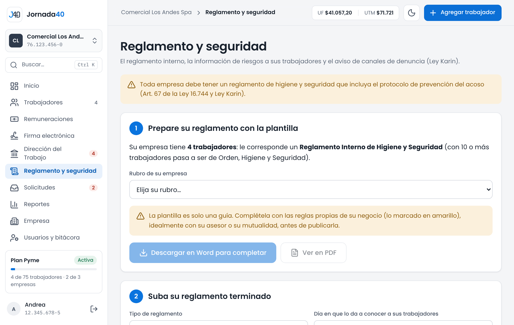

# Reglamento y seguridad {#sec-reglamento}

*Disponible desde el plan Pyme.*

En el menú, **Reglamento y seguridad** reúne el reglamento interno, la información de riesgos a los trabajadores y la Ley Karin. La entrega de elementos de protección personal, que está en todos los planes, se registra en la carpeta de cada trabajador (sección 6.8).

## Reglamento interno {#sec-reglamento-interno}

El reglamento interno se prepara, se publica, se entrega a los trabajadores y se envía a las autoridades. La pantalla lo guía en tres pasos.

{width=100%}

**1. Prepare su reglamento con la plantilla.** Jornada40 indica qué reglamento le corresponde a la empresa según sus trabajadores activos: con 10 o más, un Reglamento Interno de Orden, Higiene y Seguridad; con menos, un Reglamento Interno de Higiene y Seguridad.

1. Elige el **Rubro de su empresa**: administración y oficina; comercio y ventas; manufactura, producción e industria; tecnología (TI); construcción; gastronomía y hotelería; transporte y bodega; agrícola; aseo y mantención, o salud.
2. Presiona **Descargar en Word para completar** o **Ver en PDF**.
3. Completa la plantilla con las reglas propias de tu negocio. Las partes por completar vienen marcadas en amarillo.

La plantilla incluye los riesgos y las medidas del rubro, los elementos de protección, el procedimiento de la Ley Karin y las sanciones. Es solo una guía: complétala idealmente con tu asesor o tu mutualidad antes de publicarla.

**2. Suba su reglamento terminado.**

1. Elige el **Tipo de reglamento**.
2. Indica el **Día en que lo da a conocer a sus trabajadores**. El reglamento rige 30 días después (Art. 156).
3. Sube el **Archivo del reglamento (PDF)**, de hasta 20 MB.
4. Presiona **Guardar reglamento**.

Desde ese día, publícalo en dos lugares visibles del lugar de trabajo. Si después cambias el reglamento, sube la versión nueva en este mismo paso: reemplaza a la anterior.

**3. Entréguelo y envíelo a las autoridades.** Este paso muestra la versión vigente, desde cuándo rige y el plazo para enviarlo.

- **Envío a las autoridades:** se envía a la Dirección del Trabajo (en Mi DT, trámite "Reglamento interno") y a la Seremi de Salud de la región. Cuando lo hagas, presiona **Ya lo envié** en cada uno (o **Deshacer**, si te equivocaste).
- **Entrega a los trabajadores:** presiona **Enviar a firma a N trabajadores**. Cada uno recibe por correo el reglamento completo y firma una constancia de recepción. La lista muestra quién firmó, quién falta y a quién le falta el correo.

A los trabajadores nuevos se les envía la constancia del reglamento vigente junto con su contrato, cuando el contrato se envía a firma (sección 5.1).

## Información de riesgos {#sec-informacion-riesgos}

Antes de empezar a trabajar, y cada vez que cambie de puesto o de proceso, cada trabajador debe conocer los riesgos de su trabajo y cómo prevenirlos (Art. 15 del DS 44). Jornada40 lo registra con una constancia que el trabajador firma.

**A todos los que faltan**, en **Reglamento y seguridad › Información de riesgos del trabajo**:

1. Elige el **Rubro de su empresa**.
2. Revisa los **Riesgos que se informan**: vienen marcados los del rubro; desmarca los que no apliquen.
3. Indica la **Fecha de la capacitación presencial en procedimientos de trabajo seguro**. Los procedimientos se enseñan en persona; la constancia deja registro de lo informado.
4. Presiona **Enviar a firma a N trabajadores**.

**A un trabajador en particular**, en su carpeta, **Documentos › Generar documento › Información de riesgos**: elige el rubro, cuándo se informa (antes de empezar a trabajar; cambio de puesto o de tareas, o un nuevo proceso, tecnología, material o sustancia), los riesgos de su puesto y la fecha de la capacitación. Presiona **Crear documento** y envíalo a firma.

La carpeta avisa si un trabajador no tiene una constancia firmada o si cambió de cargo desde la última. El resumen por correo también lo recuerda (sección 15.2).

## Ley Karin {#sec-ley-karin}

La Ley Karin (Ley 21.643) exige prevenir, investigar y sancionar el acoso laboral, el acoso sexual y la violencia en el trabajo. En Jornada40 hay tres partes: el aviso de los canales de denuncia a los trabajadores, el encargado que recibe las denuncias y, para ti, un contador con solo cifras.

### Aviso de canales de denuncia

Cada semestre hay que informar a todos los trabajadores dónde denunciar. El aviso incluye el canal interno de la empresa, la Dirección del Trabajo, la mutual de la empresa y la Superintendencia de Seguridad Social, y cada trabajador firma que lo recibió.

1. En **Ley Karin: aviso de canales de denuncia**, completa **Quién recibe las denuncias (persona o cargo)** y **Correo para denuncias**, y presiona **Guardar canal**.
2. Revisa el avance del semestre: cuántos trabajadores fueron informados y el plazo.
3. Presiona **Enviar el aviso a N trabajadores**.

### Encargado de denuncias

*Solo el titular.*

El encargado de denuncias recibe y gestiona las denuncias con reserva. Puede ser el titular, alguien del equipo o un asesor externo. Entra por un acceso aparte (anexo B); tú no ves el contenido de las denuncias, solo que hubo actividad. El plan Pyme incluye un encargado.

1. En **Ley Karin: encargado de denuncias**, presiona **Designar encargado**.
2. Completa **RUT del encargado**, **Nombres**, **Apellidos** y **Correo**. Al correo le llega la invitación para crear su clave y, si la olvida, el enlace para una nueva.
3. Marca **¿De qué empresas recibe denuncias?** y presiona **Enviar invitación**.

El encargado aparece como **Invitado: aún no crea su clave** hasta que crea su clave, y luego como **Activo**. Mientras está invitado, puedes **Reenviar invitación**. Para quitarle el acceso, presiona **Quitar acceso**: no se borra nada de lo que hizo.

### Lo que ves como titular

Cuando hay denuncias en curso, la tarjeta muestra **Denuncias en curso** con cifras por empresa: cuántas están abiertas, cuántas tienen un plazo vencido y cuántas están por vencer. Nunca muestra su contenido. Inicio también muestra las denuncias en curso y si alguna tiene un plazo vencido (sección 3.1). Si hay plazos vencidos, consulta al encargado sin pedirle detalles.

Si la empresa tiene un encargado activo, cada trabajador puede presentar una denuncia desde su portal y le llega directo al encargado (anexo A).
