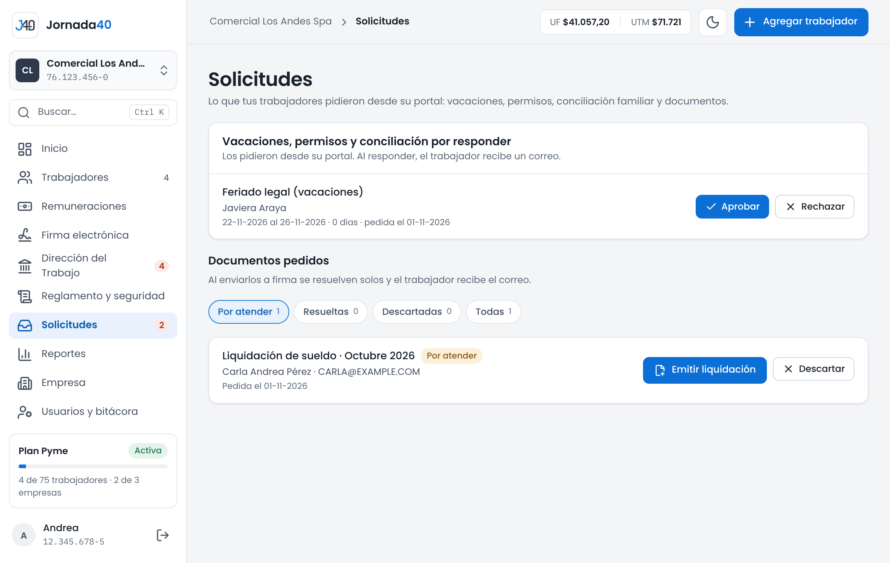

# Portal y solicitudes {#sec-portal}

*Disponible desde el plan Pyme.*

El portal del trabajador es el lugar donde cada trabajador ve sus documentos y hace sus trámites con la empresa, desde el celular o el computador. Entra con su RUT y un código que le llega al correo; si quiere, crea una clave. El anexo A explica el portal desde el lado del trabajador.

Desde su portal, el trabajador:

- ve su contrato, sus liquidaciones firmadas, sus documentos firmados y sus vacaciones con el saldo;
- firma los documentos que tiene pendientes;
- pide documentos, vacaciones, permisos legales y solicitudes de conciliación;
- emite sus propios certificados;
- puede presentar una denuncia de Ley Karin, si la empresa tiene un encargado activo (sección 12.3).

## Invitar al portal y ver el estado {#sec-invitar-portal}

En la carpeta de cada trabajador, el bloque **Portal del trabajador** muestra su estado:

| Estado                                                   | Qué hacer                                                                 |
|----------------------------------------------------------|---------------------------------------------------------------------------|
| "Todavía no ha entrado a su portal."                     | Presiona **Invitar a su portal**.                                         |
| "Ya usa su portal…"                                      | Ves su último ingreso. Si lo necesita, presiona **Reenviar instrucciones**. |
| "Agregue su correo personal en Datos personales para que pueda entrar." | Presiona **Agregar correo** y regístralo.                  |
| "El portal del trabajador está disponible desde el plan Pyme." | Revisa **Ver planes** (sección 16.2).                               |
| "Su acceso terminó el…"                                  | El trabajador desvinculado ya no tiene acceso.                            |

: Estados del portal en la carpeta

**Invitar a su portal** le envía un correo con los pasos para entrar con su RUT; no necesita contraseña. Puedes enviar una invitación cada 24 horas.

El trabajador entra solo con el correo que la empresa registró en su ficha: así ve únicamente sus propios documentos. Si se desvincula, sigue entrando por 3 meses, contados desde la ratificación del finiquito (sección 10.3); el bloque indica hasta qué fecha puede entrar.

## Solicitudes {#sec-solicitudes}

En el menú, **Solicitudes** reúne lo que los trabajadores piden desde su portal. La cifra del menú y una tarea en Inicio indican cuántas esperan respuesta. Cada respuesta le llega al trabajador por correo.

{width=100%}

### Vacaciones, permisos y conciliación

En **Vacaciones, permisos y conciliación por responder**:

- **Vacaciones** (feriado legal o progresivo, permiso sin goce o día libre por horas extra): presiona **Aprobar** o **Rechazar**. Al aprobar, se registran en la carpeta con su comprobante (capítulo 9).
- **Permisos legales:** presiona **Aprobar** o **Rechazar**. Al aprobar, Jornada40 crea la constancia del permiso (sección 6.6) y te ofrece **Enviar constancia a firma**.
- **Conciliación** (teletrabajo o cambio de jornada por responsabilidades de cuidado): presiona **Responder en su ficha** y registra tu respuesta allí (sección 4.5).

Para rechazar, elige el **Motivo**: el trabajador lo verá.

### Documentos pedidos

Los trabajadores solo pueden pedir, de una lista cerrada, documentos que Jornada40 genera y que todavía no existen o no están en firma: una liquidación de un mes cerrado, el contrato, el anexo Ley 40 horas, un comprobante de vacaciones o el finiquito.

1. En **Documentos pedidos**, revisa cada solicitud. Puedes filtrarlas en **Por atender**, **Resueltas**, **Descartadas** o **Todas**.
2. Si el documento todavía no existe, usa el botón que corresponde: **Emitir liquidación**, **Crear contrato** o **Preparar finiquito**.
3. Cuando el documento exista, presiona **Enviar a firma**.

La solicitud se resuelve sola cuando el documento se envía a firma, y el trabajador recibe el correo de firma.

Si no corresponde, presiona **Descartar** y elige el motivo, que el trabajador verá en su portal: se le entregó en papel, ese mes no hubo remuneración que liquidar, el período no corresponde a su relación laboral o el documento no corresponde a su situación laboral.

## Certificados que emiten los trabajadores {#sec-certificados}

Desde su portal, el trabajador emite al instante sus certificados, sin que la empresa tenga que hacer nada. Solo certifican datos firmes de Jornada40:

- **Certificado de antigüedad laboral**;
- **Certificado de renta** y **Certificado de cotizaciones declaradas**, de los últimos 3, 6 o 12 meses, que requieren esa cantidad de liquidaciones firmadas seguidas. El de cotizaciones no acredita que se pagaron;
- **Certificado de vacaciones**;
- **Certificado de jornada y horario**;
- **Certificado de término de relación laboral**, que no indica la causal.

> **Importante:** para que los trabajadores puedan emitir certificados, la empresa debe tener configurada la firma del empleador (sección 2.5). Cada certificado la lleva estampada.

Cada certificado tiene un folio, un código de verificación y un código QR. Cualquier persona puede comprobarlo en www.jornada40.cl/verificar.

En la carpeta del trabajador, pestaña **Documentos**, el bloque **Certificados emitidos por el trabajador** muestra los que emitió. Puedes descargarlos con **PDF**. Si un certificado tiene un error, presiona **Anular** y elige el motivo: contenía un dato erróneo, ya corregido; se emitió por error, o cambiaron las condiciones que certificaba. Un certificado anulado no se borra: su verificación pública indica que no es válido y el trabajador puede emitir uno nuevo.
