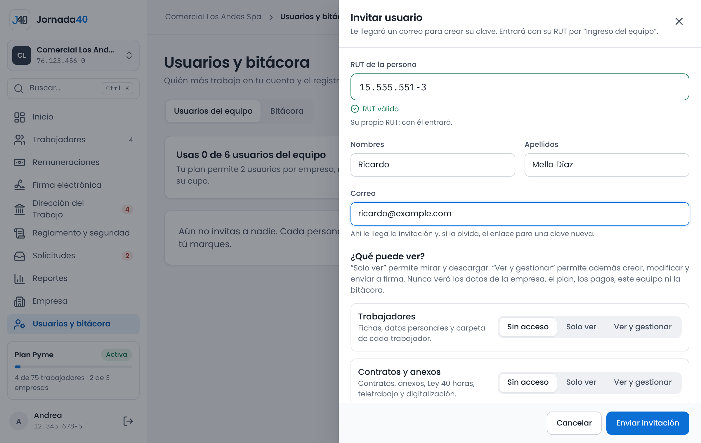
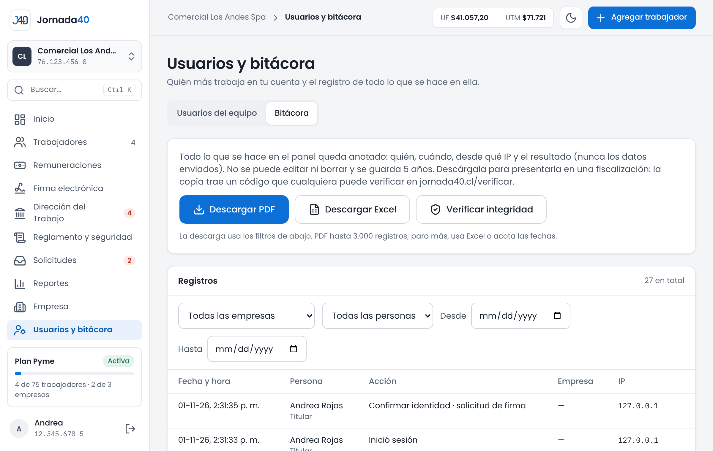

# Equipo y bitácora {#sec-equipo}

*Disponible desde el plan Starter. Solo el titular.*

En el menú, **Usuarios y bitácora** permite invitar a otras personas a trabajar en la cuenta, por ejemplo el contador o quien lleva el personal, y revisar el registro de todo lo que se hace en ella.

## Invitar, dar permisos y eliminar {#sec-usuarios-equipo}

Arriba de **Usuarios del equipo** ves cuántos usuarios usas del cupo: el plan permite 2 usuarios por cada empresa del plan, repartidos como quieras. Si necesitas más, elimina a alguien que ya no use la cuenta, sube de plan o pide usuarios adicionales a contacto.jornada40@gmail.com.

{width=100%}

### Invitar a un usuario

1. Presiona **Invitar usuario**.
2. Completa **RUT de la persona**, **Nombres**, **Apellidos** y **Correo**. Al correo le llega la invitación y, si olvida su clave, el enlace para una nueva.
3. En **¿Qué puede ver?**, elige para cada sección **Sin acceso**, **Solo ver** o **Ver y gestionar**.
4. En **¿En qué empresas?**, marca las empresas en que trabajará.
5. Presiona **Enviar invitación**.

| Sección                    | Qué incluye                                                        |
|----------------------------|--------------------------------------------------------------------|
| Trabajadores               | Fichas, alta e importación de trabajadores.                        |
| Contratos y anexos         | Contratos, anexos Ley 40 horas, anexos y pactos de teletrabajo.    |
| Remuneraciones             | Liquidaciones, conceptos y archivos del mes.                       |
| Vacaciones y permisos      | Vacaciones, permisos legales y días libres.                        |
| Documentos y pactos        | Amonestaciones, constancias, pactos y autorizaciones.              |
| Término de contrato        | Cartas de término y finiquitos.                                    |
| Dirección del Trabajo      | Registro en Mi DT y consentimiento electrónico.                    |
| Reglamento y seguridad     | Reglamento interno, riesgos, entrega de EPP y aviso de Ley Karin.  |
| Solicitudes del portal     | Documentos pedidos por los trabajadores.                           |
| Reportes y expedientes     | Reportes multiempresa y descargas en ZIP.                          |

: Secciones que se asignan a un usuario del equipo

Con **Solo ver**, el usuario consulta y descarga; con **Ver y gestionar**, también crea, edita y envía a firma. Cualquier acceso le permite ver las fichas de los trabajadores. Los datos de la empresa, la firma del empleador, el plan, las empresas, los usuarios y la bitácora son solo del titular. El contenido de las denuncias de Ley Karin no lo ve nadie más que el encargado (sección 12.3).

### Cómo entra el usuario del equipo

1. Abre el correo de invitación y crea su clave en **Crea tu clave**.
2. Ingresa en www.jornada40.cl › **Iniciar sesión › Ingreso del equipo**, con su RUT y su clave.
3. Si trabaja en más de una cuenta con la misma clave, elige en cuál entrar.

Si olvida su clave, en **Ingreso del equipo** pide un enlace nuevo con su RUT; llega al correo con que lo invitaron. En el panel, el usuario ve solo las secciones y empresas que le asignaste. Cuando envía documentos a firma, confirma con su propia clave y queda registrado como quien los envió (sección 8.1).

### Editar, reenviar y eliminar

- **Editar:** cambia sus secciones, sus niveles o sus empresas. El RUT no se puede cambiar, porque identifica a la persona.
- **Reenviar:** mientras dice **Invitado: aún no crea su clave**, puedes reenviarle la invitación.
- **Eliminar:** el usuario no podrá volver a entrar y se libera su cupo. Lo que hizo queda en la bitácora y los documentos que envió a firma siguen válidos. Si más adelante vuelve, invítalo de nuevo.

Si la cuenta pasa a un plan con menos usuarios, por ejemplo cuando termina un plan pagado, los usuarios que excedan el cupo quedan suspendidos, los más nuevos primero: no pueden entrar hasta que vuelva a haber cupo.

## Bitácora y copia verificable {#sec-bitacora}

La pestaña **Bitácora** registra todo lo que se hace en la cuenta: quién creó, cambió, envió a firma o descargó algo, en qué empresa, desde qué IP y si se completó. También registra los ingresos y los intentos fallidos. Nunca guarda los datos que se escribieron, solo la acción.

{width=100%}

Filtra por empresa, por persona y por fechas (**Desde** y **Hasta**). Los registros se ordenan del más reciente al más antiguo; avanza con **Más antiguos** y **Más recientes**. Una acción que no se completó aparece con **No se completó**.

Los registros de la bitácora no se pueden modificar ni borrar, ni siquiera desde la administración de Jornada40. Cada registro se encadena con el anterior mediante una huella criptográfica (SHA-256).

- **Verificar integridad** revisa que los registros conserven su contenido original y su secuencia completa. Si se detecta una inconsistencia, la pantalla indica desde qué registro; escribe a soporte.
- **Descargar PDF** o **Descargar Excel** genera una copia verificable con los filtros que elegiste. El PDF admite hasta 3.000 registros; para más, usa Excel o acota las fechas.

Cada copia tiene un folio, un código y un QR. Cualquier persona puede comprobarla en www.jornada40.cl/verificar: mientras los registros incluidos sigan iguales, la página indica "Documento auténtico".
