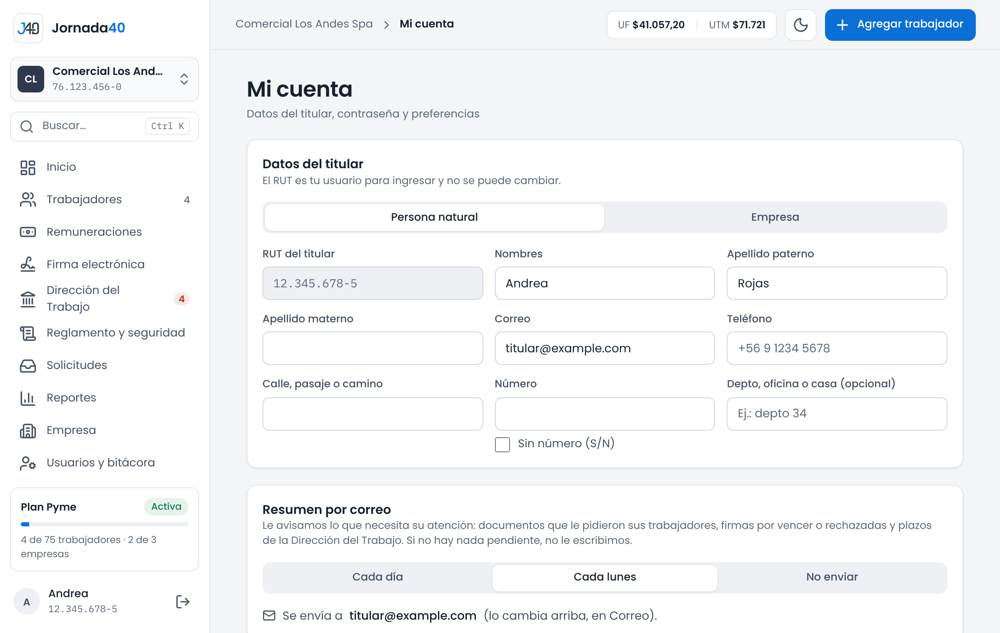

# Mi cuenta {#sec-mi-cuenta}

**Mi cuenta** se abre desde tu nombre, al pie del menú, o desde **Más › Mi cuenta** en el celular.

{width=100%}

## Datos y contraseña {#sec-datos-contrasena}

### Datos del titular

En **Datos del titular** están tus datos como titular de la cuenta:

1. Elige el **Tipo de cliente**: **Persona natural** o **Empresa** (en ese caso, agrega la **Razón social**).
2. Corrige **Nombres**, **Apellido paterno**, **Apellido materno**, **Correo** o **Teléfono**.
3. Presiona **Guardar** (o **Descartar** para volver a lo guardado).

El **RUT del titular** es tu usuario para ingresar y no se puede cambiar. El correo es al que llegan la recuperación de contraseña y el resumen por correo.

### Contraseña

1. En **Contraseña**, escribe la **Contraseña actual**.
2. Escribe la **Nueva contraseña** y repítela en **Repite la nueva**. Las marcas bajo los campos te indican si cumple las reglas: al menos 8 caracteres, no solo números, distinta de la actual y que ambas coincidan.
3. Presiona **Cambiar contraseña**.

Si olvidaste tu contraseña y no puedes entrar, recupérala desde **Iniciar sesión** (sección 2.3).

### Preferencias y sesión

En **Preferencias y sesión** eliges el tema claro u oscuro y puedes **Cerrar sesión** en ese equipo.

### Si eres usuario del equipo

Tu **Mi cuenta** muestra **Tu acceso**: las secciones que te asignó el titular, con su nivel (**Solo ver** o **Ver y gestionar**), y tus empresas. Si necesitas otra sección, pídesela al titular. También puedes cambiar tu propia clave, elegir tu resumen por correo y cerrar sesión.

## Resumen por correo {#sec-resumen-correo}

Jornada40 te envía un resumen con lo que necesita tu atención, con un botón para ir directo a cada tema. Si no hay nada pendiente, no se envía. Está en todos los planes; cada tema aparece si tu plan incluye esa función:

- documentos que pidieron los trabajadores y peticiones de vacaciones, permisos o conciliación;
- firmas por vencer, rechazadas o vencidas;
- registros en la Dirección del Trabajo vencidos o que vencen en 3 días hábiles o menos;
- horas de descanso por horas extra que vencen en los próximos 30 días;
- el reglamento interno y la Ley Karin: envío a las autoridades pendiente, trabajadores sin la recepción firmada y el aviso semestral de canales;
- seguridad en el trabajo: información de riesgos pendiente y capacitaciones en el uso de los elementos de protección de hace más de un año;
- para el titular, las cifras de denuncias de Ley Karin en curso.

En **Resumen por correo**, elige **¿Cada cuánto quiere recibirlo?**: **Cada día**, **Cada lunes** o **No enviar**. Se envía al correo de tu cuenta.

Si eres usuario del equipo, tu resumen trae solo los temas de tus secciones y empresas, y lo eliges tú.
