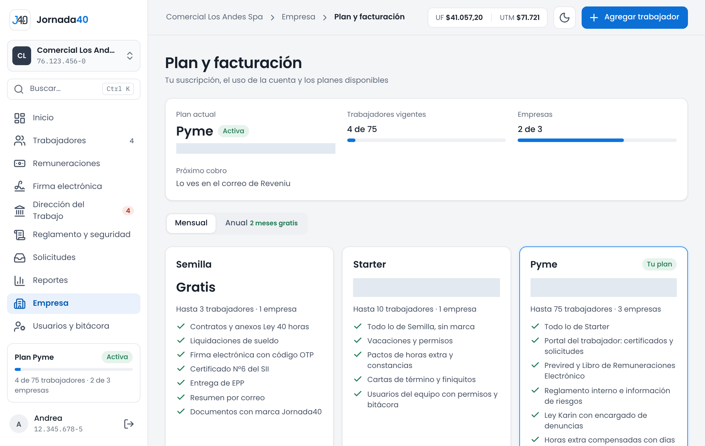

# Empresas y plan {#sec-empresas-plan}

*Solo el titular.*

## Varias empresas {#sec-varias-empresas}

Una cuenta puede administrar varias empresas, hasta el máximo que permite el plan. Todas comparten el titular, el plan, el cupo de trabajadores y el de usuarios del equipo, y cada una tiene sus propios datos, trabajadores y documentos.

Para verlas, presiona **Empresa › Agregar o administrar empresas** o, en el selector de empresa del menú, **Agregar o administrar empresas** (sección 3.2).

**Agregar una empresa:**

1. Presiona **Nueva empresa**.
2. Completa **Razón social**, **RUT de la empresa**, **Giro**, la dirección, **Comuna**, **Ciudad**, **Sucursal (opcional)**, **Representante legal** y **RUT del representante**.
3. Presiona **Crear empresa**. El panel pasa a la empresa nueva.

Después, completa sus datos de seguridad social y su firma del empleador en **Empresa**. Desde el plan Corporativo, también puedes pedírsela por correo a su representante legal (sección 2.5).

En la lista **Activas**, **Trabajar en esta** cambia a esa empresa. Si llegaste al máximo de empresas de tu plan, cambia a un plan con más empresas o desactiva una.

**Desactivar una empresa:** presiona **Desactivar** y confírmalo. Deja de aparecer en el selector y libera un cupo, pero sus trabajadores y documentos se conservan. Para volver a usarla, búscala en **Desactivadas** y presiona **Reactivar**; vuelve a ocupar un cupo.

## Plan y facturación {#sec-plan}

**Plan y facturación** muestra tu plan, el uso de la cuenta, los planes disponibles y tus pagos. Se abre con la tarjeta del plan, al pie del menú, con **Gestionar plan** en la página **Empresa** o, en el celular, con **Más › Plan y facturación**.

{width=100%}

Arriba están el **Plan actual**, su estado y el uso: **Trabajadores vigentes** y **Empresas**, frente al máximo del plan. Según el caso, también ves el **Próximo cobro**, la fecha hasta la que tienes acceso o, durante una prueba, **Prueba gratis hasta** (sin cobros ni tarjeta).

### Contratar o subir de plan

1. Elige el pago **Mensual** o **Anual** y, en el plan que quieres, presiona **Contratar** o **Subir a** ese plan.
2. Revisa el resumen y presiona **Ir a pagar**.
3. Completa el pago en Reveniu, el servicio de pagos, donde inscribes tu tarjeta.

Cuando el pago se confirma, los nuevos límites y funciones quedan activos en tu cuenta. Si estabas en una prueba con código, la prueba termina y el plan pagado empieza ese mismo día. Si un plan no alcanza para tus trabajadores o empresas actuales, la tarjeta del plan lo indica.

Para pasar del pago mensual al anual, o al revés, presiona **Cambiar a anual** o **Cambiar a mensual** en tu plan actual. El período en curso no se prorratea ni se reembolsa.

### Bajar de plan o volver al plan gratuito

1. En el plan, presiona **Bajar a** ese plan (o **Pasar a Semilla**, para el plan gratuito).
2. Lee el aviso: indica desde cuándo rige el cambio y las funciones que dejarás de tener.
3. Presiona **Confirmar cambio**.

Hasta tu próximo cobro mantienes tu plan actual con todas sus funciones. Desde ese cobro, Reveniu cobra el monto del plan nuevo con la misma tarjeta, sin volver a inscribirla. Si pasas a Semilla, tu plan no se renueva: lo mantienes hasta el fin del período pagado y después la cuenta pasa al plan gratuito, sin cobros y sin borrar tus datos.

No puedes bajar a un plan en que no caben tus trabajadores, empresas o usuarios del equipo actuales: primero ajústalos.

Mientras hay un cambio programado, un aviso lo indica y puedes deshacerlo con **Mantener** tu plan actual. Si cancelaste la renovación, presiona **Reanudar** para seguir con tu plan, sin un cobro nuevo por el período ya pagado.

### Historial de pagos

Al final de la página, **Historial de pagos** muestra los pagos registrados.

> **Importante:** cambiar de plan nunca borra datos. Si tu cuenta queda con más trabajadores o empresas de los que permite el nuevo plan, no podrás agregar nuevos hasta ajustarlos.
