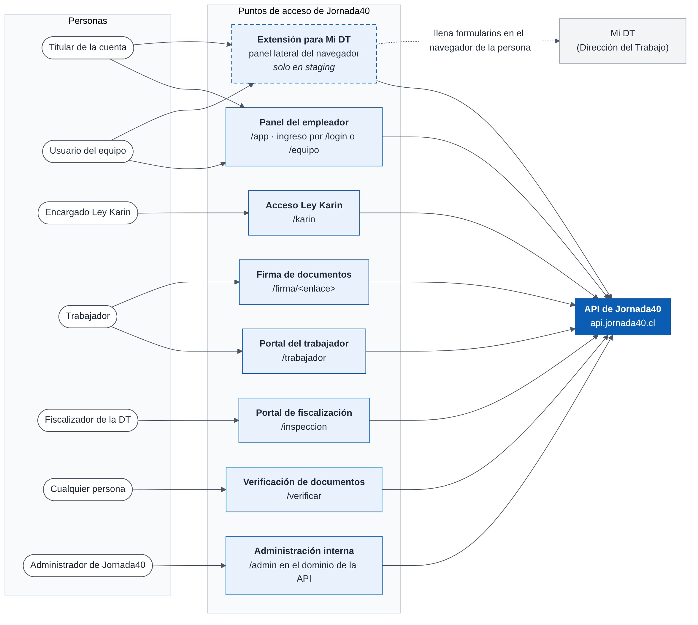

# Descripción general del sistema {#sec-descripcion}

## Contexto y objetivo del sistema {#sec-contexto}

### Contexto

Entre 2021 y 2026, la legislación laboral chilena impuso a los empleadores nuevas obligaciones que se suman a las de remuneraciones y seguridad social:

- registrar electrónicamente los contratos, sus anexos y los términos de relación laboral en el sitio Mi DT (Ley 21.327);
- reducir por etapas la jornada ordinaria máxima de 45 a 40 horas semanales (Ley 21.561);
- prevenir, investigar y sancionar el acoso y la violencia en el trabajo, con plazos y documentos obligatorios (Ley 21.643, Ley Karin, y DS N° 21 de 2024);
- dar preferencia de teletrabajo y ajustes de jornada a quienes cuidan a otras personas (Ley 21.645);
- aplicar la reforma de pensiones (Ley 21.735) y el nuevo reglamento de gestión preventiva de riesgos (DS N° 44 de 2023).

Muchas pymes cumplen estas obligaciones con planillas, formularios en papel y la ayuda de un contador externo. Esto provoca errores de cálculo, plazos vencidos y falta de evidencia ante una fiscalización.

Jornada40 aplica el calendario de la Ley 21.561 según la fecha de cada contrato, liquidación o anexo:

| Desde        | Jornada ordinaria máxima semanal |
|--------------|----------------------------------|
| —            | 45 horas                         |
| 26-04-2024   | 44 horas                         |
| 26-04-2026   | 42 horas                         |
| 26-04-2028   | 40 horas                         |

: Etapas de la Ley 21.561 aplicadas por el sistema

::: {custom-style="Nota de tabla"}
Fuente: `backend/core/jornada.py → ETAPAS_LEY_40`. La jornada máxima vigente en una fecha la entrega `jornada_maxima_vigente()`.
:::

### Objetivos

| Código | Objetivo                                                                                                                                                       |
|--------|------------------------------------------------------------------------------------------------------------------------------------------------------------------|
| OBJ-1  | Reunir en un solo lugar la gestión de la relación laboral: ingreso, contrato, remuneraciones, documentos, vacaciones y término.                                |
| OBJ-2  | Aplicar automáticamente las reglas legales y previsionales que rigen en cada fecha, con parámetros versionados que mantiene Jornada40.                          |
| OBJ-3  | Generar los documentos y archivos en los formatos que exigen la DT, Previred y el SII.                                                                         |
| OBJ-4  | Conservar evidencia verificable: documentos firmados, certificado de firma, bitácora de auditoría y registros de fiscalización.                               |
| OBJ-5  | Advertir plazos e incumplimientos con tiempo, sin reemplazar la decisión del empleador.                                                                        |
| OBJ-6  | Dar a trabajadores, encargados de denuncias y fiscalizadores un acceso propio, limitado a lo que les corresponde ver.                                          |

: Objetivos del sistema

### Principios de diseño del producto

1. **El servidor calcula.** Todo cálculo legal o previsional se hace en el servidor; la interfaz solo lo muestra. Las vistas previas también las calcula el servidor, y los montos legales (indemnizaciones, feriado, descuentos) nunca se aceptan desde el navegador.
2. **Avisos, no bloqueos.** Lo que contraviene una norma laboral (por ejemplo, una jornada sobre el máximo legal) se advierte, y la decisión queda en manos del empleador. Solo se impide lo que la ley prohíbe expresamente, como un recargo de horas extra menor al legal, o lo que dejaría inválido un documento o un archivo oficial.
3. **Listas cerradas.** Los documentos con efectos legales se construyen a partir de catálogos (causales, motivos, tipos de permiso, riesgos) y no de texto libre. Así su contenido es consistente con la norma que los respalda.
4. **Evidencia.** Un documento firmado se entrega siempre en su versión firmada, con la página de certificado de firma, y cada acción relevante queda en la bitácora.
5. **Simplicidad.** Pantallas en español de Chile, letra grande y pasos numerados, porque muchos de los usuarios son dueños de pymes con poca experiencia digital.

## Actores {#sec-actores}

La tabla siguiente resume quién usa el sistema, por dónde entra y cómo se identifica. El capítulo 8 detalla cada mecanismo de autenticación y de sesión.

| Actor                          | Qué hace                                                                                                          | Punto de acceso                                  | Identificación y sesión                                                                                                                       | Plan mínimo |
|--------------------------------|-------------------------------------------------------------------------------------------------------------------|--------------------------------------------------|-----------------------------------------------------------------------------------------------------------------------------------------------|-------------|
| Titular de la cuenta           | Contrata el plan; administra empresas, trabajadores, documentos, usuarios y pagos.                                | Panel `/app` (ingreso por `/login`)              | RUT y clave. Sesión JWT en cookies HttpOnly; token de acceso de 5 min y de renovación de 15 min, con rotación. Cierre tras 5 min de inactividad. | Semilla     |
| Usuario del equipo             | Trabaja en los módulos y empresas que le asigna el titular, con permiso de ver o de gestionar.                    | Panel `/app` (ingreso por `/equipo`)             | RUT y clave propia en cada cuenta. Misma sesión que el titular.                                                                                | Starter     |
| Encargado de denuncias Ley Karin | Recibe, investiga y documenta denuncias. No ve nada más del sistema.                                            | `/karin`                                         | RUT y clave. Cookie firmada propia; cierre tras 5 min de inactividad y a las 4 h como máximo.                                                  | Pyme        |
| Trabajador                     | Ve y firma sus documentos; pide documentos, vacaciones y permisos; emite certificados; puede denunciar (Ley Karin). | Portal `/trabajador`                             | RUT y código por correo, o clave. Cookie firmada propia; cierre tras 15 min de inactividad y a las 8 h como máximo.                             | Pyme        |
| Firmante                       | Firma un documento que recibió por correo.                                                                        | `/firma/<enlace>`                                | RUT y código de un solo uso por correo (vence en 10 min), o la clave del portal. Sesión ligada a esa solicitud de firma.                         | Semilla     |
| Fiscalizador de la DT          | Revisa, descarga y ratifica la documentación de una empresa. Solo lectura.                                        | `/inspeccion`                                    | RUT del empleador, correo institucional (`dt.gob.cl`) y código de un solo uso (10 min, 3 intentos). Cookie propia; 15 min de inactividad y 8 h como máximo. | —           |
| Persona que usa la extensión   | Registra contratos, anexos y términos en Mi DT con ayuda de las fichas. [Solo en staging]                         | Panel lateral del navegador, junto a Mi DT       | Código de vinculación de 8 caracteres (10 min, un solo uso), canjeado por un token revocable que vence tras 90 días sin uso.                     | Semilla     |
| Cualquier persona              | Comprueba la autenticidad de un certificado o de una copia de la bitácora.                                        | `/verificar`                                     | Ninguna: basta el código impreso en el documento.                                                                                              | —           |
| Administrador de Jornada40     | Mantiene parámetros previsionales, planes y catálogos; da soporte y vincula pagos no identificados.              | Administración de Django (`/admin` en el dominio de la API) | Usuario interno de Django con permisos de administración.                                                                              | —           |

: Actores del sistema

Además de las personas, interactúan con el sistema algunos sistemas externos: Reveniu, que notifica los pagos, y el servicio programado que envía los resúmenes por correo. La sección 2.6 los describe.

La figura 1 muestra los puntos de acceso. Todos se comunican con la misma API, pero cada uno con su propio mecanismo de sesión. La línea punteada indica que la extensión llena los formularios de Mi DT en el navegador de la persona: no hay conexión entre el servidor de Jornada40 y la DT.

{width=100%}

## Funcionalidades por módulo {#sec-modulos}

El capítulo 3 especifica cada funcionalidad como requerimiento. La tabla siguiente resume los módulos con los mismos códigos.

| Código | Módulo                              | Funcionalidad principal                                                                                                                                                                  | Plan mínimo                                   |
|--------|-------------------------------------|------------------------------------------------------------------------------------------------------------------------------------------------------------------------------------------|-----------------------------------------------|
| CTA    | Cuentas y empresas                  | Registro, bienvenida, perfil y recuperación por RUT. Empresas con sus datos, firma del empleador y seguridad social. Direcciones por partes.                                                | Semilla                                        |
| TRA    | Trabajadores                        | Ficha y carpeta, alta rápida, datos que faltan para el contrato, protecciones especiales (fuero y cuidados), solicitudes de conciliación, cupo por plan. Carga masiva desde Excel.        | Semilla; carga masiva: Pyme                    |
| CON    | Contratos y anexos                  | Editor de contrato con evaluación de la jornada (Ley 21.561 y Art. 22 CT). Anexos, entre ellos el de 40 horas, el de teletrabajo y el de consentimiento electrónico. Lectura de contratos escaneados con IA. | Semilla                                        |
| REM    | Remuneraciones                      | Liquidaciones con vista previa calculada por el servidor, conceptos, parámetros previsionales, asignación familiar, indemnización a todo evento, emisión masiva y avisos. Horas extra compensadas con días libres. | Semilla; horas compensadas, ZIP y consolidado del período: Pyme |
| ARC    | Archivos legales                    | Archivo Previred, revisión y exportación del LRE, libro de remuneraciones, Certificado N° 6 del SII y apoyo a la DJ 1887.                                                                 | Pyme; Certificado N° 6: Semilla                |
| VAC    | Vacaciones y feriado                | Feriado legal y progresivo, días hábiles con los feriados de Chile, saldo y comprobantes.                                                                                                 | Starter                                        |
| DOC    | Documentos legales y laborales      | Amonestaciones, cartas de despido, renuncias o mutuo acuerdo y constancias. Pactos, permisos y constancias (horas extra, descuentos, permisos legales, indemnización del Art. 164 CT). Entrega de EPP. Información de riesgos.        | Semilla; cartas de despido y pactos: Starter; información de riesgos: Pyme |
| FIN    | Finiquitos                          | Cálculo y documento, modalidad (Mi DT o ministro de fe) y registro de la ratificación.                                                                                                     | Starter                                        |
| FIR    | Firma electrónica                   | Envío a firma con confirmación de identidad del empleador, firma del trabajador con verificación de identidad, certificado de firma y conservación de la versión firmada.               | Semilla                                        |
| POR    | Portal del trabajador               | Documentos firmados, firma de pendientes, solicitudes de documentos, certificados verificables con código QR y peticiones de vacaciones, permisos y conciliación.                          | Pyme                                           |
| DT     | Dirección del Trabajo               | Registro electrónico laboral (plazos y fichas para Mi DT), consentimiento para documentos electrónicos, portal de fiscalización y registro de ratificaciones.                              | Semilla; archivo de registro masivo: Pyme (sin verificar, oculto en la interfaz) |
| REG    | Reglamento y seguridad laboral      | Plantilla guía de RIOHS o RIHS por rubro, versiones, remisión a la DT y a la Seremi de Salud, y entrega con constancia firmada.                                                            | Pyme                                           |
| KAR    | Ley Karin                           | Canal de denuncias y aviso semestral, encargado con acceso aislado, denuncias con los plazos del DS N° 21, expediente cifrado, vista para el trabajador y avisos de posibles represalias.  | Pyme                                           |
| EQU    | Usuarios del equipo y bitácora      | Usuarios con permisos por módulo y por empresa. Bitácora de auditoría encadenada con copia verificable.                                                                                    | Usuarios: Starter; bitácora: Semilla           |
| PAG    | Suscripciones y pagos               | Planes, pago con Reveniu y Transbank, avisos de pago, cambio y baja de plan, ciclo mensual o anual.                                                                                       | Semilla                                        |
| RES    | Inicio y resumen por correo         | Tareas pendientes en la pantalla de inicio. Resumen diario o semanal por correo.                                                                                                          | Semilla                                        |
| EXT    | Extensión para Mi DT                | Lista de lo que falta registrar, fichas para copiar, llenado asistido de formularios y marca de registrado. [Solo en staging]                                                             | Semilla                                        |

: Módulos del sistema y plan mínimo

## Planes y habilitación de funcionalidades {#sec-planes}

### Mecanismo

Cada cuenta tiene un plan con un nivel del 1 al 4: Semilla, Starter, Pyme y Corporativo. Las reglas de habilitación son las siguientes:

- **Por nivel, no por nombre.** Una funcionalidad se habilita solo según el nivel, con la función `backend/core/views/base.py → _plan_permite(usuario, nivel_mínimo)`, nunca por el nombre del plan. Así, cambiar el nombre o el precio de un plan no altera lo que habilita.
- **Plan vigente.** Es el plan asignado al cliente. Si no hay uno, se usa el de su suscripción cuando está en estado de prueba, activa o con pago pendiente. Sin plan, rige el nivel 1.
- **Límites.** La cantidad de empresas y de trabajadores se guarda en cada plan y se administra en el admin.
- **Marca en los documentos.** En el nivel 1, los documentos generados llevan la marca de Jornada40.

| Plan         | Nivel | Empresas | Trabajadores | Usuarios del equipo | Encargados Ley Karin |
|--------------|-------|----------|--------------|---------------------|----------------------|
| Semilla      | 1     | 1        | 3            | 0                   | 0                    |
| Starter      | 2     | 1        | 10           | 2                   | 0                    |
| Pyme         | 3     | 3        | 75           | 6                   | 1                    |
| Corporativo  | 4     | 10       | 250          | 20                  | 1                    |

: Límites de cada plan

Los valores de la tabla se interpretan así:

- **Empresas y trabajadores:** son los valores iniciales que crea la migración `0048_planes_base`. Los vigentes se administran en el admin y pueden diferir.
- **Usuarios del equipo:** son 2 por cada empresa que permite el plan, como bolsa común de la cuenta, más los usuarios adicionales que compre el cliente (`permisos.py → cupo_equipo`).
- **Encargados de la Ley Karin:** es uno desde el plan Pyme, fuera de la bolsa del equipo, más los adicionales que compre el cliente (`permisos.py → cupo_ley_karin`).
- **Precios:** se administran en el admin y quedan fuera del alcance de este documento.

**Cupo de trabajadores.** Ocupan cupo los trabajadores vigentes y los desvinculados durante el mes en curso (`views/base.py → _trabajadores_vigentes`). Así, quien se desvincula libera su cupo el mes siguiente: se permite la rotación normal, pero no reemplazar a una persona por otra dentro del mismo mes para superar el límite.

### Funcionalidades por nivel mínimo

| Nivel mínimo   | Funcionalidades                                                                                                                                                        | Control en el código                                                                      |
|----------------|--------------------------------------------------------------------------------------------------------------------------------------------------------------------------|-------------------------------------------------------------------------------------------|
| 1 · Semilla    | Contratos y anexos, liquidaciones, firma electrónica, Certificado N° 6, entrega de EPP, registro DT con fichas, bitácora, resumen por correo y pagos. Los documentos llevan la marca de Jornada40. | `views/base.py → _es_plan_semilla`                                                        |
| 2 · Starter    | Vacaciones (registro y saldo), cartas de despido, finiquitos, pactos, permisos y constancias, y usuarios del equipo.                                                     | `views/vacaciones.py`, `views/documentos.py`, `views/finiquitos.py`, `views/documentos_laborales.py → NIVEL_DOCUMENTOS`, `permisos.py → NIVEL_EQUIPO` |
| 3 · Pyme       | Portal del trabajador; Previred, LRE, libro de remuneraciones, ZIP y consolidado del período; carga y descarga masiva; horas extra compensadas; reglamento interno; información de riesgos; Ley Karin; archivo de registro masivo DT. | `NIVEL_PLAN_PORTAL`, `views/liquidaciones.py`, `views/empleados.py`, `NIVEL_COMPENSACION`, `NIVEL_REGLAMENTO`, `NIVEL_RIESGOS`, `NIVEL_LEY_KARIN`, `views/direccion_trabajo.py` |
| 4 · Corporativo | No agrega funcionalidades: amplía empresas, trabajadores y usuarios del equipo.                                                                                       | Límites del plan                                                                          |

: Funcionalidades habilitadas por nivel de plan

La interfaz también usa el nivel para no mostrar lo que el servidor rechazaría. La decisión, en todo caso, siempre la toma el servidor. La lista que ven los clientes en el sitio y en `/app/plan` está en `frontend/src/components/sitio/contenido.ts → INCLUYE_POR_NIVEL` y debe coincidir con esta tabla.

## Restricciones y supuestos {#sec-restricciones}

### Restricciones técnicas

| Código | Restricción                                                                                                   | Consecuencia en el diseño                                                                                                                                                                 |
|--------|---------------------------------------------------------------------------------------------------------------|-------------------------------------------------------------------------------------------------------------------------------------------------------------------------------------------|
| RT-01  | Mi DT no ofrece una interfaz de programación (API) para registrar contratos, anexos ni términos.               | Jornada40 calcula qué se debe registrar y en qué plazo, entrega fichas para copiar y una extensión que llena los formularios en el navegador de la persona. La persona inicia sesión con su Clave Única y confirma cada envío. |
| RT-02  | La página de inscripción de tarjetas de Transbank bloquea los navegadores automatizados.                       | La inscripción de tarjetas solo se prueba manualmente en el ambiente de pruebas (sandbox) de Reveniu.                                                                                    |
| RT-03  | El servicio web de Railway no ejecuta tareas programadas.                                                     | El resumen por correo corre como un segundo servicio de Railway con programación horaria (cron), desde la misma imagen.                                                                   |
| RT-04  | La API se publica detrás de Cloudflare y del proxy de Railway.                                                | La IP del visitante se toma del encabezado `X-Real-IP` que escribe Railway (`core/middleware.py → IpRealMiddleware`); de ella dependen los límites de intentos y la auditoría.            |
| RT-05  | La aplicación web (jornada40.cl) y la API (api.jornada40.cl) se sirven desde orígenes distintos.              | Las cookies de sesión se envían en solicitudes de origen cruzado con credenciales. Solo se permiten los orígenes de la lista de CORS.                                                    |
| RT-06  | El disco del contenedor de Railway no es persistente.                                                          | Los archivos subidos y los documentos firmados se guardan en Backblaze B2; los demás PDF se generan al pedirlos y no se almacenan.                                                         |
| RT-07  | Gunicorn corta las solicitudes que superan los 60 segundos.                                                    | La lectura de contratos con IA tiene un tiempo máximo de 45 segundos; los cálculos y documentos se generan dentro de la solicitud.                                                         |
| RT-08  | SQLite no admite bien escrituras concurrentes.                                                                 | Se usa solo en desarrollo y en las pruebas de extremo a extremo, con una configuración que ordena las escrituras en cola. Producción usa PostgreSQL.                                     |

: Restricciones técnicas

### Restricciones legales y de diseño

| Código | Restricción                                                                                                                       | Consecuencia en el diseño                                                                                                                                       |
|--------|-------------------------------------------------------------------------------------------------------------------------------------|-----------------------------------------------------------------------------------------------------------------------------------------------------------------|
| RL-01  | La firma electrónica es simple (Ley 19.799), no avanzada. La DT la acepta cuando el documento queda vinculado a su autor (ORD N° 2257 de 2022 y N° 82 de 2025). | La firma exige verificar la identidad, una aceptación expresa y la firma dibujada. Queda un certificado con la evidencia. La firma avanzada queda como paso futuro. |
| RL-02  | El finiquito tiene poder liberatorio solo si se ratifica ante un ministro de fe o se otorga y firma en Mi DT (Art. 177 CT).         | La firma en Jornada40 es solo de recepción, y el documento lo dice. El sistema registra la modalidad y la ratificación.                                            |
| RL-03  | La investigación de la Ley Karin exige reserva (Art. 211-C CT), y la DT no admite denuncias anónimas (Dictamen N° 497/21).            | Acceso aislado para el encargado, datos de la denuncia cifrados, registro reservado de actividad y un contador sin contenido para el titular.                     |
| RL-04  | La decisión sobre una conducta de acoso y su sanción corresponde a quien investiga y al empleador.                                   | La plataforma no concluye ni propone sanciones: la persona que investiga elige desde listas cerradas.                                                            |
| RL-05  | Los reglamentos internos y los protocolos dependen de cada empresa.                                                                  | Las plantillas se entregan como guía, con las partes por completar destacadas.                                                                                   |
| RL-06  | Los parámetros previsionales (topes, tasas de AFP, seguro de invalidez y sobrevivencia, asignación familiar, factores del SII) cambian por ley o por publicación oficial. | Jornada40 los mantiene en el admin, versionados por fecha de vigencia. Los clientes no los editan.                                                         |

: Restricciones legales y de diseño

### Supuestos

| Código | Supuesto                                                                                                                                                         |
|--------|------------------------------------------------------------------------------------------------------------------------------------------------------------------|
| SU-01  | El empleador es responsable de la veracidad de los datos que ingresa: el sistema valida formatos (RUT, fechas, montos) y advierte inconsistencias, pero no los comprueba ante terceros. |
| SU-02  | Cada trabajador tiene un contrato vigente a la vez (relación uno a uno entre ficha y contrato); los cambios posteriores se hacen con anexos.                      |
| SU-03  | Los trabajadores tienen RUT chileno. El archivo de registro masivo de la DT asume, además, que no hay subcontratación ni servicios transitorios y que el lugar de trabajo está en la comuna de la empresa. |
| SU-04  | El archivo Previred no cubre el régimen del IPS (ex INP), pensionados, ahorro previsional voluntario, licencias médicas con fechas ni líneas adicionales: esos casos se informan directamente en Previred. |
| SU-05  | El portal del trabajador y la firma usan el correo personal del trabajador. Un correo con apariencia corporativa genera un aviso (ORD N° 2965 de la DT).        |
| SU-06  | Las personas usan navegadores actuales. La extensión requiere Chrome o Edge.                                                                                     |

: Supuestos

## Dependencias externas {#sec-dependencias}

| Servicio                     | Uso en Jornada40                                                                                                  | Datos que intercambia                                                       | Comportamiento si falla                                                                                                         |
|------------------------------|-------------------------------------------------------------------------------------------------------------------|-----------------------------------------------------------------------------|---------------------------------------------------------------------------------------------------------------------------------|
| Railway                      | Aloja la API (contenedor Docker con Python 3.11 y Gunicorn), la base de datos PostgreSQL y la tarea programada de resúmenes. | Todos los datos del sistema                                                  | El sistema no está disponible.                                                                                                   |
| Vercel                       | Aloja la aplicación web (archivos estáticos).                                                                     | Ninguno: solo entrega el código de la interfaz                              | El sitio no está disponible.                                                                                                     |
| Cloudflare                   | DNS y proxy de `api.jornada40.cl`.                                                                                | Tráfico cifrado (HTTPS) de la API                                           | No se puede acceder a la API.                                                                                                     |
| Backblaze B2                 | Almacenamiento de objetos compatible con S3: archivos subidos, PDF por firmar (temporales) y firmados (permanentes), y archivos cifrados de la Ley Karin. | Documentos laborales; archivos de la Ley Karin ya cifrados                   | No se puede completar una firma ni descargar una versión firmada; el error se informa al usuario.                               |
| Resend (con django-anymail)  | Envío de correos: códigos, solicitudes de firma, invitaciones, avisos y resúmenes.                                | Dirección del destinatario y contenido del mensaje                          | La solicitud de firma queda pendiente y el panel avisa que el correo no salió, para reenviarlo después.                         |
| Reveniu y Transbank          | Suscripciones y cobro con tarjeta. Reveniu notifica cada pago a la API (webhook).                                | Identificación del cliente, plan, ciclo y montos. Los datos de la tarjeta los maneja Transbank. | Si la API de Reveniu falla, se usa el enlace de pago del plan. Un aviso de pago que no se puede asociar se guarda y se avisa por correo al equipo. |
| Google Gemini                | Lectura de contratos escaneados (PDF, JPG o PNG) para prellenar el editor.                                        | Imagen o PDF del contrato                                                   | El usuario recibe un mensaje y completa el contrato a mano. Si el modelo configurado no existe, se usa uno de respaldo.         |
| mindicador.cl                | Valores de la UF y la UTM.                                                                                        | Ninguno personal                                                            | Se usa un valor de respaldo, con aviso; el valor obtenido se guarda en caché por 6 horas.                                        |
| previred.com                 | Lectura de los indicadores previsionales publicados cada mes (comando `sincronizar_previred`).                    | Ninguno personal                                                            | El comando informa lo que no pudo leer y no escribe nada. Lo leído queda como propuesta que una persona confirma en el admin.   |
| Mi DT (Dirección del Trabajo) | Registro de contratos, anexos y términos, hecho por la persona en el sitio de la DT.                              | Lo que la persona registra; la extensión llena los formularios en su navegador | No aplica: no hay conexión entre el servidor de Jornada40 y la DT.                                                               |
| GitHub                       | Repositorio del código, integración continua (Actions) y actualizaciones de dependencias (Dependabot).            | Código fuente                                                               | No se pueden integrar ni publicar cambios; el sistema en producción no se ve afectado.                                          |

: Servicios externos de los que depende el sistema

Las variables de configuración de cada servicio (credenciales, direcciones y enlaces de pago), con su propósito y si son secretas, se detallan en el capítulo 12 y en el anexo G; las bibliotecas de terceros que usa el sistema, con sus versiones y licencias, en el anexo H.
