# Arquitectura {#sec-arquitectura}

Este capítulo describe la arquitectura de Jornada40 siguiendo ISO/IEC/IEEE 42010: cada vista responde a preocupaciones de quienes tienen interés en el sistema. Para las vistas estructurales se usa el modelo C4, en sus niveles de contexto, contenedores y componentes.

| Vista | Preocupaciones que responde | Interesados | Sección |
|---|---|---|---|
| Contexto | Con quién interactúa el sistema y qué intercambia | Dirección, auditores, socios | 4.2 |
| Contenedores | Qué piezas se despliegan y cómo se comunican | Arquitectura, operación, seguridad | 4.3 |
| Componentes | Cómo se organiza la API por dentro | Desarrollo y mantención | 4.4 |
| Dinámica | Cómo ocurren los flujos principales, paso a paso | Desarrollo, seguridad, auditores | 4.5 |
| Despliegue | Dónde corre cada pieza y cómo llega a producción | Operación | 4.6 |
| Conceptos transversales | Reglas comunes: sesiones, aislamiento, errores, configuración | Desarrollo y seguridad | 4.7 |
| Decisiones | Por qué la arquitectura es como es | Todos | 4.8 |

: Vistas de arquitectura

El capítulo 5 baja al diseño de cada módulo, el capítulo 6 describe los datos y el capítulo 7 las interfaces.

## Principios de arquitectura {#sec-arq-principios}

Los principios de producto de la sección 2.1.3 tienen estas consecuencias técnicas:

1. **El servidor es la única fuente de reglas.** Los cálculos legales, los plazos, las listas cerradas y las validaciones están en la API. La aplicación web solo muestra resultados, también en las vistas previas, que el servidor calcula sin guardar (ADR-04).
2. **Una API para todos los accesos, con sesiones separadas.** Los siete accesos usan la misma API y la misma base de datos. Cada uno tiene su forma de identificarse, su sesión y sus límites, y ninguno abre los datos de otro (ADR-10).
3. **Aislamiento en la capa de datos.** Cada consulta del panel se filtra por la cuenta. A los usuarios del equipo, además, se les aplica un filtro por empresa en los gestores de los modelos, de modo que olvidar un filtro en una vista no expone datos (ADR-11).
4. **Monolito modular.** Un solo proyecto Django con una sola aplicación, dividida por temas, y un solo proceso desplegable. Es la forma más simple de operar con un equipo pequeño (ADR-02).
5. **Servidor sin estado entre peticiones.** La sesión viaja en cookies firmadas o en tokens, y los archivos se guardan en el almacenamiento de objetos. Cualquier proceso atiende cualquier petición. Hay una excepción: la caché, que hoy es local a cada proceso (sección 4.7).
6. **Evidencia por diseño.** Los documentos firmados se guardan con su huella, las bitácoras solo admiten agregar registros y los datos reservados se cifran (ADR-08, ADR-12 y ADR-13).
7. **Degradación controlada.** Si falla un servicio externo, el sistema sigue con un respaldo y lo avisa: valor de respaldo de la UF, enlace de pago fijo, solicitud de firma que se puede reenviar. No falla en silencio.
8. **Configuración por ambiente.** El mismo código corre en desarrollo, pruebas y producción. Lo que cambia se lee de variables de entorno (sección 4.7).

## Vista de contexto {#sec-arq-contexto}

La figura muestra a Jornada40 como una sola caja, con las personas que lo usan y los sistemas externos con que se comunica. La sección 2.2 describe a los actores y la sección 2.6, cada servicio externo.

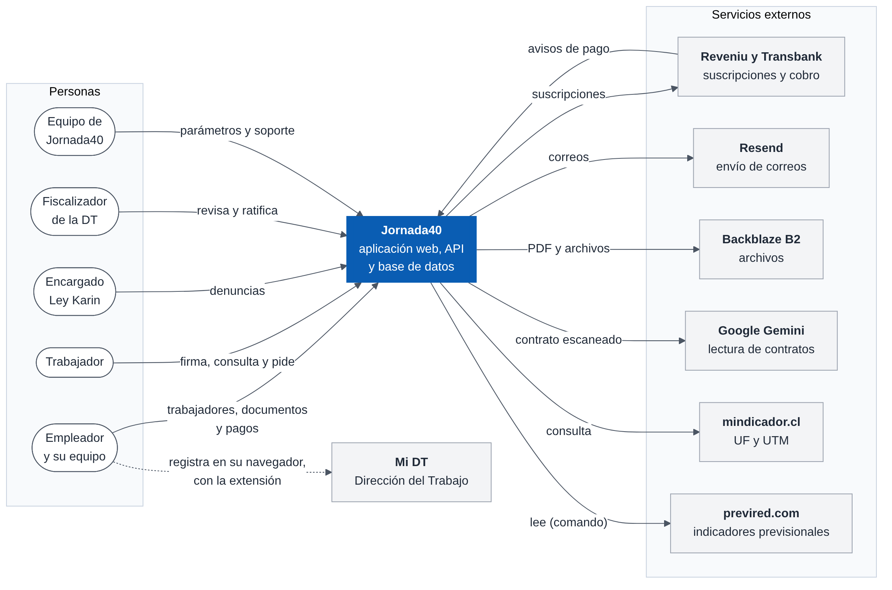{width=100%}

Dos relaciones merecen atención:

- **Pagos.** La comunicación con Reveniu va en ambos sentidos: Jornada40 crea las suscripciones y Reveniu avisa cada pago a la API.
- **Mi DT.** No hay conexión entre el servidor de Jornada40 y la Dirección del Trabajo. La persona registra en Mi DT con su Clave Única, y la extensión llena los formularios en su navegador (ADR-15).

## Vista de contenedores {#sec-arq-contenedores}

Un contenedor, en el modelo C4, es una pieza que se ejecuta o guarda datos por separado.

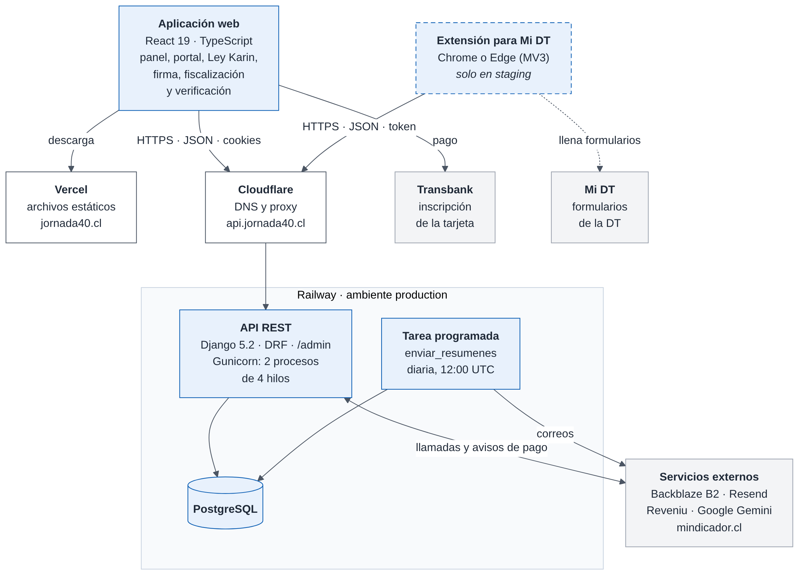{width=100%}

| Contenedor | Tecnología | Responsabilidad | Dónde corre |
|---|---|---|---|
| Aplicación web | React 19, TypeScript, Vite, React Router, TanStack Query, Tailwind CSS | Todas las pantallas: panel, portal del trabajador, acceso Ley Karin, firma, fiscalización y verificación | Navegador; los archivos se publican en Vercel |
| Extensión para Mi DT [Solo en staging] | Chrome o Edge, Manifest V3, React en el panel lateral | Lista lo que hay que registrar en Mi DT y llena sus formularios | Navegador de la persona |
| API REST | Python 3.11, Django 5.2, Django REST Framework, Gunicorn | Reglas, cálculos, documentos, sesiones y acceso a los datos; incluye el administrador de Django | Railway, contenedor Docker |
| Tarea programada | La misma imagen, con el comando `enviar_resumenes` | Resúmenes por correo y avisos de plazos de la Ley Karin | Railway, servicio con horario (cron) |
| Base de datos | PostgreSQL | Todos los datos estructurados (capítulo 6) | Railway |
| Almacenamiento de objetos | Backblaze B2, API compatible con S3 | PDF por firmar y firmados, archivos subidos, archivos cifrados de la Ley Karin | Servicio externo |

: Contenedores del sistema

**Comunicación.**

- La aplicación web y la extensión llaman a la API por HTTPS con JSON. El dominio `api.jornada40.cl` pasa por Cloudflare.
- La aplicación web y la API están en orígenes distintos (`jornada40.cl` y `api.jornada40.cl`). La API solo acepta los orígenes de su lista de CORS, con credenciales, y rechaza toda escritura que venga de otro origen (sección 4.7).
- La aplicación web se identifica con cookies; la extensión, con un token en el encabezado `Authorization`.
- La API llama a los servicios externos con sus bibliotecas (boto3, django-anymail, google-genai) o con `requests`.
- Reveniu llama a la API para avisar los pagos.

**Por qué la aplicación web no pasa por un proxy.** Vercel solo entrega archivos estáticos y reescribe toda ruta a `index.html`. No hay proxy `/api`, así que cada petición va directo al dominio de la API (ADR-01).

## Vista de componentes de la API {#sec-arq-componentes}

La API es un proyecto Django (`backend/config`) con una sola aplicación (`backend/core`): unas 23.000 líneas de Python, sin contar pruebas ni migraciones. Sus componentes se ordenan en capas: cada petición atraviesa el middleware y la autenticación, llega a una vista, que usa las reglas y el cálculo, y estas leen o escriben los datos.

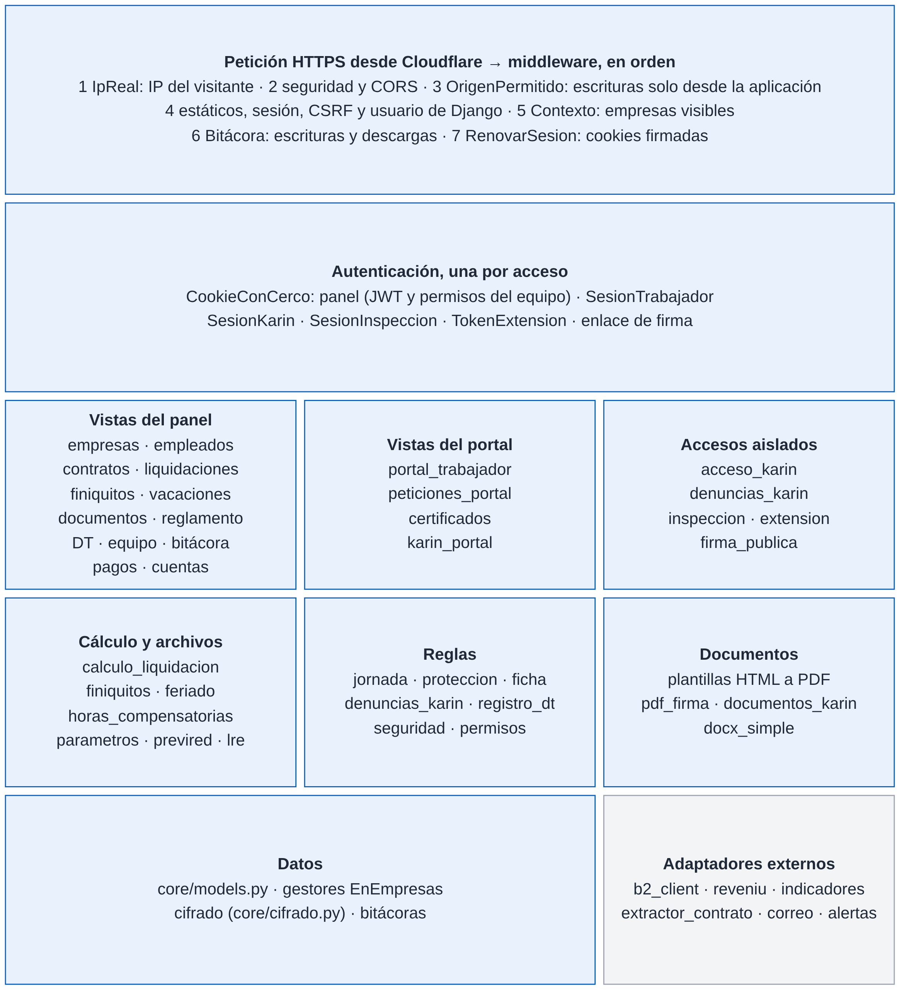{width=100%}

| Capa | Ubicación | Responsabilidad |
|---|---|---|
| Middleware | `config/settings.py` (`MIDDLEWARE`); `core/middleware.py`, `core/contexto.py`, `core/bitacora.py`, `core/sesion_inactividad.py` | Tomar la IP real del visitante, aplicar seguridad y CORS, rechazar las escrituras de otros orígenes, preparar el contexto de empresas, anotar la bitácora y renovar las cookies de sesión |
| Autenticación | `core/autenticacion.py` y una clase en el módulo de cada acceso | Identificar a quien llama según el acceso y, para el equipo, aplicar sus permisos (sección 4.7) |
| Vistas | `core/views/` (39 módulos), `core/urls.py`, `core/serializers.py` | Recibir la petición, validar, orquestar y responder; un módulo por tema |
| Reglas y cálculo | Módulos de `core/views/` y de `core/` | Cálculo de liquidaciones, finiquitos, feriado y plazos; reglas de jornada, protecciones y Ley Karin; archivos legales |
| Documentos | Plantillas en `core/templates/` y `templates/`; `core/pdf_firma.py`, `core/documentos_karin.py`, `core/docx_simple.py` | PDF desde plantillas HTML, página de certificado de firma, documentos de la Ley Karin y documentos Word |
| Datos | `core/models.py`, `core/cifrado.py`, `core/bitacora.py`, `core/karin.py` | Modelos y gestores con filtro por empresa, campos cifrados y bitácoras encadenadas |
| Adaptadores externos | `core/b2_client.py`, `core/reveniu.py`, `core/extractor_contrato.py`, `core/indicadores.py`, `core/alertas.py` | Encapsular cada servicio externo con sus tiempos máximos y su manejo de errores |

: Capas de la API

**Paquete de vistas.** Las vistas estaban en un solo archivo, `core/views.py`, hasta el 24-09-2026; hoy forman el paquete `core/views/`. Su `__init__.py` vuelve a exportar todos los nombres, así que `from core.views import X` sigue funcionando. Entre los módulos no hay importaciones circulares: los módulos base (`base`, `feriado`, `parametros`, `calculo_liquidacion`) no importan a los de cada tema. El capítulo 5 describe cada módulo.

**Aplicación web.** Sigue una estructura por páginas: una por ruta (`src/pages/`), componentes compartidos (`src/components/`, con los componentes base del diseño en `j40/`), ganchos de datos (`src/hooks/`), el cliente HTTP (`src/api/client.ts`) y utilidades (`src/utils/`). Son unas 22.000 líneas de TypeScript en 143 archivos. El capítulo 5 detalla su diseño.

## Vista dinámica: flujos principales {#sec-arq-dinamica}

Las secuencias siguientes muestran los ocho flujos que mejor explican cómo colaboran las piezas. Para que quepan en la página, las rutas de la API se abrevian con «…» cuando repiten el prefijo del paso anterior. El capítulo 7 da las rutas completas.

### Ingreso al panel y renovación de la sesión {#sec-arq-flujo-sesion}

El titular entra con su RUT y su clave. La API responde con dos cookies HttpOnly:

- el token de acceso, que vence en 5 minutos;
- el token de renovación, que vence en 15 minutos y rota en cada uso.

Ante un 401, el cliente HTTP de la aplicación web (`src/api/client.ts`) pide una sola renovación para todas las peticiones que esperan y las repite. Si la renovación falla dentro del panel, vuelve al ingreso recordando la página.

Mientras hay actividad, el componente de cierre por inactividad renueva la sesión cada 2 minutos. Tras 5 minutos sin actividad, la cierra; avisa 60 segundos antes (sección 4.7).

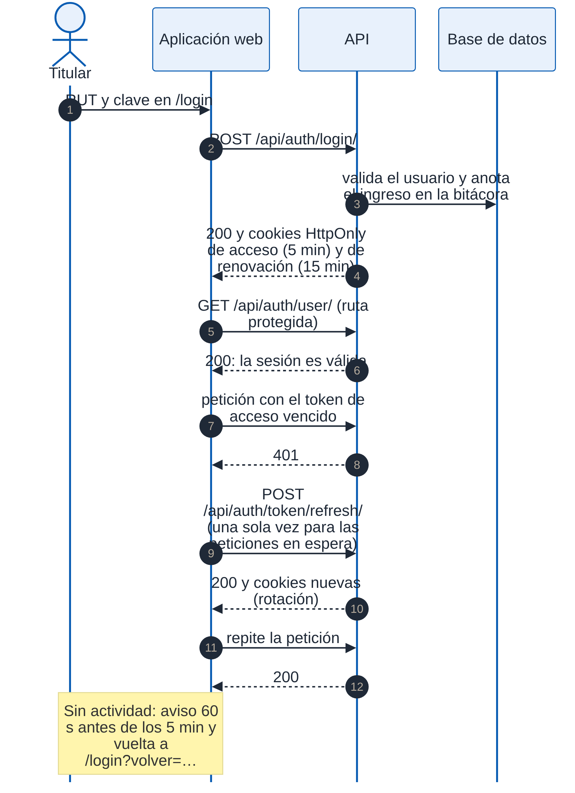{width=66%}

### Emisión de una liquidación {#sec-arq-flujo-liquidacion}

La vista previa y la emisión usan la misma función de cálculo (`_calcular_liquidacion`, en `core/views/calculo_liquidacion.py`), con los parámetros legales del período liquidado (sección 6.3). La vista previa no guarda nada; la emisión crea un registro congelado con lo que usó. La unicidad por trabajador y período la garantiza la base de datos: un segundo intento responde 409.

La emisión masiva de un período no tiene una ruta propia: la aplicación web repite la emisión por cada trabajador.

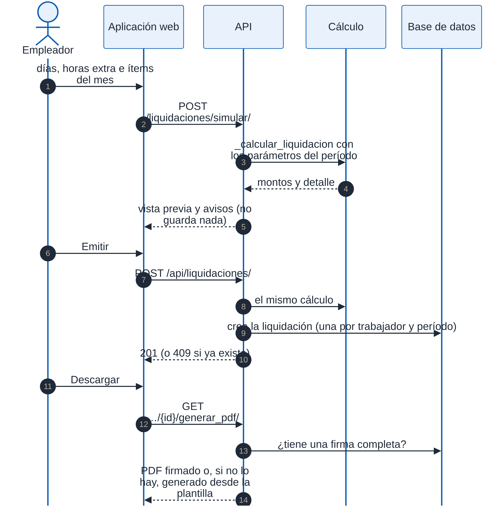{width=83%}

### Firma electrónica de un documento {#sec-arq-flujo-firma}

El flujo tiene tres tramos:

1. **Envío.** El empleador confirma su identidad con su clave; la confirmación vale 10 minutos. La API genera el PDF, lo sube a `pendientes/` y envía el enlace al trabajador. Si el correo falla, la solicitud queda creada y se puede reenviar.
2. **Identidad.** El trabajador abre el enlace y se identifica con su RUT más un código enviado a su correo, o con la clave del portal. Obtiene una sesión válida solo para esa solicitud.
3. **Firma.** El trabajador acepta el contenido y dibuja su firma. Con la solicitud bloqueada, la API:
   - asigna el folio, que es correlativo por empresa;
   - calcula las huellas SHA-256 del PDF original y del firmado;
   - agrega la página de certificado;
   - guarda el PDF firmado y borra el pendiente.

Después aplica los efectos de la firma:

- traspasa al contrato los cambios del anexo;
- cambia la modalidad si es un pacto de teletrabajo;
- registra el consentimiento electrónico si el documento lo incluye.

Si falla la generación o el guardado del PDF, la solicitud vuelve a quedar pendiente y el trabajador puede intentarlo otra vez.

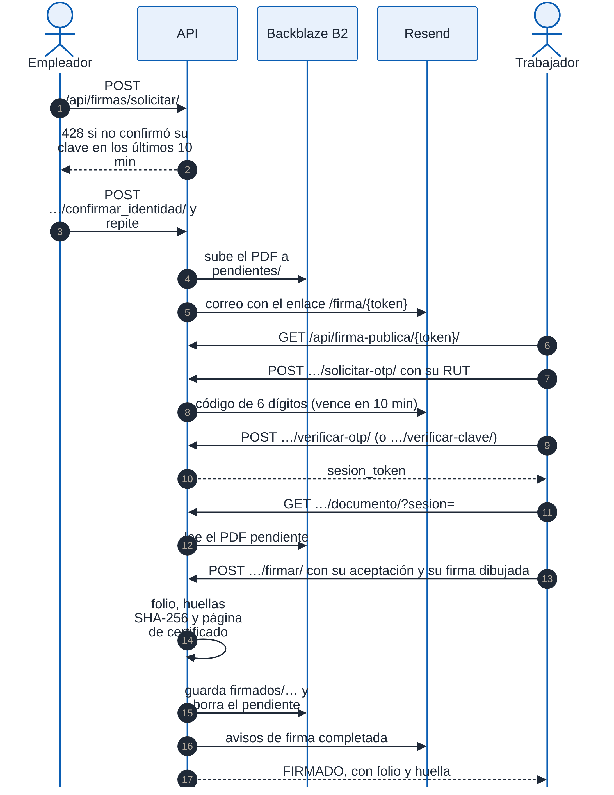{width=83%}

### Contratación de un plan y aviso de pago {#sec-arq-flujo-pago}

**Inicio del pago.** La API crea un intento de pago y, con la API de Reveniu, una suscripción que lleva el identificador del intento. Antes verifica que el plan de Reveniu cobre en el ciclo pedido, mensual o anual. La aplicación web envía al titular a Transbank con un formulario. Si la API de Reveniu falla, se usa el enlace de pago fijo del plan, con la referencia del cliente.

**Aviso de pago.** Reveniu avisa el pago a la API con un encabezado secreto, que se compara en tiempo constante. La API:

- guarda el aviso tal como llegó;
- descarta los repetidos por su orden de compra;
- reconoce al cliente por el intento, por la referencia o por la suscripción ya conocida;
- aplica el plan.

Un aviso que no puede asociar queda guardado y se avisa por correo al equipo.

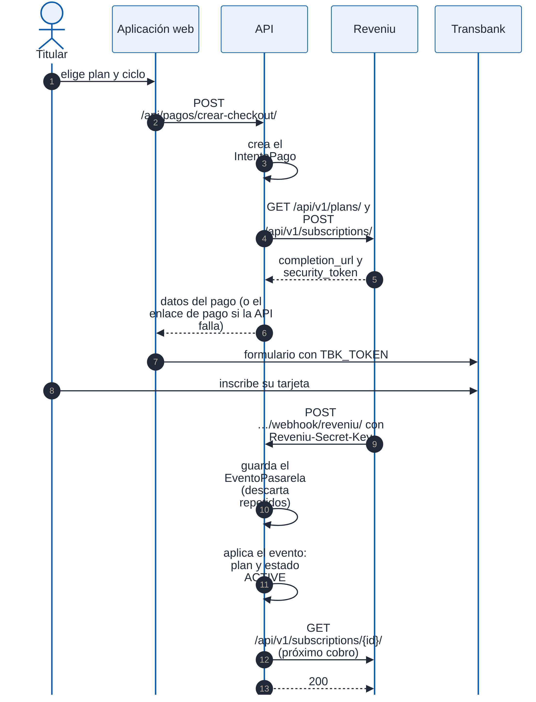{width=83%}

### Ingreso al portal del trabajador {#sec-arq-flujo-portal}

El portal tiene su propia identidad, separada de la del panel (sección 6.2.7).

1. **Clave.** Si alguna cuenta de ese RUT creó una clave, se pide la clave.
2. **Código.** Si no, se envía un código a cada correo de las fichas habilitadas. La respuesta es la misma haya o no fichas, para no revelar dónde trabaja una persona.
3. **Cuenta.** Verificar un código entra a la cuenta de quien recibe ese correo, nunca a la de otra persona con el mismo RUT.

La sesión es una cookie firmada que se renueva en cada petición y vence tras 15 minutos sin uso o a las 8 horas.

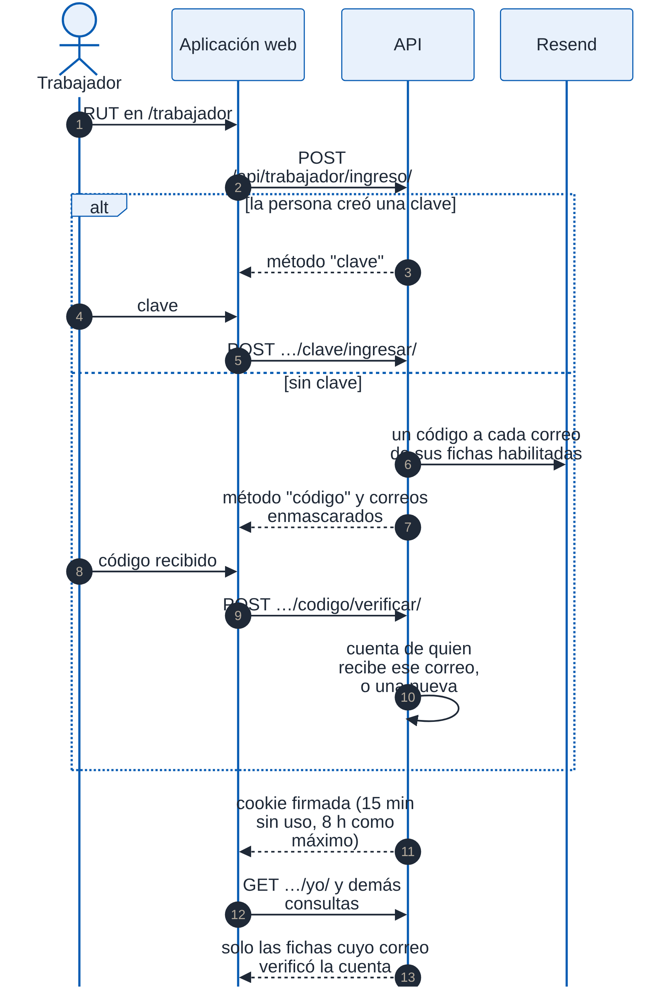{width=66%}

### Denuncia Ley Karin desde el portal {#sec-arq-flujo-karin}

El trabajador queda identificado por su sesión del portal: no hay denuncias anónimas.

**Registro.** La API valida la ficha, que la empresa tenga un encargado activo y el máximo de tres denuncias en 24 horas. Luego crea la denuncia con sus datos cifrados y anota el registro reservado. Envía un comprobante al trabajador y un aviso sin contenido al encargado.

**Atención.** El encargado entra por su propio acceso, con una cookie firmada que vence tras 5 minutos sin uso o a las 4 horas. Cada consulta de un expediente queda en el registro reservado.

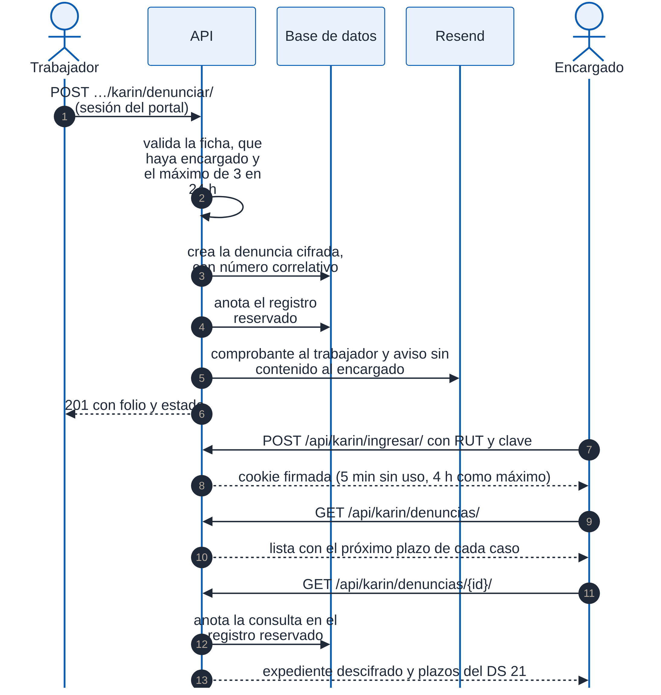{width=83%}

### Fiscalización de la Dirección del Trabajo {#sec-arq-flujo-inspeccion}

**Ingreso.** El fiscalizador se identifica con su nombre, su RUT y su correo institucional, e indica el RUT del empleador. Si la empresa usa Jornada40, recibe un código de un solo uso. La respuesta normal es la misma exista o no la empresa. Hay una excepción: un segundo pedido antes de un minuto, o una falla del correo, responde distinto solo si la empresa existe. Está registrada como hallazgo (capítulo 8).

**Consulta.** El acceso es de solo lectura. Cada ingreso, descarga, ratificación y salida queda registrado, y el empleador puede ver ese registro.

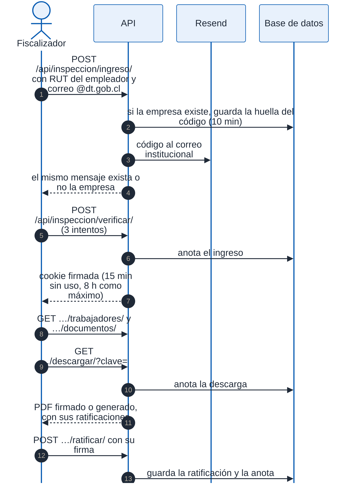{width=66%}

### Registro en Mi DT con la extensión {#sec-arq-flujo-extension}

**[Solo en staging]**

**Conexión.** La persona genera un código en el panel y lo escribe en la extensión. La API lo canjea por un token y guarda solo su huella.

**Llenado.** La extensión pide la lista de lo que hay que registrar, la ficha y los mapeos de los formularios. El script que corre dentro de Mi DT llena cada campo como lo haría la persona, para que la página lo reconozca. Si falta un campo esperado, no llena nada y avisa.

**Registro.** La persona revisa y presiona el botón de Mi DT. La extensión lee la confirmación y marca el registro en Jornada40.

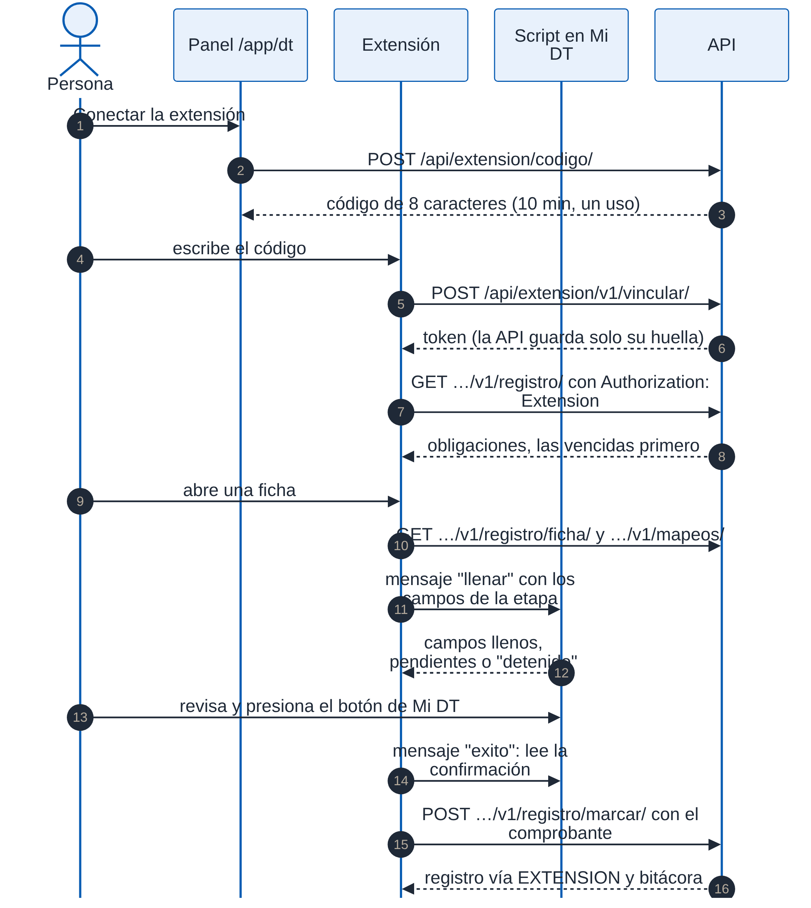{width=82%}

## Vista de despliegue {#sec-arq-despliegue}

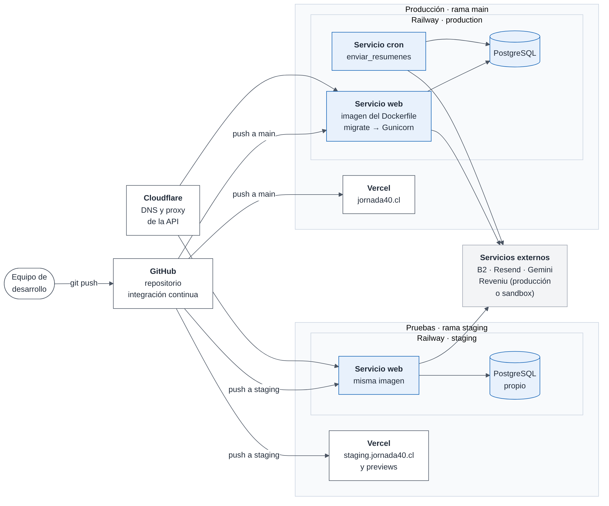{width=100%}

| Elemento | Producción | Pruebas (staging) | Desarrollo |
|---|---|---|---|
| Rama | `main` | `staging` | Cualquiera |
| Aplicación web | Vercel, `jornada40.cl` | Vercel, `staging.jornada40.cl` y vistas previas del proyecto | Vite en `localhost:5173` |
| API | Railway, ambiente `production`, `api.jornada40.cl` vía Cloudflare | Railway, ambiente `staging`; se recomienda `api-staging.jornada40.cl` | `runserver` en `127.0.0.1:8000` |
| Base de datos | PostgreSQL de Railway | PostgreSQL propio del ambiente | SQLite local |
| Pagos | Reveniu de producción | Reveniu de pruebas (sandbox) | — |
| Tarea programada | Servicio cron diario, 12:00 UTC | Opcional | Comando manual |
| Detección del ambiente | `RAILWAY_ENVIRONMENT_NAME=production` | Cualquier otro valor | Variable ausente: `DEBUG` activo |

: Ambientes

**Construcción de la API.** La imagen se construye con el Dockerfile de `backend/`, sobre Python 3.11, e incluye los estáticos. Al arrancar el contenedor:

1. aplica las migraciones;
2. crea el superusuario si se configuró;
3. inicia Gunicorn con 2 procesos de 4 hilos y un tiempo máximo de 60 segundos por petición.

Si la migración falla, el contenedor se detiene y Gunicorn no arranca: un despliegue no atiende con el esquema a medio aplicar. **[Solo en staging]** Esta regla se corrigió el 12-10-2026; la orden que corre en producción todavía arranca Gunicorn aunque la migración falle (capítulo 12).

**Publicación.** Railway y Vercel despliegan solos al recibir un cambio en `main` (producción) o en `staging` (pruebas). La integración continua de GitHub corre en paralelo y no condiciona el despliegue. Por eso la práctica es integrar en `staging`, revisar ahí y solo después publicar en `main` (capítulo 12).

**Escalamiento.** Hoy corre un contenedor de la API. El diseño admite más, porque el servidor no guarda estado entre peticiones (sección 4.1), con dos salvedades:

- los límites de intentos y la caché de indicadores son locales a cada proceso;
- la tarea programada debe seguir siendo una sola, para no repetir los resúmenes.

## Conceptos transversales {#sec-arq-transversales}

### Identidad y sesiones

Cada acceso tiene su propio mecanismo, resumido en la sección 2.2 y detallado en el capítulo 8:

| Acceso | Clase de autenticación | Credencial que viaja | Vencimiento |
|---|---|---|---|
| Panel: titular y equipo | `CookieConCerco` | JWT en cookies HttpOnly | 5 min el acceso; 15 min la renovación, que rota |
| Portal del trabajador | `SesionTrabajador` | Cookie firmada `jornada40-trabajador` | 15 min sin uso, 8 h como máximo |
| Ley Karin | `SesionKarin` | Cookie firmada `jornada40-karin` | 5 min sin uso, 4 h como máximo |
| Fiscalización | `SesionInspeccion` | Cookie firmada `jornada40-inspeccion` | 15 min sin uso, 8 h como máximo |
| Extensión | `TokenExtension` | `Authorization: Extension <token>` | 90 días sin uso, o hasta que se desconecta |
| Firma por enlace | Sin clase: token de la solicitud y sesión de firma | Token en la ruta y `sesion` en la petición | Vencimiento de la solicitud |
| Confirmación de identidad del empleador | Cookie firmada `jornada40-confirmacion` | Se exige para enviar a firma (respuesta 428 sin ella) | 10 min |

: Mecanismos de sesión por acceso

**Cookies firmadas.** Las cookies firmadas usan la firma de Django con una sal propia de cada acceso. El middleware `RenovarSesionMiddleware` las vuelve a firmar en cada petición autenticada, así que vencen por inactividad; además guardan la hora de ingreso, que fija el tope absoluto.

**Escrituras solo desde la aplicación (CSRF).** **[Solo en staging]** La autenticación del panel no verifica un token anti-CSRF, así que la protección está en dos capas:

- **Revisión del origen.** El middleware `OrigenPermitidoMiddleware` (`core/middleware.py`) responde 403 a toda petición POST, PUT, PATCH o DELETE a la API cuyo encabezado `Origin` no sea un origen de la aplicación ni la propia API. Sin `Origin`, revisa `Referer`; sin ninguno de los dos, la petición no viene de una página web y sigue. Rechaza también el origen `null`, el de un iframe aislado. Quedan fuera el aviso de pago de Reveniu y la extensión, que no usan cookies.
- **Cookies `SameSite`.** En producción, la aplicación y la API son el mismo sitio, y las cookies de sesión van con `SameSite=Lax`: el navegador no las envía en peticiones que nacen en otro sitio. En staging van con `SameSite=None`, porque las vistas previas de Vercel y el dominio de Railway son otros sitios; ahí protege la revisión del origen.

Además, las vistas del portal, de la Ley Karin, de la fiscalización y de la extensión solo aceptan JSON. Este control corrige el hallazgo de la versión 0.3 del documento (capítulo 8). La prueba `test_csrf` lo comprueba.

### Aislamiento de los datos

Cada cuenta ve solo sus datos, en dos niveles:

1. **Filtro por dueño.** Las vistas del panel filtran por el usuario titular, por ejemplo `empresa__owner=request.user`.
2. **Cerco del equipo.** Para un usuario del equipo, la autenticación (`CookieConCerco`) hace cuatro cosas:
   - clasifica la ruta en un módulo y exige el permiso de ver o de gestionar;
   - deja `request.user` como el titular, para que el filtro por dueño siga valiendo;
   - guarda a la persona en `request.actor`;
   - fija sus empresas en una variable de contexto (`core/contexto.py`).

Los gestores `EnEmpresas` de 18 modelos filtran por esas empresas en toda consulta. El middleware de contexto las borra antes y después de cada petición. Una ruta nueva queda cerrada para el equipo hasta que se asigna a un módulo; la prueba `test_permisos_equipo` recorre todas las rutas para comprobarlo.

### Auditoría

Hay tres registros, cada uno con su alcance:

- **La bitácora del panel** (`BitacoraMiddleware`) anota toda escritura y toda descarga del panel: quién actuó, empresa, ruta, IP y resultado. Nunca anota los datos enviados.
- **El registro reservado de la Ley Karin** anota la actividad del encargado y del portal sobre las denuncias, con el folio y sin contenido.
- **El registro de fiscalización** anota los ingresos, descargas, ratificaciones y salidas de los fiscalizadores.

Las dos primeras están encadenadas con huellas SHA-256 (sección 6.4.4).

### Errores, registros de ejecución y alertas

- **Respuesta al usuario.** Ante una excepción inesperada, las vistas llaman a `error_interno()` (`core/views/base.py`). Esa función anota la traza completa en el registro de ejecución y responde un mensaje genérico; el texto de la excepción nunca llega al usuario.
- **Registro de ejecución.** Va a la salida estándar del contenedor, que Railway conserva. En los ambientes desplegados se anota desde el nivel WARNING.
- **Alertas.** Cada error anotado con su excepción envía además un correo al equipo (`core/alertas.py`). El correo lleva la ruta, el tipo de error y la traza del código, sin el texto de la excepción ni datos personales. Se agrupan los errores repetidos y hay un máximo por hora.
- **Aplicación web.** Distingue el 401 y el 403, que llevan al ingreso, de los demás errores, para los que muestra un reintento sin cerrar la sesión. Si después de un despliegue falta un archivo de la aplicación, la página se recarga una vez y, si no basta, ofrece «Recargar» (`utils/cargaDiferida.ts`).

### Configuración y ambientes

**Variables de entorno.** La configuración se lee con `python-decouple`. La presencia de `RAILWAY_ENVIRONMENT_NAME` marca un ambiente desplegado; su valor `production` distingue producción de pruebas. De ahí dependen:

- `DEBUG`, que solo se activa en desarrollo;
- los dominios permitidos y los orígenes de CORS;
- el atributo `SameSite` de las cookies;
- HSTS, que solo se activa en producción;
- el almacenamiento en B2;
- las alertas.

El capítulo 12 y el anexo G listan todas las variables.

**Interfaz.** En la aplicación web, `VITE_API_URL` apunta a la API. `VITE_ENTORNO=staging` muestra la etiqueta «Pruebas» y evita la indexación, y `VITE_EXTENSION_MIDT=1` muestra la tarjeta de la extensión.

### Tiempo, idioma y formato

El servidor usa `es-cl` y la zona `America/Santiago`, con fechas conscientes de la zona horaria (`USE_TZ`): se guardan en UTC y se muestran en hora de Chile. La aplicación web formatea con los auxiliares de `src/utils/formato.ts`. Todo texto visible está en español de Chile.

### Concurrencia

**Base de datos.** Las secuencias se protegen con bloqueos de fila (`select_for_update`) dentro de transacciones (sección 6.4.3). Las restricciones de unicidad resuelven los choques restantes; por ejemplo, la segunda liquidación del mismo período responde 409.

**SQLite.** En desarrollo y en las pruebas de navegador, SQLite trabaja en modo WAL, con transacciones inmediatas y una espera de 30 segundos. Así las escrituras simultáneas esperan su turno en vez de fallar.

### Caché y límites de intentos

**Caché.** No hay un servicio de caché configurado, así que Django usa una caché en memoria de cada proceso. Ahí viven la UF y la UTM (6 horas), los contadores de los límites de intentos y la agrupación de alertas.

**Límites de intentos.** Con dos procesos de Gunicorn, cada proceso cuenta por separado: el límite efectivo puede llegar al doble del configurado. Este hallazgo se trata en el capítulo 8, con la opción de una caché compartida. Los límites que más importan para la seguridad no dependen de la caché, porque cuentan en la base de datos: los intentos de los códigos y de la clave de firma.

### Correo

Los correos salen por Resend mediante django-anymail, con remitente `DEFAULT_FROM_EMAIL`. Se arman con plantillas HTML y una versión en texto simple (capítulo 7). Cuando un correo falla, la regla es informar sin perder lo hecho:

- una solicitud de firma queda pendiente y el panel dice que el correo no salió;
- un código que no se pudo enviar se descarta y se pide de nuevo.

### Documentos

- **PDF.** Se generan en el servidor desde plantillas HTML con xhtml2pdf; reportlab dibuja la página de certificado de firma y los códigos QR, y pypdf une documentos (ADR-07).
- **Word.** Se arman sin dependencias externas (`core/docx_simple.py`).
- **Versión que se entrega.** La firmada siempre manda (sección 6.6).

## Decisiones de arquitectura {#sec-arq-decisiones}

El registro siguiente reúne las decisiones que dan forma al sistema, con su contexto y sus consecuencias. La columna «Desde» indica la fecha en que la decisión aparece en el historial del repositorio, que parte el 13-02-2026. Todas están vigentes.

| Código | Decisión y contexto | Consecuencias | Desde |
|---|---|---|---|
| ADR-01 | **Aplicación web separada de la API.** Una aplicación de una sola página en Vercel y una API REST en Railway, en dominios propios. | • Cada parte se despliega por separado.  • Las cookies deben viajar entre orígenes, con CORS y credenciales.  • Vercel no tiene proxy: la aplicación llama a la API por su dominio. | 13-02-2026 |
| ADR-02 | **Monolito modular en Django**, con una sola aplicación (`core`) dividida por temas. El equipo es pequeño y el dominio es uno solo: la relación laboral. | • Un solo despliegue y una sola base.  • Sin llamadas entre servicios.  • La separación por temas depende de la disciplina del código: paquete de vistas desde el 24-09-2026. | 13-02-2026 |
| ADR-03 | **Sesión del panel con JWT en cookies HttpOnly**, no en el almacenamiento del navegador. Los tiempos son cortos (5 y 15 min) y el token de renovación rota. | • Un script en la página no puede leer el token.  • Requiere renovar con frecuencia y cerrar por inactividad.  • Requiere una protección propia contra peticiones de otros sitios (ADR-21). | 13-02-2026 |
| ADR-04 | **Todo cálculo legal en el servidor.** La interfaz solo muestra, también en las vistas previas. Los montos legales no se aceptan del navegador. | • Un solo lugar para cada regla, probado en el servidor.  • Cada vista previa es una petición. | 23-09-2026 |
| ADR-05 | **Advertir, no bloquear.** Lo que contraviene una norma se avisa; solo se impide lo que la ley prohíbe o lo que invalidaría un documento o un archivo oficial. | • La decisión queda en el empleador.  • Cada aviso debe ser claro y estar en el lugar de la acción. | 23-09-2026 |
| ADR-06 | **Parámetros legales en tablas versionadas por vigencia**, mantenidas por Jornada40 en el administrador. Lo leído de Previred queda como propuesta hasta que una persona lo confirma. | • Recalcular un período antiguo usa sus valores.  • Una actualización no requiere desplegar.  • Depende de que alguien cargue cada reajuste a tiempo. | 22-09-2026 |
| ADR-07 | **PDF generados en el servidor desde plantillas HTML**, al momento de pedirlos. Solo se guarda la versión firmada. | • Lo que no está firmado siempre refleja los datos actuales.  • La generación ocupa tiempo de la petición, con un máximo de 60 s por petición. | 07-03-2026 |
| ADR-08 | **Firma electrónica simple propia**: identidad verificada con código o clave, aceptación expresa, firma dibujada, huellas y página de certificado. La firma avanzada queda como paso futuro (sección 2.5). | • Cumple el criterio de la DT para la firma simple.  • No tiene poder liberatorio para el finiquito.  • No depende de un proveedor acreditado. | 25-04-2026 |
| ADR-09 | **Almacenamiento de objetos (B2)** para documentos firmados y archivos, porque el disco del contenedor no es persistente. | • Los firmados sobreviven a cada despliegue.  • Firmar depende de que B2 responda. | 25-04-2026 |
| ADR-10 | **Accesos separados, cada uno con su sesión**: portal, fiscalización, Ley Karin y extensión, fuera del JWT del panel. | • Una sesión no abre otro acceso.  • Cada acceso tiene su propia superficie que proteger y probar. | 28-09-2026 |
| ADR-11 | **Cerco del equipo en la autenticación y filtro por empresa en los gestores** de los modelos, en vez de verificar en cada vista. | • Una vista nueva queda protegida por omisión.  • Depende de la variable de contexto, que se limpia en cada petición. | 30-09-2026 |
| ADR-12 | **Bitácora inalterable encadenada con SHA-256**, con copias verificables por código. | • Hace evidente una alteración.  • Crece sin límite: se conserva al menos 5 años. | 30-09-2026 |
| ADR-13 | **Cifrado de campo con Fernet para la Ley Karin**, con claves rotables. | • Reserva aun ante una copia de la base.  • No se puede buscar por contenido.  • Perder la clave pierde los datos. | 01-10-2026 |
| ADR-14 | **Pagos con la API de Reveniu y respaldo en el enlace de pago**, con avisos que se aplican una sola vez. | • El pago se asocia solo a la cuenta.  • Si la API falla, el pago sigue por el enlace, pero puede llegar sin asociar y requerir trabajo manual. | 25-09-2026 |
| ADR-15 | **Mi DT sin API: fichas para copiar y una extensión** que llena los formularios en el navegador, sin enviarlos. | • La persona mantiene el control y su Clave Única.  • Un cambio en Mi DT exige actualizar los mapeos. | 09-10-2026 |
| ADR-16 | **Ambiente de pruebas separado**, en Railway y Vercel desde la rama `staging`, con base y pagos de pruebas. | • Se prueba sin tocar producción.  • Requiere mantener dos juegos de variables. | 18-04-2026 |
| ADR-17 | **IP del visitante desde `X-Real-IP` de Railway**, no desde `X-Forwarded-For`, que trae la IP de Cloudflare. | • Los límites y la auditoría usan la IP real.  • Depende de cómo Railway arme el encabezado (verificado el 24-09-2026). | 24-09-2026 |
| ADR-18 | **Lectura de contratos con Gemini**, filtrando la respuesta a los campos esperados y descartando un RUT inválido. | • Prellena el editor, pero la persona confirma.  • Envía el contrato a un tercero (capítulo 9). | 28-04-2026 |
| ADR-19 | **Pruebas sin internet**: los servicios externos se simulan y toda salida real falla. | • Las pruebas son repetibles.  • Las integraciones reales se verifican a mano en el ambiente de pruebas. | 11-10-2026 |
| ADR-20 | **Alertas de errores por correo, sin servicios de terceros**, y sin datos personales. | • Monitoreo básico sin costo.  • No hay panel de errores ni métricas (capítulo 12). | 11-10-2026 |
| ADR-21 | **Escrituras en la API solo desde los orígenes propios**, revisando `Origin` y `Referer`, más cookies `SameSite=Lax` en producción. Se prefirió a un token anti-CSRF, que la aplicación tendría que leer desde otro dominio. | • Cierra la falsificación de peticiones entre sitios en todos los accesos.  • Una copia del sitio en otro dominio no puede usar la API.  • Cada origen nuevo de la aplicación se agrega a la configuración. | 12-10-2026 |

: Registro de decisiones de arquitectura
