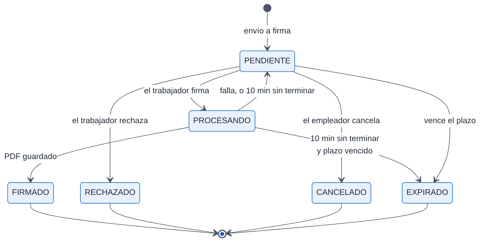
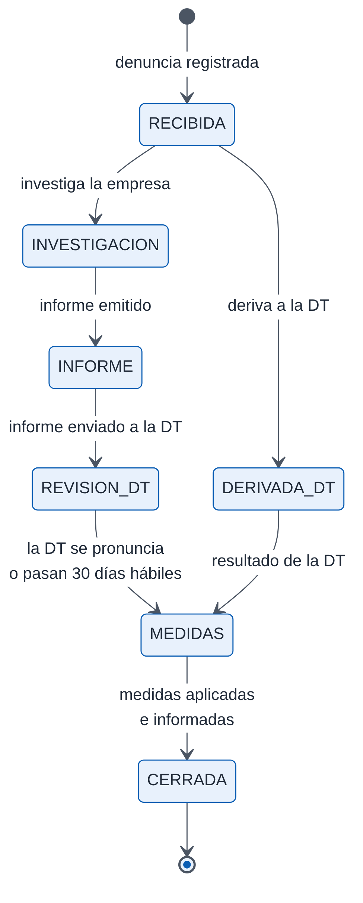
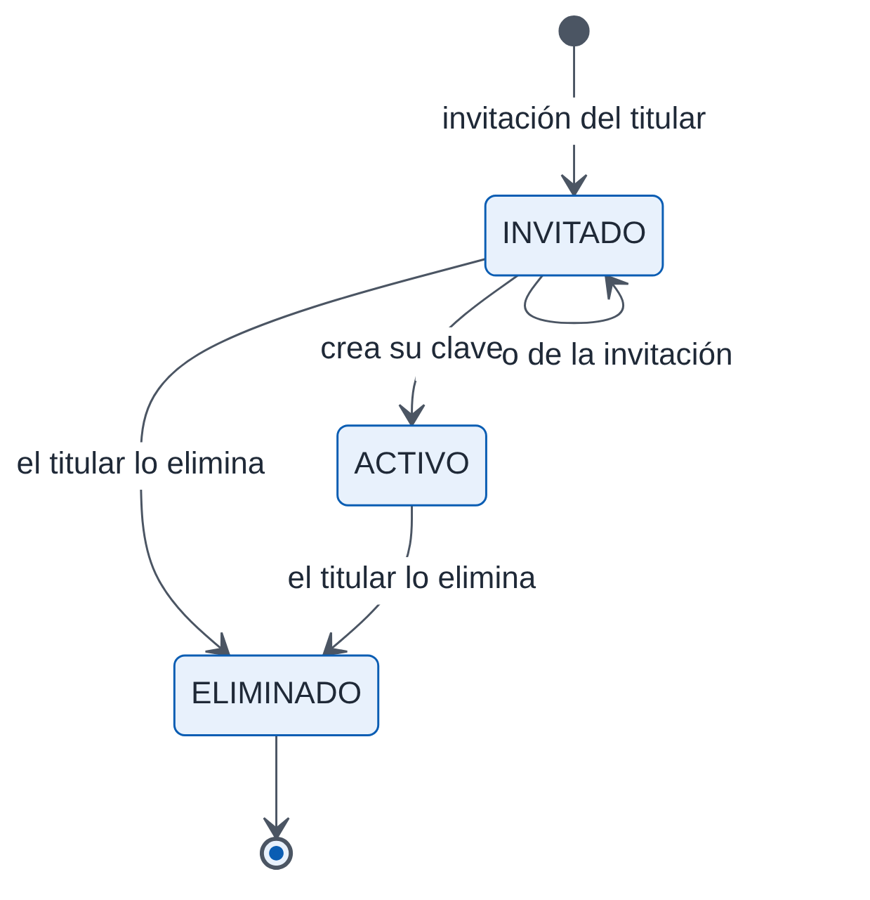

# Diseño detallado {#sec-diseno}

Este capítulo describe el diseño de cada parte del sistema, siguiendo los puntos de vista de IEEE 1016:

- **Composición:** qué módulos hay y qué hace cada uno (secciones 5.1 a 5.3).
- **Dinámica de estados:** cómo cambian los registros principales (sección 5.4).
- **Algoritmos:** cómo se organizan los cálculos (sección 5.5).

Las reglas legales que aplican esos cálculos están en el capítulo 3; aquí se citan por su código.

## Servidor {#sec-dis-servidor}

### Módulos de vistas {#sec-dis-vistas}

Las vistas están en el paquete `backend/core/views/`, con un módulo por tema. Los cuatro primeros de la tabla son la base: los demás los usan, y ellos no importan a los demás.

| Área | Módulo | Responsabilidad |
|---|---|---|
| Base | `base` | Límites de intentos, plan activo y cupos, fechas, respuestas PDF, contexto de los contratos y la respuesta de error genérica |
| Base | `feriado` | Feriados de Chile, días hábiles y saldo de vacaciones (Arts. 67 a 70) |
| Base | `parametros` | Parámetros previsionales por período, tasas de AFP, asignación familiar e indicadores del día |
| Base | `calculo_liquidacion` | Cálculo de la liquidación, conceptos, comisiones y PDF de la liquidación |
| Remuneraciones | `liquidaciones` | Emisión, edición, PDF, avisos del período, libro, consolidado y exportaciones |
| Remuneraciones | `conceptos` | Catálogo de haberes y descuentos de cada empresa |
| Remuneraciones | `horas_compensatorias` | Horas extra compensadas con descanso: bolsa, vencimientos y efecto en la liquidación y el finiquito |
| Remuneraciones | `indemnizacion` | Aporte a la indemnización a todo evento |
| Archivos legales | `previred` | Archivo Previred de 105 campos |
| Archivos legales | `lre` | Libro de Remuneraciones Electrónico |
| Archivos legales | `certificado_sueldos` | Certificado N°6 del SII y resumen para la DJ 1887 |
| Trabajadores | `empresas` | Empresas del cliente |
| Trabajadores | `empleados` | Fichas de trabajadores y carga masiva desde planilla |
| Trabajadores | `contratos` | Contratos, evaluación de jornada y anexos |
| Trabajadores | `catalogos` | Listas cerradas de la ficha (bancos, cuidados, fueros) |
| Trabajadores | `conciliacion` | Solicitudes de conciliación de trabajadores con responsabilidades de cuidado |
| Documentos | `documentos` | Cartas: amonestaciones, constancias y cartas de término |
| Documentos | `documentos_laborales` | Pactos, autorizaciones y constancias desde datos estructurados |
| Documentos | `vacaciones` | Registro de vacaciones y permisos |
| Documentos | `finiquitos` | Cálculo del finiquito, PDF y ratificación |
| Documentos | `reglamento` | Plantilla guía por rubro, versiones, plazos y entrega del reglamento interno |
| Documentos | `ley_karin` | Aviso semestral de los canales de denuncia |
| Firma | `firmas` | Solicitudes de firma del empleador y confirmación de su identidad |
| Firma | `firma_publica` | Flujo público del trabajador: identidad, documento, firma y rechazo |
| Dirección del Trabajo | `direccion_trabajo` | Obligaciones de registro en Mi DT, fichas y anexos de consentimiento |
| Dirección del Trabajo | `inspeccion` | Portal de fiscalización |
| Dirección del Trabajo | `extension` | Conexión y servicios de la extensión para Mi DT [Solo en staging] |
| Portal | `portal_trabajador` | Ingreso, sesión y consultas del portal; estado del portal en la ficha |
| Portal | `peticiones_portal` | Peticiones de vacaciones, permisos y conciliación, y su respuesta |
| Portal | `solicitudes_documento` | Documentos pedidos por el trabajador y su atención en el panel |
| Portal | `certificados` | Certificados emitidos por el trabajador y su verificación pública |
| Portal | `karin_portal` | Denuncias y casos de la Ley Karin vistos desde el portal |
| Ley Karin | `acceso_karin` | Encargados de denuncias: designación, ingreso y sesión propia |
| Ley Karin | `denuncias_karin` | Expedientes de las denuncias |
| Cuenta | `cuentas` | Ingreso, registro, recuperación por RUT, perfil y diagnóstico de red |
| Cuenta | `equipo` | Usuarios del equipo: administración e ingreso por su propia puerta |
| Cuenta | `bitacora` | Consulta, verificación y copia de la bitácora |
| Cuenta | `suscripciones` | Planes, suscripción y pagos con Reveniu |
| Cuenta | `resumen` | Resumen por correo del empleador y de su equipo |

: Módulos de vistas del servidor

### Módulos de reglas, utilidades y adaptadores {#sec-dis-modulos}

Fuera del paquete de vistas, `backend/core/` reúne las piezas que no responden peticiones:

| Tipo | Módulo | Responsabilidad |
|---|---|---|
| Reglas | `jornada.py` | Jornada máxima vigente y avisos de incumplimiento (RN-CON-01 y RN-CON-02) |
| Reglas | `proteccion.py` | Cuidados, hijo con enfermedad grave y fueros: avisos |
| Reglas | `ficha.py` | Datos que faltan para un contrato completo |
| Reglas | `denuncias_karin.py` | Procedimiento de la Ley Karin: validación, plazos, estados, avisos y vista por rol |
| Reglas | `registro_dt.py` | Registro electrónico laboral: plazos, tablas oficiales y archivo masivo |
| Reglas | `lre.py` | Tablas y columnas del Libro de Remuneraciones Electrónico |
| Reglas | `permisos.py` | Módulos del panel, rutas por módulo y cupos de usuarios |
| Catálogos | `bancos.py`, `seguridad.py`, `direcciones.py`, `rut.py` | Listas cerradas de bancos y de seguridad laboral; direcciones por partes; RUT |
| Documentos | `pdf_firma.py`, `documentos_karin.py`, `docx_simple.py`, `reglamento_plantilla.py` | Certificado de firma, documentos de la Ley Karin, Word mínimo, plantilla del reglamento |
| Seguridad | `autenticacion.py`, `contexto.py`, `sesion_inactividad.py`, `cifrado.py`, `bitacora.py`, `karin.py`, `middleware.py` | Cerco del equipo, empresas visibles, cookies firmadas, cifrado, bitácoras e IP real |
| Adaptadores | `b2_client.py`, `reveniu.py`, `extractor_contrato.py`, `indicadores.py`, `alertas.py` | B2, Reveniu, Gemini, UF y UTM, y alertas por correo |
| Datos | `models.py`, `serializers.py`, `admin.py`, `urls.py` | Modelos, serializadores, administrador y rutas |

: Otros módulos del servidor

### Patrones de las vistas {#sec-dis-patrones}

**Recursos del panel.** Usan `ViewSet` de Django REST Framework, registrados en un enrutador. Su consulta base filtra por el dueño de la cuenta, y las operaciones que no son de lectura o escritura simple son acciones con `@action`. Por ejemplo:

- `POST /api/liquidaciones/simular/`;
- `POST /api/firmas/solicitar/`;
- `POST /api/finiquitos/{id}/registrar_ratificacion/`.

**Accesos aislados.** Usan funciones con decoradores que fijan su autenticación, sus permisos, sus límites de intentos y sus formatos de entrada. El portal, la Ley Karin y la fiscalización definen dos envoltorios:

- `_publica`, para los pasos de ingreso, con un límite por IP;
- `_con_sesion`, para lo demás, con la clase de sesión del acceso y un límite por cuenta.

La extensión usa uno propio, `_de_la_extension`, con su token. Todos aceptan solo JSON.

**Plan.** Las funciones que dependen del plan consultan su nivel con `_plan_permite`, nunca el nombre del plan. Antes de agregar un trabajador se verifica el cupo (`_exigir_cupo_trabajador`, RN-PAG-01).

**Confirmación de identidad.** Enviar documentos a firma exige que el empleador haya confirmado su clave en los últimos 10 minutos (`confirmacion_vigente` en `core/views/firmas.py`); si no, la vista responde 428.

**Respuestas de error.** Los errores esperables responden `{"error": "…"}` con un mensaje para la persona; los inesperados pasan por `error_interno()` (sección 4.7). El capítulo 7 lista los códigos de estado.

### Documentos {#sec-dis-documentos}

Cada tipo de documento tiene una sola función que produce su PDF. La usan la descarga, el envío a firma y los archivos ZIP.

| Documento | Función | Plantilla |
|---|---|---|
| Contrato y anexo de 40 horas | `_generar_pdf_firma` (`firmas`) y la descarga en `contratos` | `contrato_trabajo.html`, `anexo_40h.html` |
| Anexo de contrato | `pdf_anexo_contrato` (`documentos`) | `anexo_contrato.html` |
| Carta | `pdf_documento_legal` (`documentos`) | `documento_legal.html`, `carta_despido.html` |
| Liquidación | `_pdf_liquidacion` (`calculo_liquidacion`) | `liquidacion.html` |
| Comprobante de vacaciones | `pdf_vacacion` (`vacaciones`) | `comprobante_vacaciones.html` |
| Finiquito | `pdf_finiquito` (`finiquitos`) | HTML armado en `html_finiquito` |
| Pacto, autorización o constancia | `pdf_documento_laboral` (`documentos_laborales`) | `documento_laboral.html`; la constancia del reglamento agrega el PDF subido |
| Certificado del portal | `certificados` | `certificado.html`, con código QR |
| Certificado N°6 | `certificado_sueldos` | `certificado_sueldos.html` |
| Documentos de la Ley Karin | `core/documentos_karin.py` | `karin_documento.html` |
| Copia de la bitácora | `bitacora` | `bitacora.html` |

: Generación de documentos PDF

Antes de generar un documento, la descarga busca su versión firmada (`pdf_firmado` en `core/views/base.py`). Si la hay, entrega esa, con el encabezado `X-Documento-Firmado` y un nombre terminado en `_firmado.pdf`.

### Comandos de administración {#sec-dis-comandos}

| Comando | Uso |
|---|---|
| `enviar_resumenes` | Resúmenes por correo del día y avisos de plazos a los encargados Ley Karin. Lo ejecuta el servicio cron; se puede repetir el mismo día sin duplicar envíos |
| `sincronizar_previred` | Lee los indicadores de Previred y crea una propuesta de parámetros sin confirmar |
| `estado_indicadores` | Informa si se calcula con parámetros sin confirmar o antiguos, o con UF y UTM de respaldo |
| `revisar_topes_imponibles` | Detecta, y con `--aplicar` recalcula, liquidaciones emitidas sin el tope imponible. No toca las firmadas |
| `rotar_cifrado` | Vuelve a cifrar los datos reservados con la clave actual |

: Comandos de administración

### Administrador de Django {#sec-dis-admin}

El administrador (`/admin` en el dominio de la API) es la herramienta interna del equipo de Jornada40. Registra 26 modelos.

- **Mantención:** parámetros, tasas, tramos, factores, períodos escolares, planes y conceptos del sistema.
- **Soporte:** clientes, empresas, fichas, contratos y anexos.
- **Pagos:** al elegir cliente y plan en un aviso de pago sin asociar y guardarlo, se aplica el aviso.
- **Consulta:**
  - la bitácora del panel, que es de solo lectura;
  - el registro de fiscalización;
  - las copias de la bitácora;
  - los dispositivos y los levantamientos de la extensión. Los levantamientos se pueden descargar en JSON.

Los modelos de la Ley Karin y los usuarios del equipo no están registrados en el administrador.

## Aplicación web {#sec-dis-web}

### Estructura {#sec-dis-web-estructura}

| Carpeta | Archivos | Contenido |
|---|---|---|
| `src/pages/sitio` | 15 | Sitio público e ingresos: inicio, ingreso, registro, recuperación, firma, verificación, fiscalización, ingresos del equipo y de la Ley Karin |
| `src/pages/app` | 18 | Panel del empleador, una página por ruta |
| `src/pages/trabajador` | 9 | Portal del trabajador |
| `src/pages/karin` | 3 | Acceso del encargado Ley Karin |
| `src/components/app` | 35 | Piezas del panel: estructura, cajones de edición, carpeta del trabajador, remuneraciones |
| `src/components/j40` | 16 | Sistema de diseño: botones, campos (RUT, código, contraseña), tarjetas, cajones, modales, panel de firma y cierre por inactividad |
| `src/components/sitio`, `trabajador`, `karin`, `firma` | 13 | Piezas de cada sección |
| `src/hooks` | 9 | Consultas y permisos: panel, portal, remuneraciones, catálogos, planes, avisos de jornada, borradores, tema |
| `src/api` | 6 | Cliente HTTP y funciones de descarga, pagos, portal e inspección |
| `src/utils` | 13 | Funciones puras: RUT, formatos, Ley 40 horas, contraseñas, carga diferida, actividad, borradores |
| `src/context` | 3 | Sesión (`AuthContext`) y tema |

: Estructura de la aplicación web

### Rutas y protección {#sec-dis-web-rutas}

`src/App.tsx` define 57 rutas, incluidas las redirecciones de direcciones antiguas.

- **Panel (`/app/…`):** las protege `ProtectedRoute`, que consulta `GET /api/auth/user/`. Solo un 401 o un 403 llevan al ingreso; cualquier otro error muestra una pantalla para reintentar, sin cerrar la sesión.
- **Permisos dentro del panel:** cada ruta se envuelve en `ConPermiso`, que indica si es solo del titular, qué módulos exige y si exige gestionar. El servidor decide; la interfaz solo evita mostrar lo que respondería 403.
- **Portal, Ley Karin y fiscalización:** verifican su propia sesión (`…/yo/`) y tienen su propia estructura de página.

Cada página se carga al visitarla con `diferida()` (`src/utils/cargaDiferida.ts`), una envoltura de `lazy`. Si un despliegue dejó sin archivos a una pestaña abierta antes, recarga una vez (como máximo cada 10 s); si no basta, muestra «Recargar» en vez de una página en blanco.

### Estado y datos {#sec-dis-web-estado}

**Datos del servidor.** Se piden con TanStack Query, sin una biblioteca de estado global. Los ganchos de `src/hooks/` agrupan las consultas de cada área, por ejemplo `usePanel` y `usePortal`, y las habilitan según los permisos (`usePermisos`).

**Estado de la sesión.** `AuthContext` guarda la sesión del panel: usuario, ingreso del titular y del equipo, y salida. El ingreso y la salida limpian la caché de consultas.

**Estado local.** El resto vive en cada componente.

**Borradores.** El editor de contratos y el cajón de la liquidación guardan un borrador local por usuario, durante 24 horas (`useBorrador`). Así, un cierre por inactividad no pierde el trabajo. Nunca se guardan borradores de la Ley Karin.

### Cliente HTTP {#sec-dis-web-cliente}

`src/api/client.ts` crea una instancia de Axios con la dirección de la API (`VITE_API_URL`) y `withCredentials`, para que viajen las cookies. Sus interceptores:

- **401:** pide una renovación compartida y repite la petición una vez (sección 4.5.1). No lo hace en las rutas de los accesos con sesión propia ni en las de ingreso.
- **428 con `confirmar_identidad`:** abre el modal de confirmación de clave y repite la petición una vez.
- **403 con `detail`:** copia el mensaje a `error`, el campo que leen las pantallas.

### Sistema de diseño y accesibilidad {#sec-dis-web-diseno}

**Componentes y tema.** Los componentes base están en `src/components/j40/` y los colores, en variables de `src/styles/j40.css`. El tema claro u oscuro se aplica con el atributo `data-j40`. Los estilos usan Tailwind CSS 4; los íconos, Lucide.

**Pensado para personas mayores.** Muchos titulares son dueños de pymes con poca experiencia digital, así que las pantallas usan:

- letra grande;
- pasos numerados;
- un botón claro por acción;
- textos en español de Chile.

**Accesibilidad.** Una prueba automática revisa 21 pantallas con axe, según WCAG 2.1 A y AA (capítulo 11).

## Extensión para Mi DT {#sec-dis-extension}

**[Solo en staging]** La extensión está en `frontend/extension/`. Sigue Manifest V3 y pide permisos mínimos:

- almacenamiento y panel lateral;
- acceso a `https://midt.dirtrab.cl/*`;
- acceso al dominio de la API de su ambiente, que se agrega al construirla.

| Pieza | Archivo | Responsabilidad |
|---|---|---|
| Fondo | `src/fondo.ts` | Abre el panel lateral al hacer clic en el ícono |
| Script de contenido | `src/contenido.ts` | Corre dentro de Mi DT y responde los mensajes del panel: `estado`, `levantar`, `llenar`, `leer` y `exito` |
| Llenado | `src/llenar.ts` | Escribe cada campo con el método nativo y dispara `input`, `change` y `blur`, para que la página, hecha en React, lo reconozca. Marca en verde lo llenado y en amarillo lo pendiente |
| Levantamiento | `src/levantar.ts` | Lee la estructura de una pantalla, sin los valores escritos, y enmascara RUT y correos |
| Mapeo | `src/mapeo.ts` | Traduce los campos de la ficha a los campos de cada etapa de Mi DT |
| Panel lateral | `src/panel/` | Aplicación React con los mismos componentes del sistema de diseño: conectar, lista, ficha y levantamiento |
| Almacén | `src/panel/almacen.ts` | Guarda en el navegador solo el token, la empresa elegida y las pantallas ya levantadas; nunca datos de trabajadores |

: Piezas de la extensión

**Reglas del llenado.**

- Si falta en la pantalla algún campo del mapeo, no se llena nada y se informa que la extensión está detenida, porque Mi DT pudo cambiar.
- Un mensaje de éxito que ya estaba en pantalla al abrir la ficha se ignora.
- La empresa se reconoce por el RUT que muestra Mi DT; si no se puede leer, la persona la confirma.

**Mapeos.** Son datos, no código: están en `backend/core/datos/mapeos_midt.json`. Hoy esa lista está vacía (versión 0) hasta que se haga el levantamiento con una sesión real de Mi DT.

**Construcción.** `construir.mjs` arma una versión por ambiente (desarrollo, pruebas y producción), cada una con su dominio de API y su archivo ZIP.

## Estados de los registros principales {#sec-dis-estados}

### Solicitud de firma {#sec-dis-estado-firma}

{width=100%}

**Cuándo se actualizan.** Los vencimientos no los aplica una tarea programada, sino `SolicitudFirma.actualizar_estados()`, que se llama antes de leer o reenviar una solicitud. También los aplican el pedido y la verificación del código. Esa función:

- marca vencidas las pendientes cuyo plazo pasó;
- devuelve a pendiente las que quedaron más de 10 minutos en proceso, o las marca vencidas si además su plazo pasó.

**Reglas.**

- **Una solicitud viva por documento.** Un documento no puede tener dos solicitudes pendientes, en proceso o firmadas a la vez; lo verifica `_crear_solicitud`.
- **Cancelar y reenviar.** Solo una solicitud pendiente se puede cancelar o reenviar.

### Denuncia Ley Karin {#sec-dis-estado-denuncia}

El estado de una denuncia no se elige: se calcula con `estado_de()` a partir de sus hitos, y se guarda después de cada acción del encargado.

{width=37%}

**Restricciones.**

- **Derivación a la DT.** Si la derivación es obligatoria, por ejemplo cuando la denuncia es contra el empleador, la decisión de investigar en la empresa se rechaza.
- **Decisión.** Una vez tomada, no se puede cambiar.
- **Cierre.** Solo se puede cerrar con las medidas aplicadas e informadas.

### Usuarios del equipo y encargados Ley Karin {#sec-dis-estado-usuarios}

{width=47%}

**Cupo.** Los invitados y los activos ocupan cupo; un eliminado lo libera.

**Al eliminar** a un usuario:

- su usuario de Django queda inactivo;
- la autenticación lo rechaza de inmediato, aunque su token siga vigente;
- su historia se conserva.

Al encargado Ley Karin, además, se le cierran las sesiones con `version_sesion`.

### Suscripción {#sec-dis-estado-suscripcion}

La suscripción no sigue un diagrama de estados completo: en la operación normal solo se usan `ACTIVE` y `CANCELED`.

| Evento | Origen | Efecto |
|---|---|---|
| Registro de la cuenta | Panel | Suscripción `ACTIVE` con el plan Semilla |
| Activación o pago | Aviso de Reveniu | `ACTIVE` con el plan pagado, o con el plan programado; borra la fecha de cancelación y actualiza el próximo cobro |
| Baja a un plan pagado menor | Panel (`bajar-plan`) | Guarda el plan programado y cambia el monto en Reveniu; se aplica con el siguiente pago |
| Baja a Semilla | Panel (`bajar-plan`) | Desactiva la renovación en Reveniu y fija la fecha de cancelación; el plan pagado se mantiene hasta el fin del período |
| Anular un cambio programado | Panel (`cancelar-cambio`) | Restituye el monto y borra el plan programado |
| Renovación cancelada | Aviso de Reveniu | Fija la fecha de cancelación; el acceso sigue hasta el fin del período |
| Reanudar la renovación | Panel (`reanudar`) | Extiende la suscripción en Reveniu y verifica que quedó con renovación automática |
| Suscripción desactivada | Aviso de Reveniu | `CANCELED`; el cliente pasa al plan base, sin borrar nada |

: Eventos de la suscripción

**Estados no usados.** El modelo define también `TRIAL` y `PAST_DUE`. El código no asigna `PAST_DUE`, y `TRIAL` solo aparece si no existe un plan de nivel 1 al crear la suscripción.

### Peticiones y solicitudes del portal {#sec-dis-estado-portal}

| Registro | Estado inicial | Respuestas | Efecto de la respuesta |
|---|---|---|---|
| Vacaciones pedidas en el portal | `PENDIENTE` | `APROBADO` o `RECHAZADO` con motivo de una lista | El día libre por horas extra se aprueba solo si hay horas suficientes; se avisa al trabajador por correo |
| Permiso legal | `PENDIENTE` | `APROBADA` o `RECHAZADA` con motivo: falta el certificado, ya se usó o no corresponde | La aprobación crea la constancia del permiso y ofrece enviarla a firma |
| Conciliación | `PENDIENTE` | `ACEPTADA`, `ALTERNATIVA` o `RECHAZADA`; las dos últimas con motivo y fundamento | Lo declarado pasa a la ficha (`cuidado_de`), salvo un rechazo por no acreditar el cuidado |
| Documento pedido | `PENDIENTE` | `RESUELTA` sola, cuando el documento tiene una solicitud de firma viva; o `DESCARTADA` con motivo de una lista | El trabajador ve el motivo del descarte |

: Estados de las peticiones del portal

## Algoritmos {#sec-dis-algoritmos}

### Cálculo de la liquidación {#sec-dis-alg-liquidacion}

`_calcular_liquidacion` recibe el contrato, la ficha y los datos del mes, y devuelve todos los campos de la liquidación. Avanza en este orden:

1. **Asistencia:** días a pagar, descontando ausencias, licencias y días fuera de contrato (RN-REM-04).
2. **Ítems:** una sola lista de haberes y descuentos, validados contra el catálogo de conceptos. Su naturaleza (imponible, tributable) la fija el servidor.
3. **Comisiones** del contrato (RN-REM-06).
4. **Horas extra** con su recargo; luego, si hay un pacto firmado de compensación, la parte que se compensa con descanso (RN-REM-15).
5. **Asignación familiar**, calculada siempre por el servidor (RN-REM-13).
6. **Semana corrida** (RN-REM-07).
7. **Haberes:** sueldo del mes, gratificación (RN-REM-08) y total imponible (RN-REM-09).
8. **Descuentos legales:** AFP, salud, seguro de cesantía e impuesto único, con los topes del período (RN-REM-10 y RN-REM-11).
9. **Líquido** (RN-REM-12).
10. **Aporte a la indemnización a todo evento**, que no afecta el líquido (RN-REM-14).

Los parámetros salen de las tablas de la sección 6.3, según el período liquidado (RN-REM-01). La UF y la UTM vienen de los indicadores del día (RN-REM-02). Los ejemplos de la sección 3.2.8 están verificados por una prueba automática.

### Cálculo del finiquito {#sec-dis-alg-finiquito}

`_calcular_finiquito` (`core/views/finiquitos.py`) suma, en orden:

1. la remuneración del último mes y su gratificación (RN-FIN-05);
2. el feriado: el saldo de los años cumplidos más el proporcional del año en curso, convertido a días corridos (RN-FIN-04), más las horas de descanso pendientes;
3. las indemnizaciones que corresponden a la causal (RN-FIN-01 a RN-FIN-03 y RN-FIN-06);
4. los descuentos legales sobre la remuneración del último mes (RN-FIN-07).

El empleador no puede ingresar los montos legales: los envía el servidor en la simulación y los vuelve a calcular al guardar.

### Días hábiles y plazos {#sec-dis-alg-plazos}

Los feriados de Chile vienen de la biblioteca `holidays`. Hay dos funciones de días hábiles, porque las normas cuentan distinto:

- **Feriado (vacaciones).** `core/views/feriado.py` cuenta de lunes a viernes sin feriados (RN-VAC-01).
- **Plazos de registro en Mi DT y de la Ley Karin.** `sumar_dias_habiles` y `dias_habiles_entre`, en `core/registro_dt.py`, también excluyen sábados, domingos y feriados (RN-DT-01 y RN-KAR-01).

Los plazos en días corridos, como los de la conciliación (RN-TRA-01) o los 15 días de las medidas de la Ley Karin, suman días de calendario.

### Bolsa de horas compensatorias {#sec-dis-alg-bolsa}

La bolsa de horas no se guarda: `bolsa()` la reconstruye cada vez desde dos fuentes.

1. **Lotes.** Cada liquidación emitida aporta un lote con las horas compensadas de su mes. El lote vence al final del sexto mes siguiente.
2. **Consumo.** Las horas usadas son los días libres aprobados, que consumen los lotes no vencidos en orden de antigüedad.

Al vencer un lote con horas sin usar, la liquidación de ese mes las paga. Al terminar la relación, el saldo pasa al finiquito.

### Códigos de un solo uso {#sec-dis-alg-codigos}

Los códigos de firma, del portal, de fiscalización y de la extensión siguen el mismo patrón:

1. el código se genera al azar con `secrets` y se envía;
2. se guarda solo su huella (sección 6.5);
3. se anulan los códigos anteriores sin usar de la misma persona;
4. la verificación compara la huella en tiempo constante;
5. un código vale una vez y vence en 10 minutos;
6. los códigos de 6 dígitos admiten 3 intentos cada uno, y el de firma, además, hasta 5 códigos por hora. El de la extensión tiene 8 caracteres de un alfabeto de 31, y su límite es el de pedidos por IP.

Los intentos se cuentan en la base de datos, no en la caché.
