# Modelo de datos {#sec-datos}

Este capítulo describe cómo guarda la información Jornada40:

- las entidades y sus relaciones, agrupadas por dominio;
- las tablas de parámetros legales;
- las reglas de integridad que impone la base de datos;
- cómo se protegen los datos sensibles y dónde se guardan los archivos;
- la evolución del esquema y lo que se conserva o se elimina.

**Fuente.** El modelo está definido en `backend/core/models.py` con el ORM de Django, dentro de la única aplicación del servidor (`core`). En producción la base es PostgreSQL; en desarrollo y en las pruebas de navegador, SQLite. No hay SQL escrito a mano: las tablas, los índices y las restricciones salen de las migraciones de Django (sección 6.7).

**Diagramas generados desde el código.** Las figuras de este capítulo las genera `docs/tecnico/herramientas/modelo_datos.py`, que lee la definición de los modelos, no la base de datos. Si aparece un modelo que no está asignado a un dominio, el script se detiene. Así, un diagrama no puede quedar incompleto sin que se note.

| Elemento | Cantidad |
|---|---|
| Modelos propios (una tabla cada uno) | 45 |
| Campos, incluido el identificador de cada tabla | 555 |
| Relaciones | 77: 70 claves foráneas, 5 uno a uno y 2 muchos a muchos |
| Campos JSON | 21 |
| Campos cifrados | 7 |
| Campos con valor único | 9 |
| Restricciones de unicidad de varios campos o condicionales | 13 |
| Migraciones | 105 |

: Cifras del modelo de datos a la fecha de corte

Además de las tablas propias, la base contiene las de Django y sus bibliotecas:

- usuarios, grupos y permisos (`django.contrib.auth`);
- sesiones del sitio de administración;
- tipos de contenido y registro de acciones del administrador;
- sitios (`django.contrib.sites`);
- tokens de `rest_framework.authtoken`, una aplicación instalada que el panel no usa: se autentica con JWT en cookies (capítulo 8).

## Convenciones {#sec-datos-convenciones}

**Notación de los diagramas.** Las figuras usan la notación de "pata de gallo":

- `||` significa exactamente uno y `|o`, cero o uno;
- `o{` significa cero o más.

Cada caja muestra una selección de atributos con su tipo; la marca UK indica un valor único. El detalle campo por campo está en el anexo B. Las entidades de otro dominio se dibujan sin atributos, solo como referencia.

**`User`** es el usuario de Django. Guarda las credenciales de tres tipos de personas:

- el titular de la cuenta;
- los usuarios del equipo;
- los encargados de la Ley Karin.

Las otras formas de ingreso tienen sus propias tablas de credenciales:

- el portal del trabajador usa `CuentaTrabajador`;
- la fiscalización, `CodigoInspeccion`;
- la extensión, `DispositivoExtension`.

**Nombres.**

- Los modelos y campos están en español. Los campos se escriben en `snake_case`.
- Cada tabla se llama `core_<modelo>` en minúsculas.
- La fecha de creación es `creado_en`, presente en 27 modelos. `Empresa` usa `created_at`, un nombre heredado.
- La fecha de última modificación, `actualizado_en`, existe en tres modelos: `Finiquito`, `SolicitudFirma` y `DenunciaKarin`.

| Tipo en los diagramas | Tipo de Django | Uso |
|---|---|---|
| texto | `CharField`, `TextField` | Nombres, RUT, códigos de listas cerradas |
| correo | `EmailField` | Correos electrónicos |
| entero | `IntegerField` y variantes | Montos en pesos, días, contadores, números correlativos |
| decimal | `DecimalField` | Tasas, valores en UF, horas semanales |
| fecha, fecha_hora | `DateField`, `DateTimeField` | Fechas; las de hora se guardan en UTC y se muestran en hora de Chile |
| booleano | `BooleanField` | Marcas como `activo` o `usado` |
| json | `JSONField` | Estructuras variables (ver más abajo) |
| uuid | `UUIDField` | Enlaces públicos de firma |
| ip | `GenericIPAddressField` | Dirección IP de quien firma |
| archivo | `FileField` | Archivos guardados en el almacenamiento (sección 6.6) |
| TextoCifrado, JSONCifrado | Campos propios (`core/cifrado.py`) | Datos reservados de la Ley Karin (sección 6.5) |

: Tipos de datos

**Montos.** Los montos en pesos son enteros, porque las liquidaciones y los finiquitos se calculan y redondean al peso. Las tasas y los valores en UF son decimales.

**Listas cerradas.** Los estados, tipos y motivos se guardan como texto con opciones fijas (`choices`), por ejemplo:

- los 6 estados de una solicitud de firma;
- los 18 tipos de documento que se pueden firmar.

La base no valida esas opciones: las valida el servidor en los serializadores y las vistas.

**Campos JSON.** Se usan para estructuras variables, por ejemplo:

- la distribución del horario de un contrato;
- el detalle de los ítems de una liquidación;
- los datos con que se redacta un pacto o una constancia;
- los permisos por módulo de un usuario del equipo;
- los hitos de una denuncia.

Su forma la definen el código y las pruebas, no la base de datos.

**Borrado lógico.** Ocho modelos tienen el campo `activo`: `Plan`, `Empresa`, `Empleado`, `ConceptoRemuneracion`, `DocumentoLaboral`, `ReglamentoInterno`, `ArchivoKarin` y `SolicitudConciliacion`. Desactivar reemplaza a borrar. Los demás registros reflejan su ciclo de vida con un estado (por ejemplo, una solicitud de firma `CANCELADO`) o no se eliminan nunca. La sección 6.4.2 describe dónde la API todavía permite un borrado físico.

## Entidades por dominio {#sec-datos-dominios}

Los 45 modelos se agrupan en doce dominios. Once tienen un diagrama; los parámetros legales no se relacionan con otras tablas y se describen en la sección 6.3.

| Dominio | Modelos | Sección |
|---|---|---|
| Cuentas, planes y pagos | `Plan`, `Cliente`, `Suscripcion`, `IntentoPago`, `EventoPasarela` | 6.2.1 |
| Empresas, trabajadores y contratos | `Empresa`, `Empleado`, `Contrato`, `AnexoContrato` | 6.2.2 |
| Remuneraciones y certificados del SII | `ConceptoRemuneracion`, `Liquidacion`, `CertificadoSueldos` | 6.2.3 |
| Cartas, pactos, constancias y reglamento | `DocumentoLegal`, `DocumentoLaboral`, `ReglamentoInterno` | 6.2.4 |
| Firma electrónica | `SolicitudFirma`, `OTPFirma` | 6.2.5 |
| Vacaciones, permisos, conciliación y término | `VacacionEmpleado`, `SolicitudPermiso`, `SolicitudConciliacion`, `Finiquito` | 6.2.6 |
| Portal del trabajador | `CuentaTrabajador`, `CorreoTrabajador`, `CodigoTrabajador`, `SolicitudDocumento`, `CertificadoEmitido` | 6.2.7 |
| Registro en Mi DT y fiscalización | `RegistroDT`, `CodigoInspeccion`, `RegistroInspeccion`, `RatificacionInspeccion` | 6.2.8 |
| Extensión para Mi DT [Solo en staging] | `DispositivoExtension`, `CodigoExtension`, `LevantamientoMiDT` | 6.2.9 |
| Usuarios del equipo y bitácora | `UsuarioEquipo`, `RegistroBitacora`, `ExportacionBitacora` | 6.2.10 |
| Ley Karin | `EncargadoKarin`, `DenunciaKarin`, `ArchivoKarin`, `RegistroKarin` | 6.2.11 |
| Parámetros legales | `ParametroPrevisional`, `TasaAFP`, `TramoAsignacionFamiliar`, `FactorActualizacionSII`, `PeriodoVacacionesEscolares` | 6.3 |

: Dominios del modelo de datos

### Cuentas, planes y pagos {#sec-datos-cuentas}

La cuenta es el usuario de Django del titular. Su perfil, `Cliente`, se relaciona uno a uno con ese usuario y guarda:

- el RUT, único en todo el sistema;
- el tipo de cliente: persona natural (`PERSONA`) o empresa (`EMPRESA`);
- los datos de contacto y la dirección;
- la frecuencia del resumen por correo;
- los cupos que se venden aparte: usuarios del equipo y encargados de la Ley Karin.

`Cliente.plan` es el plan con que el sistema habilita las funciones por nivel. Los planes se desactivan en vez de borrarse; además, las suscripciones y los intentos de pago los protegen (`PROTECT`).

**Suscripción.** `Suscripcion` es una por cliente y guarda:

- el estado: `TRIAL`, `ACTIVE`, `PAST_DUE` o `CANCELED`;
- el ciclo, mensual o anual;
- las fechas de inicio, de próximo cobro y de cancelación;
- el identificador de la suscripción en Reveniu;
- el plan programado de una baja de plan, que se aplica con el siguiente pago.

**Pagos.**

- `IntentoPago` es cada pago iniciado desde Jornada40. Su identificador viaja a Reveniu, y así el aviso de pago se asocia al cliente, al plan y al ciclo.
- `EventoPasarela` guarda cada aviso de Reveniu tal como llegó (`datos`). Su orden de compra permite descartar los avisos repetidos. Un aviso que no se pudo asociar queda sin cliente hasta que se vincula a mano en el administrador (capítulo 7).

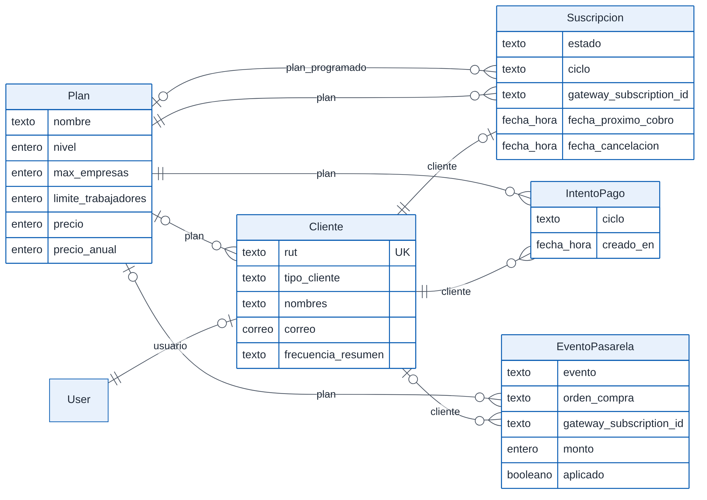{width=100%}

### Empresas, trabajadores y contratos {#sec-datos-trabajadores}

**Empresa.** `Empresa` pertenece al usuario titular (`owner`). Su RUT es único en todo el sistema, de modo que una empresa está en una sola cuenta. Guarda:

- los datos legales y la dirección;
- los datos de seguridad social: mutual, tasa de accidentes, sucursal y caja de compensación;
- el canal interno de denuncias y el rubro;
- la firma del representante legal: imagen PNG en base64, nombre, cargo y fecha.

**Ficha del trabajador.** `Empleado` es la ficha de una persona en una empresa. La combinación de empresa y RUT es única: la misma persona puede tener fichas en varias empresas, de la misma cuenta o de cuentas distintas. Sus 57 campos cubren:

- identidad, contacto y dirección por partes;
- cargo y modalidad de trabajo;
- previsión, salud y forma de pago;
- cargas y tramo de asignación familiar;
- protecciones: cuidados, fuero y fecha de parto;
- el consentimiento para documentos electrónicos;
- el estado: `activo` y fecha de desvinculación.

El número de ficha es correlativo por empresa.

**Contrato.** `Contrato` se relaciona uno a uno con la ficha: cada ficha tiene a lo más un contrato, y sus cambios se hacen con anexos. Guarda:

- el tipo de contrato y de jornada;
- las fechas, el sueldo y las horas semanales;
- la distribución del horario (JSON);
- la configuración de comisiones;
- las funciones y las cláusulas especiales;
- el contrato escaneado o generado (`archivo_contrato`).

**Anexos.** Las modificaciones se hacen con anexos (`AnexoContrato`), de tres tipos: general, consentimiento electrónico y teletrabajo.

- Los cambios estructurados de un anexo (`cambios`) se traspasan al contrato **cuando el trabajador lo firma**, y el anexo queda marcado como aplicado (`aplicado`, `aplicado_en`). Una modificación sin firmar no tiene efecto (Art. 11 del Código del Trabajo).
- Los anexos tipados, como el de teletrabajo, guardan en `datos` la información con que se redactan sus cláusulas.

En la figura, el anexo aparece al lado de la ficha y no debajo del contrato para que el diagrama quepa en la página. La relación es la misma: cada anexo pertenece a un contrato.

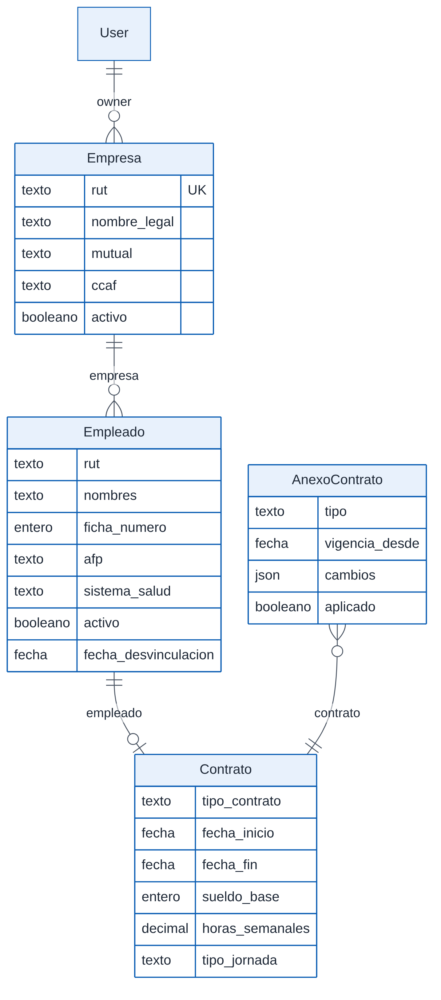{width=54%}

### Remuneraciones y certificados del SII {#sec-datos-remuneraciones}

**Conceptos.** `ConceptoRemuneracion` es el catálogo de haberes y descuentos. Cada concepto tiene:

- su naturaleza: imponible, tributable, si afecta la gratificación y si afecta la semana corrida;
- su código del Libro de Remuneraciones Electrónico.

Los conceptos sin empresa forman el catálogo del sistema, común a todos los clientes. Los que tienen empresa son propios de ella.

**Liquidación.** `Liquidacion` es única por trabajador, mes y año. Es un registro congelado del cálculo: además de los totales, guarda lo que se usó para calcularla:

- el sueldo y las horas del contrato a esa fecha;
- el valor de la UF;
- la AFP y el sistema de salud;
- el detalle de los ítems (JSON);
- la tasa y el aporte de la indemnización a todo evento.

Así, una liquidación emitida no cambia si después cambian el contrato o los parámetros.

**Certificado N°6.** `CertificadoSueldos` es el certificado de sueldos de un trabajador por año. Lleva un número correlativo por empresa y guarda en `datos` lo que certifica. Si se reemite con datos distintos, se crea uno nuevo que apunta al anterior (`reemplaza`); el anterior se conserva como historia.

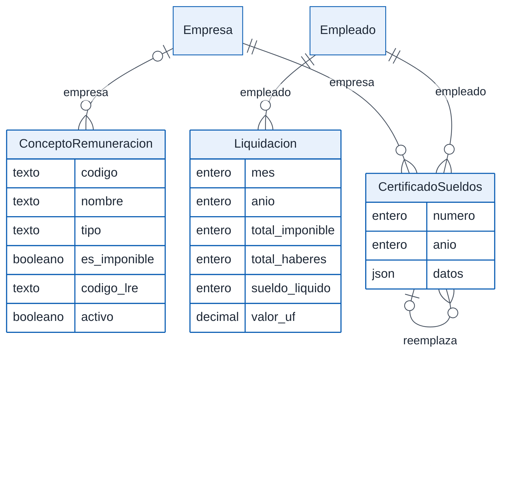{width=77%}

### Cartas, pactos, constancias y reglamento {#sec-datos-documentos}

**Cartas.** `DocumentoLegal` guarda las cartas: amonestación, despido, mutuo acuerdo y constancia. En las de término registra la causal, el último día, el aviso previo y los montos informados.

**Pactos y constancias.** `DocumentoLaboral` guarda los pactos, autorizaciones y constancias, en nueve tipos:

- horas extra, descuento voluntario y su revocación;
- permiso legal e indemnización a todo evento;
- constancias de reglamento, de canales de denuncia, de entrega de elementos de protección y de información de riesgos.

El tipo determina el contenido de `datos`, del que se redactan las cláusulas. `vigente_desde` y `vigente_hasta` delimitan su vigencia. Dos relaciones están protegidas contra borrado (`PROTECT`):

- la constancia de reglamento apunta a la versión del reglamento que se entregó;
- el descuento apunta al concepto que se descuenta.

**Reglamento interno.** `ReglamentoInterno` es cada versión del reglamento que sube el empleador, en PDF, con su número de versión único por empresa. Guarda las fechas de publicación y de vigencia, y las de remisión a la Dirección del Trabajo y a la Seremi de Salud.

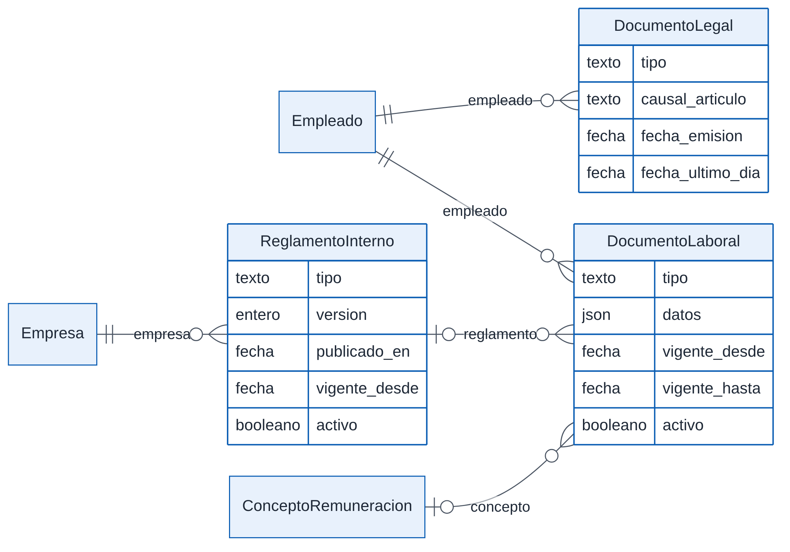{width=95%}

### Firma electrónica {#sec-datos-firma}

`SolicitudFirma` es el envío de un documento a firma. Apunta:

- al trabajador y la empresa;
- a la persona que lo emitió (`emisor`);
- al documento que se firma.

Para el documento tiene siete claves foráneas opcionales, una por clase de documento: contrato, carta, anexo, liquidación, vacación, finiquito y documento laboral. Según el tipo (`tipo_documento`, 18 valores), se llena una sola. Por ejemplo, el contrato y el anexo de 40 horas usan la del contrato, y los nueve tipos de documento laboral, la suya. Guarda además:

- el token del enlace público (UUID único) y su vencimiento;
- el estado: `PENDIENTE`, `PROCESANDO`, `FIRMADO`, `RECHAZADO`, `EXPIRADO` o `CANCELADO`;
- el origen (panel o portal), la IP del emisor y cuándo confirmó su identidad;
- cómo se verificó la identidad del trabajador: código por correo o clave del portal;
- el folio;
- la firma dibujada (imagen) y la IP del firmante;
- las huellas SHA-256 del PDF original y del firmado;
- las claves de esos PDF en el almacenamiento (sección 6.6).

`OTPFirma` es el código de un solo uso enviado al correo del trabajador. Se guarda solo como huella (sección 6.5), con su vencimiento y sus intentos.

Que un documento no tenga dos solicitudes vivas (pendiente, en proceso o firmada) lo controla el servidor al crear la solicitud; la base no tiene una restricción para eso.

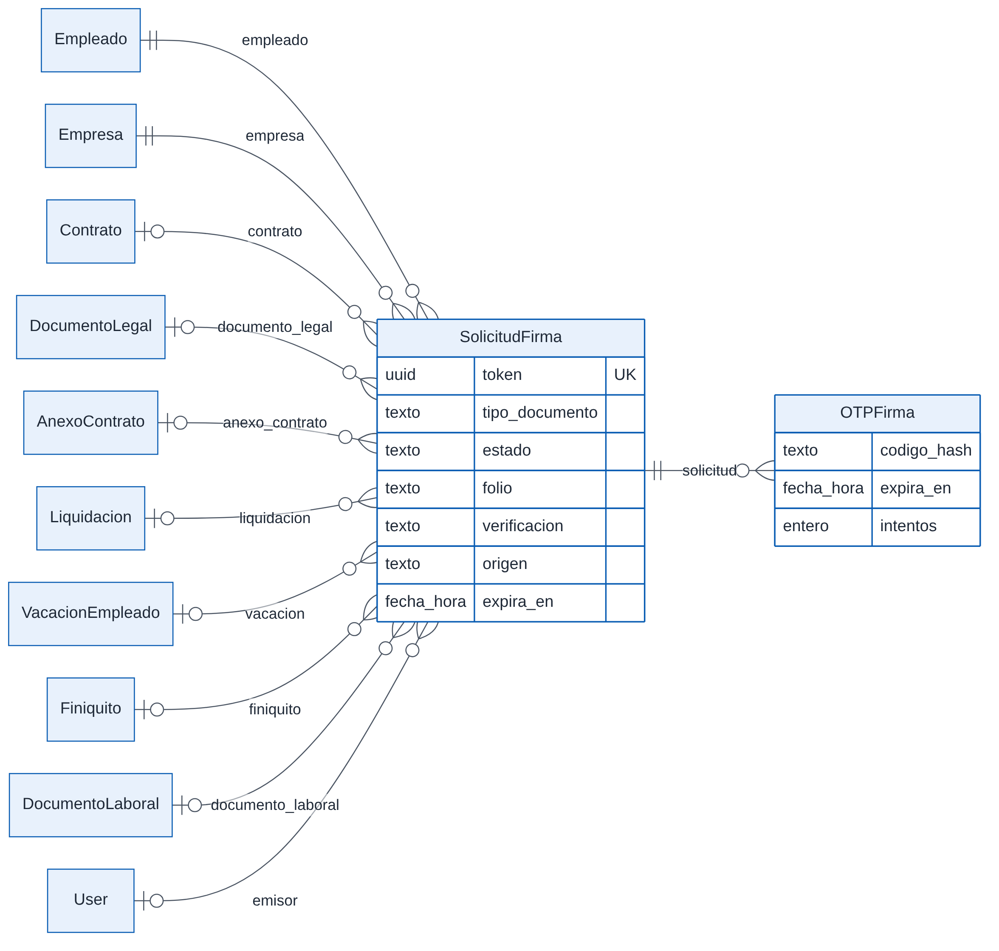{width=100%}

### Vacaciones, permisos, conciliación y término {#sec-datos-termino}

- **Vacaciones.** `VacacionEmpleado` registra vacaciones legales y progresivas, permisos sin goce y días libres por horas extra. Guarda los días hábiles, las horas compensadas y el estado: `PENDIENTE`, `APROBADO` o `RECHAZADO`. Con origen en el portal, empieza pendiente hasta que el empleador responde. Además de la ficha, apunta directamente a la empresa; sobre esa relación se aplica el filtro de empresas de los usuarios del equipo (capítulo 8).
- **Permisos.** `SolicitudPermiso` es el permiso legal pedido desde el portal. Al aprobarse, apunta a la constancia (`DocumentoLaboral`) que se crea.
- **Conciliación.** `SolicitudConciliacion` registra lo que pide un trabajador con responsabilidades de cuidado: teletrabajo o cambio de jornada. Guarda la respuesta, el motivo y el fundamento, y lo que el trabajador declaró cuidar.
- **Finiquito.** `Finiquito` guarda:
  - la causal y la fecha de término;
  - los montos calculados y el total a pagar;
  - la modalidad, presencial o en Mi DT, y la ratificación.

  Apunta a la carta de término de la que proviene, si existe.

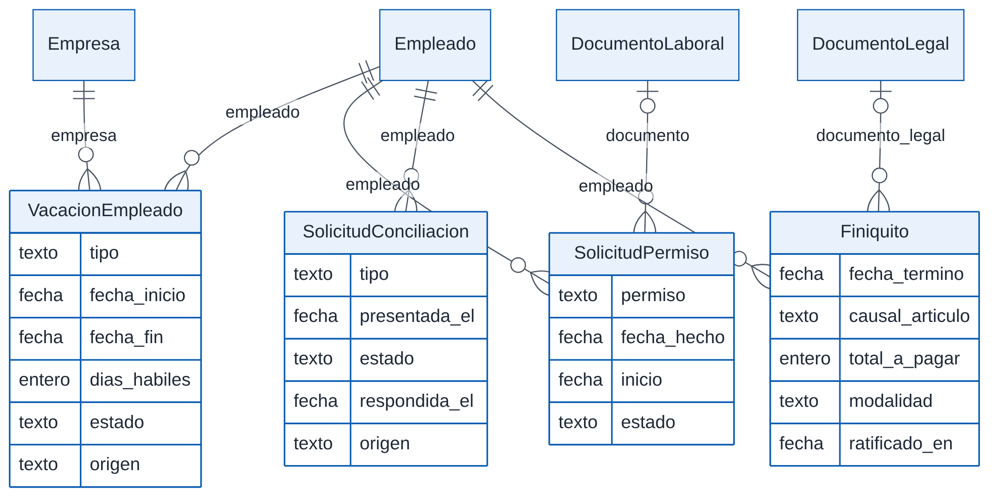{width=100%}

### Portal del trabajador {#sec-datos-portal}

El portal tiene un modelo de identidad propio, separado del usuario de Django.

- **Cuenta.** `CuentaTrabajador` es el acceso de una persona. Su RUT **no** es único: puede haber más de una cuenta por RUT, porque la cuenta es de quien demostró recibir los correos, no del RUT (decisión del 08-10-2026, sección 6.7). La clave es opcional y se guarda con el mismo algoritmo que las del panel. `version_sesion` invalida las sesiones anteriores cuando la clave cambia.
- **Correos verificados.** `CorreoTrabajador` es cada correo que la cuenta demostró recibir; es único por cuenta. El trabajador ve solo las fichas (`Empleado`) que tienen uno de esos correos.
- **Códigos de ingreso.** `CodigoTrabajador` es el código de 6 dígitos enviado por correo. No tiene clave foránea: se asocia al RUT y a los correos a los que se envió.
- **Solicitudes de documentos.** `SolicitudDocumento` es un documento pedido por el trabajador. Apunta a la ficha, a la cuenta que lo pidió y, si corresponde, a la vacación.
- **Certificados.** `CertificadoEmitido` es un certificado que el trabajador genera. Tiene un código de verificación único y guarda en `datos` lo que certifica, para reconstruir el PDF. Si se anula, conserva la fecha y el motivo.

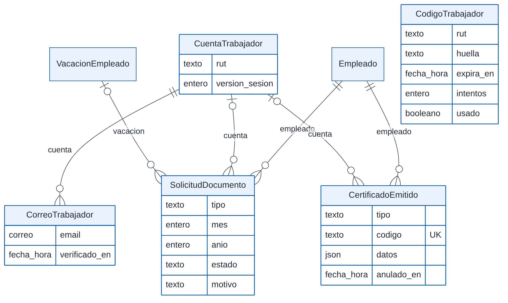{width=100%}

### Registro en Mi DT y fiscalización {#sec-datos-dt}

**Registro en Mi DT.** `RegistroDT` es la constancia de que el empleador registró en Mi DT un contrato, un anexo o un término. Se identifica con una clave única por empresa, por ejemplo `CONTRATO:<id>` o `TERMINO:<empleado>:<aaaammdd>`. Guarda la vía (manual o extensión), el comprobante y quién lo registró.

**Fiscalización.** Las tablas de fiscalización se relacionan con la empresa fiscalizada:

- `CodigoInspeccion` es el código de ingreso del fiscalizador. Se guarda como huella, con su correo, nombre, RUT, vencimiento e intentos.
- `RegistroInspeccion` es la bitácora de la fiscalización: ingresos, descargas, ratificaciones y salidas.
- `RatificacionInspeccion` es la firma de un inspector sobre un documento, en terreno, con su identificación y la imagen de su firma.

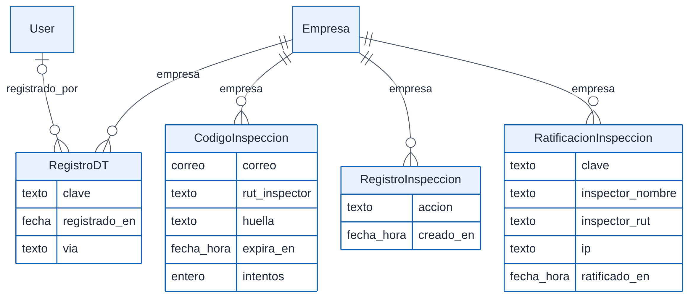{width=100%}

### Extensión para Mi DT {#sec-datos-extension}

**[Solo en staging]** Los tres modelos apuntan a la cuenta (el titular) y a la persona que actuó, que puede ser el titular o un usuario del equipo:

- `DispositivoExtension` es cada navegador conectado. Guarda la huella SHA-256 de su token, única, y las fechas de último uso y de desconexión.
- `CodigoExtension` es el código de un solo uso que conecta un navegador. Se guarda como HMAC.
- `LevantamientoMiDT` es la estructura de una pantalla de Mi DT, sin los valores escritos, que se usa para preparar los mapeos.

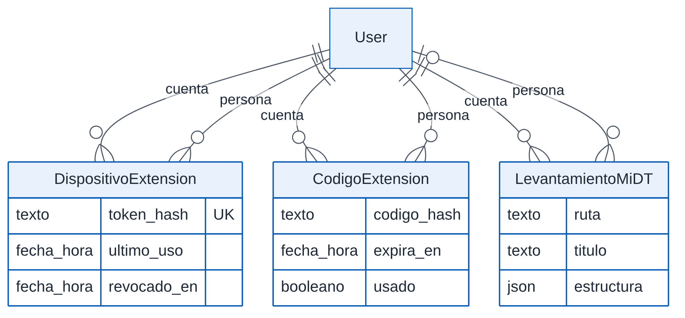{width=84%}

### Usuarios del equipo y bitácora {#sec-datos-equipo}

**Usuarios del equipo.** `UsuarioEquipo` es una persona invitada por el titular. Tiene:

- su propio usuario de Django (uno a uno);
- los permisos por módulo, en JSON (`VER` o `GESTIONAR`);
- las empresas asignadas (muchos a muchos);
- el estado: `INVITADO`, `ACTIVO` o `ELIMINADO`.

La cuenta y el usuario están protegidos contra borrado: un usuario eliminado conserva su historia.

**Bitácora.** `RegistroBitacora` registra las acciones en el panel de una cuenta. Copia el nombre y el RUT de quien actuó, por si su usuario deja de existir. Cada registro guarda la huella de su contenido encadenada con la del anterior (sección 6.4.4).

**Copias verificables.** `ExportacionBitacora` es cada copia descargada de la bitácora. Guarda:

- su folio correlativo por cuenta y su código de verificación;
- los filtros aplicados;
- el rango de registros incluidos;
- la huella SHA-256 del conjunto.

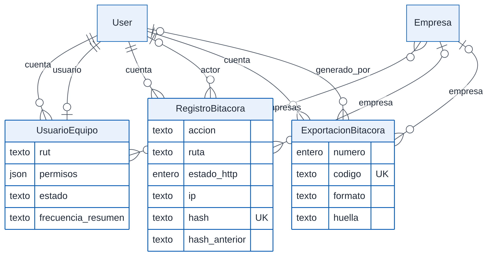{width=100%}

### Ley Karin {#sec-datos-karin}

**Encargados.** `EncargadoKarin` es la persona que recibe las denuncias. Como el usuario del equipo, tiene su propio usuario de Django y sus empresas asignadas. Además tiene un contador de sesiones, `version_sesion`, que cierra sus sesiones al cambiar la clave o al ser removido.

**Denuncias.** `DenunciaKarin` guarda cada denuncia.

- Su número es correlativo por empresa; el folio `LK-<año>-<NNN>` agrega el año de recepción.
- El contenido va **cifrado**: partes, relato, resguardo, investigación, informe y medidas.
- En claro quedan solo el tipo, el canal, el estado, las fechas y los hitos, que se necesitan para calcular los plazos y ordenar la lista.

**Archivos.** `ArchivoKarin` es un archivo del expediente. Se cifra antes de subirlo al almacenamiento; la tabla guarda su clave en el almacenamiento, el nombre original (cifrado) y la huella SHA-256 del archivo original.

**Bitácora reservada.** `RegistroKarin` es la bitácora reservada del acceso Ley Karin. Se encadena como la del panel y su descripción va cifrada.

La cuenta, la empresa y la denuncia están protegidas contra borrado (`PROTECT`): ningún borrado en cascada puede eliminar una denuncia.

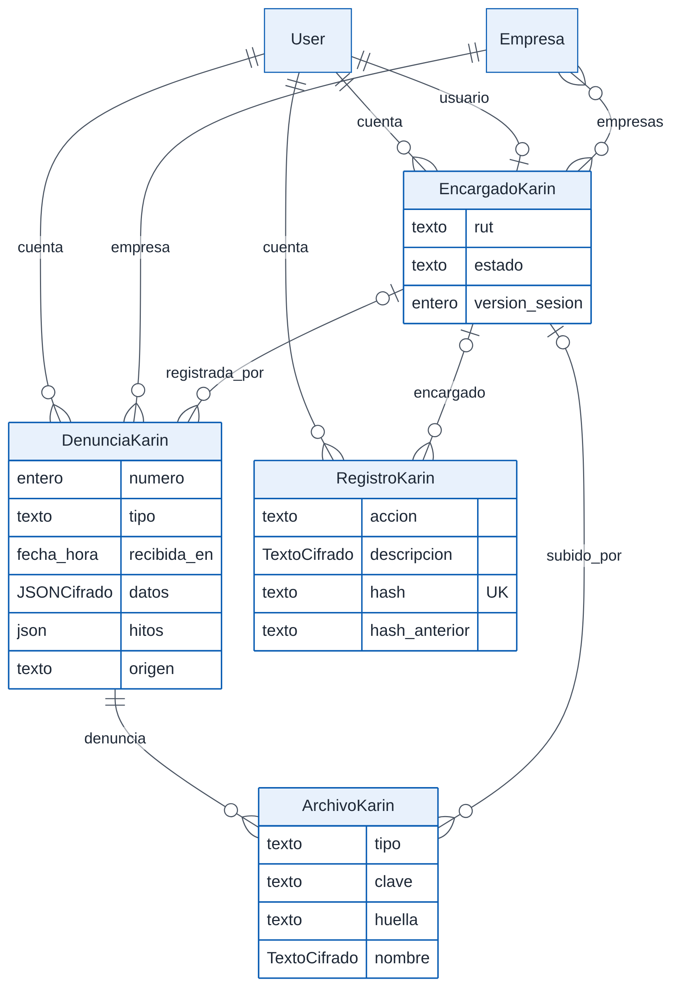{width=79%}

## Parámetros legales {#sec-datos-parametros}

Los valores legales que cambian en el tiempo están en tablas versionadas por fecha de vigencia. Las mantiene el equipo de Jornada40 en el administrador de Django, y son comunes a todos los clientes. El panel solo las lee.

| Tabla | Qué guarda | Versión | Carga inicial |
|---|---|---|---|
| `ParametroPrevisional` | Topes imponibles (AFP y seguro de cesantía), ingreso mínimo, factor de gratificación, tasas de salud, cesantía y SIS, tasa base de la mutual y las tasas de cargo del empleador de la reforma de pensiones | Una fila por `vigente_desde`, que es única | Migraciones 0035, 0041 y 0045 |
| `TasaAFP` | Tasa de cotización de cada AFP | Única por AFP y `vigente_desde` | Migraciones 0035 y 0041 |
| `TramoAsignacionFamiliar` | Monto por carga y renta máxima de cada tramo (A, B y C) | Única por `vigente_desde` y tramo | Migración 0063 (tablas de mayo de 2025, enero de 2026 y mayo de 2026) |
| `FactorActualizacionSII` | Factor de actualización de cada mes de un año, para el certificado N°6 | Único por año y mes | Migración 0075 (año comercial 2025) |
| `PeriodoVacacionesEscolares` | Períodos de vacaciones escolares del calendario del Mineduc | Por fechas de inicio y término | Se cargan cada año en el administrador |
| `Plan` | Precio mensual y anual, máximo de empresas y de trabajadores, y nivel | No se versiona: un cambio de precio rige desde que se guarda | Migraciones 0048, 0052 y 0055 |

: Tablas de parámetros legales y comerciales

**Cómo se elige el valor vigente.** El cálculo usa la fila con la fecha de vigencia más reciente que no sea posterior al período que se liquida, y no la vigente a la fecha de hoy. Así, recalcular una liquidación antigua usa los topes y el sueldo mínimo de su época. Si no hay ninguna fila anterior al período, usa la más antigua. Si la tabla está vacía, usa los valores de respaldo escritos en el código (`core/views/parametros.py`) y lo advierte.

**Propuestas automáticas.** El comando `sincronizar_previred` lee los indicadores publicados por Previred y crea una propuesta con origen `PREVIRED` y sin confirmar. El cálculo ignora esas propuestas hasta que una persona las confirma en el administrador. El comando `estado_indicadores` informa si los parámetros vigentes no están confirmados o tienen más de 14 meses.

**Lo que no está en tablas:**

- La **UF y la UTM** no se guardan: se consultan a mindicador.cl y se mantienen 6 horas en la caché. Si el servicio no responde, se usa un valor de respaldo del código, y el panel lo indica junto a los indicadores del día. Cada liquidación guarda el valor de la UF que usó.
- La **tabla del impuesto único** de segunda categoría está en el código (`core/indicadores.py`), en UTM. Sus tramos no cambian salvo por ley, y el valor de la UTM se actualiza mes a mes.
- Las **tablas del Libro de Remuneraciones Electrónico y del registro de contratos** (comunas, causales, códigos de AFP y salud) están en el código: `core/lre.py`, `core/registro_dt.py` y `core/datos/`.

## Integridad {#sec-datos-integridad}

### Unicidad {#sec-datos-unicidad}

La base de datos garantiza los valores únicos de la tabla siguiente. Las demás reglas, por ejemplo que un documento no tenga dos firmas vivas, las valida el servidor.

| Modelo | Valor único | Significado |
|---|---|---|
| `Cliente` | RUT | Un titular por RUT |
| `Empresa` | RUT | Una empresa está en una sola cuenta |
| `Empleado` | Empresa y RUT | Una ficha por persona en cada empresa |
| `Contrato` | Ficha (uno a uno) | Un contrato por ficha |
| `Liquidacion` | Ficha, mes y año | Una liquidación por período |
| `ConceptoRemuneracion` | Código, entre los del sistema; empresa y código, entre los de una empresa | Restricciones condicionales `concepto_codigo_unico_en_sistema` y `concepto_codigo_unico_por_empresa` |
| `CertificadoSueldos` | Empresa y número | Numeración correlativa por empresa |
| `ReglamentoInterno` | Empresa y versión | Versiones numeradas por empresa |
| `RegistroDT` | Empresa y clave | Una constancia por obligación de registro |
| `SolicitudFirma` | Token | Un enlace por solicitud |
| `CorreoTrabajador` | Cuenta y correo | Un correo verificado una vez por cuenta |
| `CertificadoEmitido` | Código | Un código de verificación por certificado |
| `DispositivoExtension` | Huella del token | Un token por navegador |
| `RegistroBitacora`, `RegistroKarin` | Huella | Cada registro de la cadena es distinto |
| `ExportacionBitacora` | Código; cuenta y número | Un código y un folio por copia |
| `DenunciaKarin` | Empresa y número | Numeración correlativa por empresa |
| `ParametroPrevisional` | Fecha de vigencia | Una fila por fecha |
| `TasaAFP` | AFP y fecha de vigencia | Una tasa por AFP y fecha |
| `TramoAsignacionFamiliar` | Fecha de vigencia y tramo | Un monto por tramo y fecha |
| `FactorActualizacionSII` | Año y mes | Un factor por mes |

: Restricciones de unicidad

### Borrado y relaciones {#sec-datos-borrado}

Las 75 claves foráneas y relaciones uno a uno siguen tres reglas al borrarse el registro al que apuntan:

| Regla | Relaciones | Cuándo se usa |
|---|---|---|
| `CASCADE` (borra también) | 34 | Datos que no tienen sentido sin su dueño: las fichas sin su empresa, las liquidaciones o las solicitudes de firma sin su ficha |
| `SET_NULL` (deja vacío) | 26 | Referencias que pueden desaparecer sin perder el registro: quién emitió una firma, el documento de una solicitud, el plan de un cliente |
| `PROTECT` (impide borrar) | 15 | Lo que se debe conservar: la cuenta de la bitácora, de los usuarios del equipo y de la Ley Karin; las denuncias y sus archivos; el reglamento y el concepto de un documento laboral; el plan de una suscripción |

: Reglas de borrado de las relaciones

En la operación normal, el panel no borra lo que importa:

- **Fichas y empresas:** se desactivan.
- **Documentos sin firmar:** se anulan.
- **Firmas:** se cancelan.
- **Certificados:** se anulan, y se conservan.

Sin embargo, la API todavía acepta la operación de borrado (`DELETE`) en seis recursos: trabajadores, contratos, liquidaciones, cartas, finiquitos y vacaciones. La pueden usar el titular y los usuarios del equipo con permiso de gestionar. Como las solicitudes de firma dependen de la ficha en cascada, borrar un trabajador por la API eliminaría también la evidencia de sus firmas. Ninguna pantalla lo ofrece, pero la regla del borrado lógico no está garantizada en el servidor. Este hallazgo está registrado en `docs/PENDIENTES.md` y se retoma en los capítulos 8 y 13.

El administrador de Django, reservado al equipo de Jornada40, también permite borrar fichas, empresas y contratos. Los modelos de la Ley Karin y los usuarios del equipo no están en el administrador, y la bitácora aparece en él solo para consulta.

### Numeración correlativa {#sec-datos-numeracion}

Los números que se muestran en documentos se asignan como el máximo actual más uno. Para que dos operaciones simultáneas no tomen el mismo número, se bloquea antes la fila de la empresa o de la cuenta (`select_for_update`, dentro de una transacción). Se numeran así:

- el folio de cada firma, por empresa;
- el certificado N°6, por empresa;
- las denuncias de la Ley Karin, por empresa;
- las copias de la bitácora, por cuenta;
- la cadena de la bitácora y la del registro Ley Karin, por cuenta.

El número de ficha del trabajador también es el máximo más uno, pero sin bloqueo ni restricción de unicidad. Dos altas simultáneas en la misma empresa podrían recibir el mismo número; el servidor sí impide repetirlo al editarlo. El número de ficha no tiene efecto legal.

### Registros inalterables {#sec-datos-inalterables}

La bitácora del panel (`RegistroBitacora`) y la bitácora reservada de la Ley Karin (`RegistroKarin`) solo admiten agregar registros:

- **Sin edición ni borrado:** su gestor rechaza la edición y el borrado en bloque. El modelo rechaza guardar un registro existente y borrarlo. En el administrador, la bitácora del panel es de solo lectura y la reservada no aparece.
- **Encadenamiento:** cada registro guarda la huella SHA-256 de su contenido, que incluye la huella del registro anterior de la misma cuenta. La función `verificar()` recorre la cadena e informa el primer registro alterado o faltante.
- **Copias exportadas:** cada copia guarda la huella del conjunto de registros que contiene. Con su código, cualquiera verifica que esos registros siguen iguales.

La cadena delata cualquier cambio hecho fuera de la aplicación. Pero la huella no usa una clave secreta: quien tenga acceso de escritura directo a la base podría alterar un registro y recalcular toda la cadena. Las copias exportadas fijan la huella fuera del sistema y acotan ese riesgo (capítulo 8).

### Registros congelados {#sec-datos-congelados}

Algunos registros guardan una copia de lo que se usó al emitirlos, para que no cambien después:

- **Liquidaciones:** guardan la UF, el sueldo y las horas del contrato, y el detalle de cada ítem (sección 6.2.3).
- **Documentos firmados:** se entregan siempre desde el PDF firmado guardado, no se vuelven a generar. Con una firma viva, el servidor impide editar el contrato (se modifica con anexos), las liquidaciones y los finiquitos. Una carta firmada todavía se puede editar por la API, aunque lo que se entrega sigue siendo el PDF firmado; es otro de los hallazgos registrados en `docs/PENDIENTES.md`.
- **Certificados del portal:** guardan en `datos` lo que certifican; el PDF se reconstruye desde ahí.
- **Certificado N°6:** reemitir con datos distintos crea un número nuevo y conserva el anterior.

## Datos sensibles {#sec-datos-sensibles}

El capítulo 9 trata el régimen de protección de datos personales. Esta sección describe cómo se guarda cada categoría.

| Dato | Dónde | Cómo se guarda |
|---|---|---|
| Contraseñas del titular, del equipo y de los encargados Ley Karin | `User.password` | Derivación PBKDF2 con SHA-256, 1.000.000 de iteraciones (la configuración por omisión de Django 5.2) |
| Clave del portal del trabajador | `CuentaTrabajador.password` | Igual que las contraseñas del panel |
| Código de firma enviado al trabajador | `OTPFirma.codigo_hash` | HMAC-SHA256 con la clave secreta del servidor, ligado al token de la solicitud. Desde la migración 0102 no se guarda el código |
| Código de ingreso al portal | `CodigoTrabajador.huella` | SHA-256 del RUT, el código y la clave secreta del servidor |
| Código del fiscalizador | `CodigoInspeccion.huella` | SHA-256 de la empresa, el correo, el código y la clave secreta del servidor |
| Código para conectar la extensión | `CodigoExtension.codigo_hash` | HMAC-SHA256 con la clave secreta del servidor |
| Token de la extensión | `DispositivoExtension.token_hash` | SHA-256 del token; el token solo lo tiene el navegador |
| Enlace de firma | `SolicitudFirma.token` | UUID aleatorio en claro (es la llave de búsqueda), con vencimiento |
| Contenido de las denuncias Ley Karin, nombres de sus archivos y descripción de su bitácora reservada | 7 campos de `DenunciaKarin`, `ArchivoKarin` y `RegistroKarin` | Cifrado simétrico Fernet (AES-128 en modo CBC con HMAC-SHA256), con claves rotables (ver más abajo) |
| Archivos de los expedientes Ley Karin | Almacenamiento de objetos | Cifrados con Fernet antes de subirlos |
| Firmas manuscritas: representante, trabajador e inspector | `Empresa.firma_imagen`, `SolicitudFirma.firma_trabajador_imagen`, `RatificacionInspeccion.firma_imagen` | Imagen PNG en base64, en claro |
| Datos personales y laborales: identidad, contacto, dirección, cuenta bancaria, sueldo, previsión y cargas | `Empleado`, `Contrato`, `Liquidacion`, `Finiquito` | En claro en la base, protegidos por el control de acceso (capítulo 8) |
| Datos sensibles de salud y familia: discapacidad, pensión de invalidez, hijo con enfermedad grave, cuidados, fuero maternal, fecha de parto, días de licencia | `Empleado`, `Liquidacion` | En claro en la base, protegidos por el control de acceso. El capítulo 9 analiza su tratamiento |

: Almacenamiento de los datos sensibles

**Claves del cifrado.**

- Las claves de Fernet se leen de la variable `KARIN_CLAVES_CIFRADO`, separadas por comas. La primera cifra; todas descifran.
- En los ambientes desplegados la variable es obligatoria. En desarrollo y en las pruebas se deriva una clave de la clave secreta de Django.
- Para rotar una clave: se agrega la nueva al principio, se despliega, se ejecuta `python manage.py rotar_cifrado` y luego se quita la antigua.
- Perder la clave implica perder los datos cifrados.
- Los campos cifrados no se pueden filtrar ni ordenar por su contenido. Por eso, lo que se usa para buscar o calcular plazos queda en claro sin datos personales: estado, fechas e hitos.

## Archivos {#sec-datos-archivos}

En los ambientes desplegados, los archivos se guardan en un depósito privado de Backblaze B2, compatible con S3:

- los enlaces de descarga que genera el almacenamiento vencen en una hora;
- un archivo nunca reemplaza a otro con el mismo nombre.

Sin las variables de B2, como en desarrollo, los archivos van a la carpeta local `backend/media/`.

| Ubicación | Contenido | Quién la escribe |
|---|---|---|
| `pendientes/<empresa>/<uuid>.pdf` | El PDF que se envía a firma | Envío a firma (`core/views/firmas.py`); se borra al firmarse |
| `firmados/<empresa>/<año>/<mes>/<token>_firmado.pdf` | El PDF firmado, con su página de certificado | Firma pública (`core/views/firma_publica.py`) |
| `karin/<cuenta>/<denuncia>/<uuid>.bin` | Archivos de un expediente Ley Karin, cifrados | Expediente Ley Karin (`core/views/denuncias_karin.py`) |
| `contratos/`, `anexos/` | Contratos y anexos de 40 horas generados o subidos | Campos de archivo de `Contrato` |
| `anexos_contrato/`, `documentos_legales/`, `liquidaciones/`, `finiquitos/`, `vacaciones/` | Copias de PDF generados que algunas acciones guardan | Campos `archivo_pdf` de esos modelos |
| `reglamentos/` | El reglamento interno subido por el empleador | Campo de archivo de `ReglamentoInterno` |

: Ubicación de los archivos en el almacenamiento

**Qué versión se entrega.** La versión que se entrega de un documento firmado es siempre la firmada, guardada en `firmados/`. Un documento sin firma se genera de nuevo desde los datos en cada descarga. Por eso, las copias de los campos `archivo_pdf` no son la fuente de verdad: al editar una carta o un finiquito, su copia anterior se borra.

**PDF pendientes.** Los PDF de las solicitudes rechazadas, vencidas o canceladas quedan en `pendientes/`; hoy no hay una tarea que los elimine (sección 6.8).

## Migraciones {#sec-datos-migraciones}

El esquema evoluciona con las migraciones de Django en `backend/core/migrations/`: hay 105 a la fecha de corte, de la `0001` a la `0105`.

- **Generación:** se generan con `makemigrations` y no se editan a mano.
- **Integración continua:** ejecuta `makemigrations --check`, que falla si un cambio en los modelos no tiene su migración.
- **Producción:** el contenedor aplica las migraciones pendientes al arrancar, antes de iniciar el servidor (capítulo 12).

Dieciséis migraciones también cargan o transforman datos:

| Migración | Qué hace | Reversible |
|---|---|---|
| 0035, 0041, 0045 | Cargan los parámetros previsionales y las tasas de AFP; la 0045, con los indicadores de Previred de septiembre de 2026 | Sí |
| 0038 | Carga el catálogo base de haberes y descuentos | Sí |
| 0039 | Une en una sola lista las cinco listas de detalle de la liquidación | Sí |
| 0040 | Pasa las categorías de comisión del contrato al catálogo de conceptos | Sí |
| 0048 | Crea los planes base si no existen | No |
| 0052 | Deja un solo juego de planes (Semilla, Starter, Pyme y Corporativo) y traslada a los clientes de los planes antiguos | No |
| 0055 | Fija el precio anual inicial: 10 veces el mensual | No |
| 0061 | Asigna el código del Libro de Remuneraciones Electrónico a los conceptos del sistema | Sí |
| 0063 | Carga las tablas de asignación familiar de la SUSESO | Sí |
| 0075 | Carga los factores de actualización del SII del año 2025 | Sí |
| 0092 | Normaliza los bancos escritos a mano a la lista cerrada | No |
| 0093 | Separa en partes las direcciones escritas en un solo campo, cuando se puede | No |
| 0100 | Separa las cuentas del portal que mezclaban a varias personas con el mismo RUT (una por correo) y borra sus claves | No |
| 0102 | Convierte en huella los códigos de firma vigentes antes de eliminar el campo con el código en texto | No |

: Migraciones que cargan o transforman datos

Las irreversibles no se pueden deshacer con `migrate` hacia atrás, porque la transformación pierde información; por ejemplo, el texto original de una dirección o la mezcla de cuentas. Por eso conviene respaldar la base antes de desplegar una migración de este tipo (capítulo 12).

## Conservación y eliminación {#sec-datos-conservacion}

**Lo que se conserva:**

- Las fichas, las empresas y los documentos se desactivan o se anulan, no se borran (con la excepción de la sección 6.4.2).
- La bitácora del panel se conserva al menos cinco años. Hoy no existe ningún proceso que la elimine.
- Las denuncias de la Ley Karin, sus archivos y su bitácora reservada no tienen operación de borrado.
- Los certificados anulados se conservan, marcados como anulados.

**Lo que el sistema elimina:**

- **El código de firma**, cuando su correo no se pudo enviar.
- **La constancia de registro en Mi DT**, cuando el empleador la desmarca.
- **Un correo verificado de otra cuenta del mismo RUT**, cuando el trabajador lo verifica en la suya.
- **El PDF pendiente**, una vez guardado el PDF firmado.
- **La copia anterior de una carta o de un finiquito**, al editarlos.

**Lo que se acumula:**

- Los códigos vencidos de firma, del portal, de fiscalización y de la extensión.
- Los levantamientos de la extensión.
- Los PDF de las solicitudes que no se firmaron.

No ocupan mucho espacio, pero una política de conservación formal debería fijar cuándo se eliminan. Esa política está pendiente y se trata en los capítulos 9 y 13.

**Respaldos.** No hay respaldos automáticos propios de la base de datos ni pruebas de restauración. Esta es una de las limitaciones señaladas en el resumen ejecutivo y se trata en el capítulo 12.
