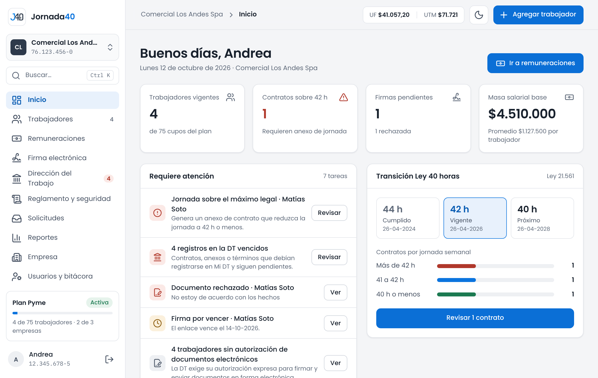
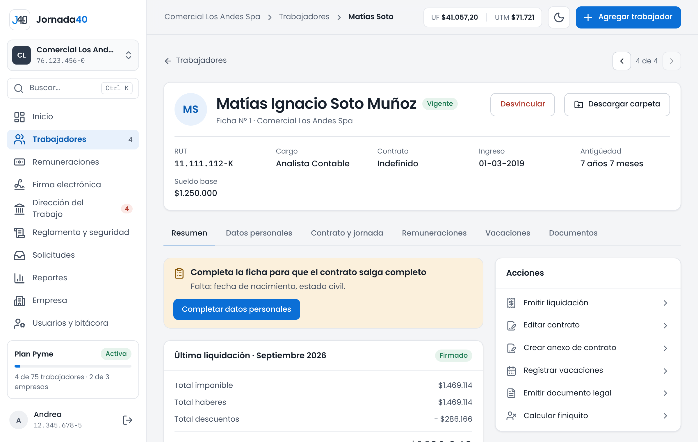
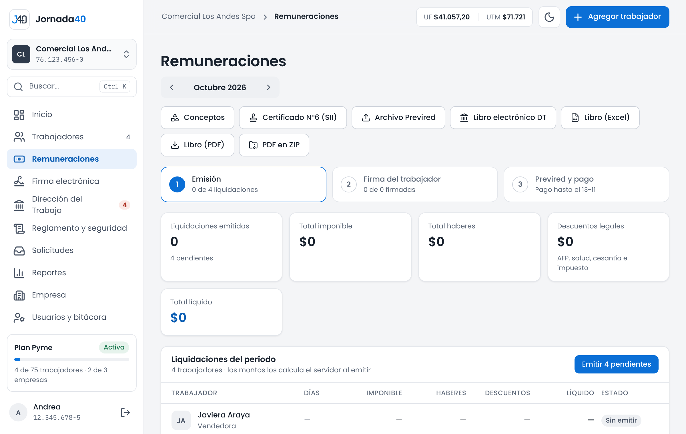
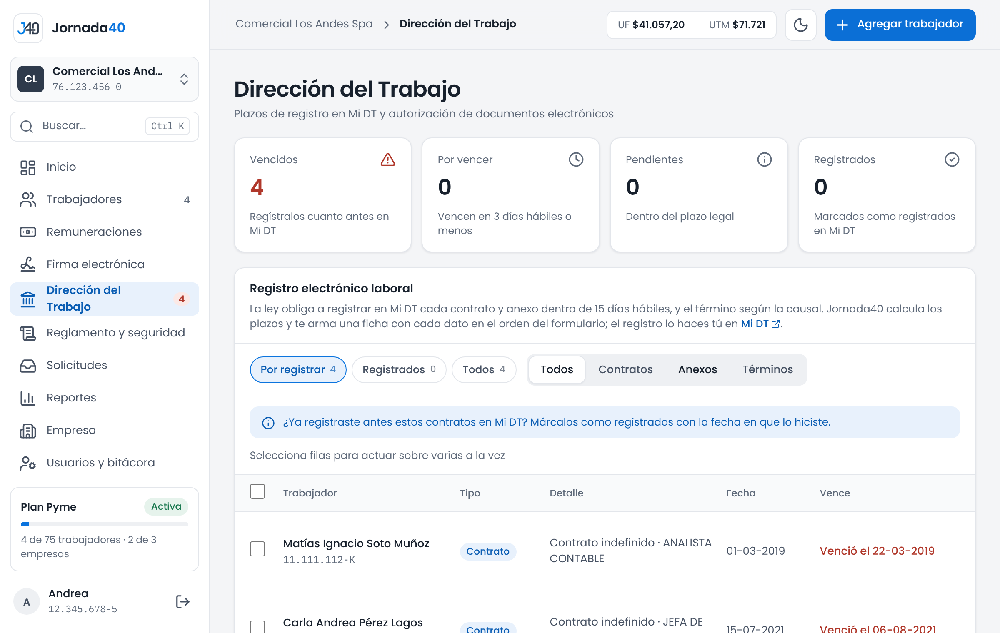
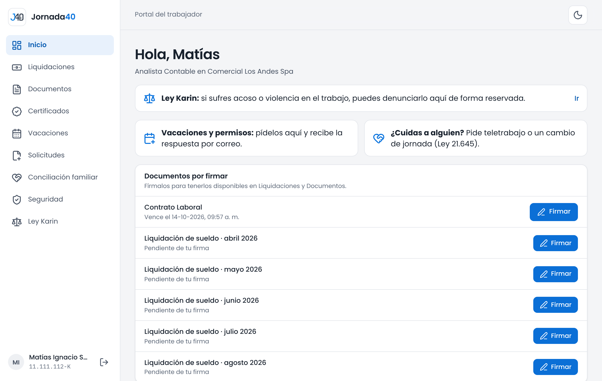
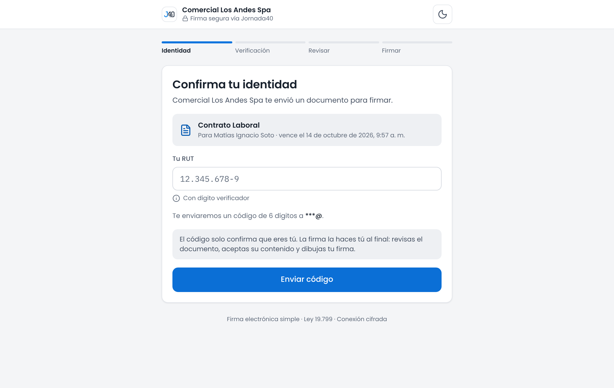
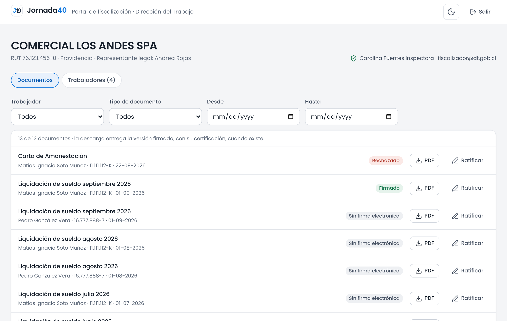
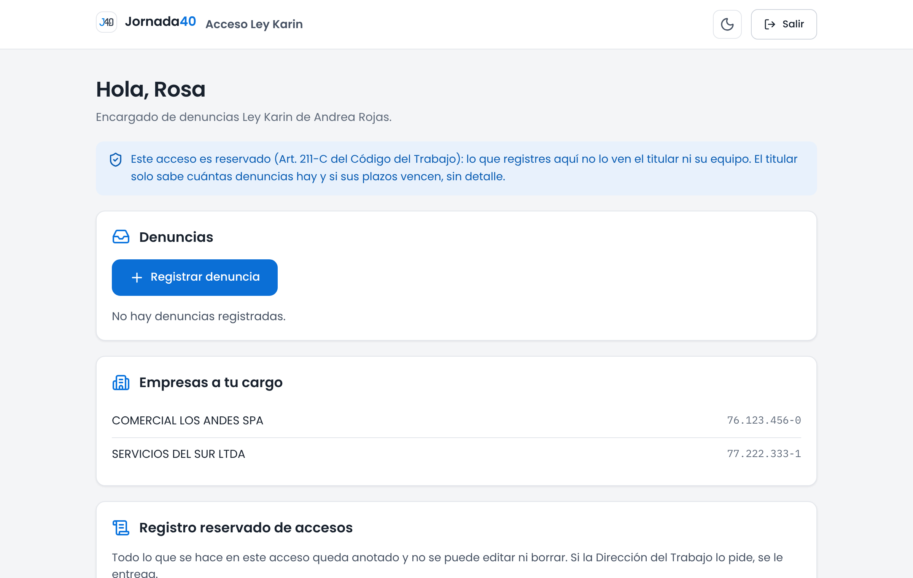

# Interfaces {#sec-interfaces}

Este capítulo describe las interfaces del sistema:

- las pantallas que usan las personas (sección 7.1);
- la API REST que las alimenta (sección 7.2);
- las conexiones con sistemas externos (sección 7.3);
- los archivos que el sistema genera o recibe (sección 7.4);
- los correos que envía (sección 7.5);
- la comunicación de la extensión con Mi DT (sección 7.6).

El anexo C lista cada ruta de la API con sus métodos, la vista que la atiende y el acceso que la abre.

## Interfaces de usuario {#sec-int-usuario}

La sección 5.2 describe cómo está construida la aplicación web. La tabla siguiente muestra sus pantallas principales, agrupadas por acceso.

| Acceso | Rutas | Contenido |
|---|---|---|
| Sitio público | `/`, `/terminos`, `/privacidad/extension`, `/verificar` | Presentación, planes, preguntas frecuentes, términos, privacidad de la extensión y verificación de documentos |
| Ingresos | `/login`, `/register`, `/forgot-password`, `/equipo`, `/karin`, `/trabajador`, `/inspeccion` | Una puerta por acceso, con su recuperación de clave |
| Panel: inicio y trabajadores | `/app`, `/app/trabajadores`, `/app/trabajadores/:id` | Tareas pendientes, indicadores, lista de trabajadores y la carpeta de cada uno, con sus pestañas |
| Panel: documentos | `/app/trabajadores/:id/contrato`, `…/finiquito`, `/app/firmas`, `/app/solicitudes`, `/app/reglamento` | Editor de contratos, finiquitos, firmas, solicitudes del portal, reglamento, seguridad y Ley Karin |
| Panel: remuneraciones | `/app/remuneraciones`, `/app/remuneraciones/conceptos`, `/app/reportes` | Emisión del período, archivos legales, conceptos y reportes |
| Panel: DT y administración | `/app/dt`, `/app/empresa`, `/app/empresas`, `/app/plan`, `/app/cuenta`, `/app/equipo` | Registro en Mi DT y fiscalizaciones, datos de la empresa, plan, cuenta, usuarios y bitácora |
| Portal del trabajador | `/trabajador/portal/…` | Inicio, liquidaciones, documentos, certificados, vacaciones, solicitudes, conciliación, seguridad y Ley Karin |
| Firma | `/firma/:token` | Identidad, revisión, aceptación y firma |
| Ley Karin | `/karin/panel`, `/karin/denuncias/…` | Lista de denuncias con sus plazos y el expediente de cada una |
| Fiscalización | `/inspeccion` | Trabajadores y documentos de la empresa, descarga y ratificación |

: Pantallas principales por acceso

Las capturas siguientes se tomaron con los datos de prueba de la base semilla: personas, empresas y RUT ficticios. Las genera el recorrido `frontend/e2e/capturas.spec.ts`, que solo corre con `CAPTURAS_DOC=1`.

{width=75%}

**Inicio del panel.** Muestra:

- los indicadores del día (UF y UTM);
- cuatro cifras de la empresa;
- las tareas que requieren atención;
- el avance de la reducción de jornada.

El menú lateral muestra solo lo que la persona puede usar según su permiso y su plan.

{width=75%}

**Carpeta del trabajador.** Reúne en pestañas todo lo de una persona: resumen, datos, contrato y jornada, remuneraciones, vacaciones y documentos. Los avisos, por ejemplo una ficha incompleta, aparecen junto a la acción que resuelven.

{width=75%}

**Remuneraciones.** Trabaja por período. Muestra el avance en tres pasos (emisión, firma del trabajador y Previred) y da acceso a los archivos legales del período.

{width=75%}

**Dirección del Trabajo.** Lista lo que hay que registrar en Mi DT, con su plazo; lo vencido va primero.

{width=75%}

**Portal del trabajador.** Muestra los documentos por firmar y los accesos a pedir vacaciones, permisos o conciliación, y a denunciar.

{width=75%}

**Firma.** Avanza en pasos numerados. El primero confirma la identidad; la página explica que el código solo verifica quién es la persona y que la firma es su aceptación y su firma dibujada.

{width=75%}

**Fiscalización.** Lista todos los documentos de la empresa con su estado de firma. Permite descargar cada uno y ratificarlo en terreno.

{width=75%}

**Acceso Ley Karin.** Muestra solo las denuncias, las empresas a cargo del encargado y su registro reservado. Nada más del sistema.

## API REST {#sec-int-api}

### Convenciones {#sec-int-api-convenciones}

| Aspecto | Convención |
|---|---|
| Dirección base | `https://api.jornada40.cl/api/` en producción; en las pruebas, la del ambiente de staging |
| Formato | JSON en ambos sentidos. Los archivos se suben con `multipart/form-data` y se descargan como binarios con `Content-Disposition` |
| Identificación | Según el acceso (sección 4.7): cookies del panel, cookies firmadas de cada portal, token de la extensión, o el token de la solicitud en la firma |
| Orígenes | Solo los de la lista de CORS, con credenciales. **[Solo en staging]** Una escritura que viene de otro origen recibe 403 (sección 4.7). Encabezados que la aplicación web puede leer: `Content-Disposition`, `X-Documento-Firmado` y `Retry-After` |
| Nombres | Recursos en español y en plural (`/empleados/`, `/liquidaciones/`). Las acciones van después del recurso, por ejemplo `/liquidaciones/simular/` o `/firmas/{id}/reenviar/` |
| Paginación | Las listas del enrutador responden por páginas de 200: `{count, next, previous, results}`. La aplicación web lee también las respuestas sin paginar (`src/api/lista.ts`) |
| Versiones | Sin versión en la ruta, porque la API y la aplicación web se publican juntas. La extensión, que se actualiza aparte, usa `/api/extension/v1/` |
| Errores | `{"error": "mensaje para la persona"}`; los de permisos de DRF usan `{"detail": "…"}`; la confirmación de identidad agrega `{"codigo": "confirmar_identidad"}` |

: Convenciones de la API

### Grupos de rutas {#sec-int-api-rutas}

| Prefijo | Acceso | Contenido |
|---|---|---|
| `/api/auth/` | Público y panel | Ingreso, salida, usuario, renovación del token, registro, recuperación por RUT, cambio de clave, ingreso y clave del equipo, sesión |
| `/api/empresas/`, `/api/empleados/`, `/api/contratos/`, `/api/anexos_contrato/` | Panel | Empresas, fichas, carga masiva, digitalización, contratos y anexos |
| `/api/liquidaciones/`, `/api/conceptos/`, `/api/certificados-sueldos/` | Panel | Liquidaciones y sus archivos legales, conceptos, certificado N°6 |
| `/api/documentos_legales/`, `/api/documentos-laborales/`, `/api/vacaciones/`, `/api/finiquitos/` | Panel | Cartas, pactos y constancias, vacaciones, finiquitos |
| `/api/firmas/` | Panel | Solicitudes de firma, confirmación de identidad, cancelación, reenvío y descarga |
| `/api/firma-publica/{token}/` | Público, con token | Datos de la solicitud, código, clave, documento, firma y rechazo |
| `/api/reglamentos/`, `/api/ley-karin/`, `/api/encargados-karin/` | Panel | Reglamento, riesgos, canales de denuncia y encargados |
| `/api/registro-dt/`, `/api/inspeccion/bitacora/` | Panel | Registro en Mi DT y accesos de fiscalización |
| `/api/solicitudes-documento/`, `/api/solicitudes-permiso/`, `/api/solicitudes-conciliacion/`, `/api/peticiones-portal/` | Panel | Atención de lo que piden los trabajadores |
| `/api/equipo/`, `/api/bitacora/` | Panel, solo el titular | Usuarios del equipo y bitácora |
| `/api/pagos/`, `/api/clientes/`, `/api/planes/` | Panel; el aviso de pago es público con secreto | Pago, cambio de plan, suscripción, perfil y resumen por correo |
| `/api/indicadores/`, `/api/parametros/vigentes/`, `/api/catalogos/trabajador/` | Panel | Indicadores, parámetros y listas cerradas |
| `/api/trabajador/` | Portal | Ingreso y todo el portal |
| `/api/karin/` | Ley Karin | Ingreso, sesión, denuncias y registro reservado |
| `/api/inspeccion/` | Fiscalización | Ingreso, consulta, descarga y ratificación |
| `/api/extension/` | Panel (`dispositivos`, `codigo`) y extensión (`v1/`) | Conexión y servicios de la extensión |
| `/api/certificados/verificar/{código}/` | Público | Verificación de certificados y copias de la bitácora |
| `/admin/` | Equipo de Jornada40 | Administrador de Django |

: Grupos de rutas de la API

### Códigos de estado {#sec-int-api-estados}

| Código | Cuándo se usa |
|---|---|
| 200, 201, 204 | Éxito: consulta, creación y operación sin contenido |
| 400 | Datos inválidos o una regla que lo impide, con el motivo en `error`. Es la respuesta más frecuente: unas 235 en el código |
| 401 | Sin sesión o sesión vencida; en el panel, la aplicación web intenta renovar. También: secreto inválido en el aviso de pago |
| 403 | Sin permiso: cerco del equipo, recurso de otra cuenta, sesión de firma inválida o una escritura que viene de otro origen |
| 404 | No existe o no pertenece a quien pregunta; ambos casos responden igual |
| 405, 415 | Método o formato no admitido (DRF); por ejemplo, un formulario en una ruta que solo acepta JSON |
| 409 | Duplicado, como una segunda liquidación del mismo período |
| 410 | Ya no disponible: enlace de firma vencido, certificado anulado o la recuperación por correo, que está cerrada |
| 428 | Falta confirmar la identidad del empleador para enviar a firma |
| 429 | Límite de intentos superado. Los límites de DRF agregan `Retry-After`; los propios (por ejemplo, un código pedido hace menos de un minuto) solo dan el mensaje |
| 500 | Error inesperado, con mensaje genérico (sección 4.7) |
| 502, 503 | Falla de un servicio externo: lectura de contratos, almacenamiento, correo o pagos. Si falta una variable de configuración, también 503 |

: Códigos de estado de la API

### Límites de intentos {#sec-int-api-limites}

| Alcance (`scope`) | Límite | Cuenta por |
|---|---|---|
| `anon` | 100 por día | IP, en las rutas públicas sin un límite propio |
| `user` | 20.000 por día | Usuario del panel |
| `login` | 3 por minuto | IP y RUT, en el ingreso del titular y del equipo |
| `register` | 3 por minuto | IP y RUT o correo |
| `password_reset` | 2 por hora | IP y RUT |
| `equipo_clave` | 10 por hora | IP, al crear la clave del equipo |
| `confirmar_identidad` | 30 por hora | Usuario |
| `firma_publica` | 120 por hora | Enlace de firma |
| `firma_publica_ip` | 1.500 por día | IP, en todas las rutas públicas de firma |
| `portal_trabajador` | 60 por hora | IP, en el ingreso al portal |
| `portal_trabajador_sesion` | 5.000 por día | Cuenta del portal |
| `karin` | 30 por hora | IP y RUT, en el ingreso Ley Karin |
| `karin_sesion` | 5.000 por día | Encargado |
| `inspeccion` | 30 por hora | IP, en el ingreso de fiscalización |
| `inspeccion_sesion` | 5.000 por día | Sesión de fiscalización |
| `verificar_certificado` | 120 por hora | IP |
| `extension_vincular` | 20 por hora | IP, al conectar la extensión |
| `extension` | 5.000 por día | Navegador conectado |
| `webhook_reveniu` | 600 por hora | IP, en el aviso de pago de Reveniu **[Solo en staging]**. Antes usaba el límite anónimo de 100 al día |

: Límites de intentos de la API

Los contadores viven en la caché (sección 4.7): **[Solo en staging]** compartida en la base de datos en los ambientes desplegados; en producción, todavía local a cada proceso. Los intentos de los códigos y de la clave de firma se cuentan además en la base de datos.

## Sistemas externos {#sec-int-externos}

Las variables de configuración se nombran aquí sin sus valores; el capítulo 12 y el anexo G las detallan.

| Sistema | Módulo | Operaciones | Autenticación | Tiempo máximo y fallas |
|---|---|---|---|---|
| Reveniu (salida) | `core/reveniu.py` | • `GET /api/v1/plans/` (paginado)  • `POST /api/v1/subscriptions/`  • `GET /api/v1/subscriptions/{id}/`  • `POST …/{id}/disablerenew/`  • `POST …/{id}/amount/`  • `POST /api/v1/subscriptions/extend/` | Encabezado `Reveniu-Secret-Key` (`REVENIU_API_KEY` o, por omisión, `REVENIU_WEBHOOK_SECRET`). Dirección en `REVENIU_API_URL` | 15 s. Si falla al iniciar un pago, se usa el enlace fijo (`REVENIU_LINK_<PLAN>_<CICLO>`). Si falla otra operación, se avisa por correo al equipo para hacerla a mano |
| Reveniu (avisos) | `core/views/suscripciones.py` | `POST /api/pagos/webhook/reveniu/`, con los eventos de activación, pago, renovación cancelada y desactivación | `Reveniu-Secret-Key` (o `X-Webhook-Token`), comparado en tiempo constante con `REVENIU_WEBHOOK_SECRET`. Sin secreto configurado, rechaza todo | Los avisos repetidos se descartan por orden de compra. Los eventos desconocidos responden 200 sin efecto |
| Transbank | `src/api/pagos.ts` | Formulario `POST` con `TBK_TOKEN` a la dirección que entrega Reveniu | La da Reveniu por cada pago | La tarjeta la maneja Transbank; Jornada40 no la ve |
| Backblaze B2 | `core/b2_client.py` y django-storages | Subir, leer, verificar y borrar objetos (API S3, boto3) | `B2_KEY_ID`, `B2_APPLICATION_KEY`, `B2_BUCKET_NAME`, `B2_ENDPOINT_URL` | Si falla al firmar, la solicitud vuelve a pendiente. Si falla al enviar a firma, responde con un error y no crea la solicitud |
| Resend | django-anymail | Envío de correos | `RESEND_API_KEY`; remitente `DEFAULT_FROM_EMAIL` | Sección 7.5 |
| Google Gemini | `core/extractor_contrato.py` (google-genai) | Lectura de un contrato escaneado (PDF, JPG o PNG de hasta 20 MB) | `GEMINI_API_KEY`; modelo `GEMINI_MODEL` | 45 s. Si el modelo no existe, prueba los de respaldo. Ante una falla, responde 502 con un mensaje y la persona completa a mano |
| mindicador.cl | `core/indicadores.py` | `GET https://mindicador.cl/api/uf` y `…/utm` | Ninguna | 3 s para conectar y 5 s para responder. Valor en caché por 6 horas; ante una falla, valor de respaldo por 10 minutos |
| previred.com | Comando `sincronizar_previred` | Lectura de `https://www.previred.com/indicadores-previsionales/` | Ninguna | No escribe nada si no puede leer; lo leído queda como propuesta sin confirmar |
| Railway y Cloudflare | `core/middleware.py` | Encabezado `X-Real-IP` con la IP del visitante | No aplica | Si el encabezado no trae una IP válida, se conserva la dirección de la conexión |

: Interfaces con sistemas externos

## Archivos {#sec-int-archivos}

| Archivo | Ruta | Formato |
|---|---|---|
| Previred | `GET /api/liquidaciones/exportar_previred/?mes=&anio=` | Texto de 105 campos por trabajador separados por `;`, Latin-1, fin de línea CRLF; formato estándar de largo variable, versión de septiembre de 2026. Si falta un dato obligatorio responde 400 con la lista |
| Libro de Remuneraciones Electrónico | `GET /api/liquidaciones/revisar_lre/` y `…/exportar_lre/` | CSV con las 147 columnas de la plantilla oficial, separador `;`, cp1252, CRLF, fechas dd/mm/aaaa; nombre `rutempleador_aaaamm.csv` |
| Registro masivo de contratos (Mi DT) | `GET /api/registro-dt/csv/` | ZIP con un CSV por cargo (`;`, cp1252, CRLF) y un `LEEME.txt` con avisos. Oculto en la interfaz hasta verificarlo con la plantilla oficial |
| Ayuda para la DJ 1887 | `GET /api/certificados-sueldos/resumen-dj1887/` | Excel con los totales por trabajador. No es el formato de carga del SII |
| Certificados N°6 | `GET /api/certificados-sueldos/zip/` | ZIP de PDF |
| Liquidaciones del período | `GET /api/liquidaciones/zip_periodo/` | ZIP de PDF, con la versión firmada cuando la hay |
| Libro y consolidado de remuneraciones | `GET /api/liquidaciones/libro_remuneraciones/` y `…/consolidado/` | Excel o PDF; el consolidado también en JSON, para la pantalla |
| Carga masiva de trabajadores | `POST /api/empleados/carga_masiva/` (con `?previsualizar=1` para revisar) | Excel `.xlsx` o `.xls` de hasta 5 MB y 500 filas. La planilla de ejemplo la genera la aplicación web |
| Reglamento interno (guía) | `GET /api/reglamentos/plantilla/?formato=docx\|pdf` | Word armado sin dependencias, o PDF de vista previa |
| Copia de la bitácora | `GET /api/bitacora/exportar/?formato=pdf\|xlsx` | PDF (hasta 3.000 registros) o Excel (hasta 100.000), con folio y código de verificación |
| Documentos firmados | Descargas de cada recurso | PDF original con su página de certificado de firma; nombre terminado en `_firmado.pdf` |

: Archivos que genera o recibe el sistema

**Identificadores impresos.**

| Identificador | Formato | Dónde aparece |
|---|---|---|
| Folio de firma | `J40-<año>-<NNNNNN>`, correlativo por empresa | Página de certificado de un documento firmado |
| Certificado del portal | Folio `C-<NNNNNNN>` y código `XXXX-XXXX-XXXX` con QR | Certificados que emite el trabajador |
| Copia de la bitácora | Folio `B-<NNNNNN>` y código `XXXX-XXXX-XXXX` con QR | PDF o Excel de la bitácora |
| Denuncia Ley Karin | `LK-<año>-<NNN>`, correlativo por empresa | Documentos del expediente y correos |

: Identificadores impresos en los documentos

## Correos electrónicos {#sec-int-correos}

| Correo | Plantilla | Cuándo se envía | Destinatario |
|---|---|---|---|
| Solicitud de firma | En el código (`firmas`) | Al enviar un documento a firma o reenviarlo | Trabajador |
| Código de firma | En el código (`firma_publica`) | Al pedir el código en la página de firma | Trabajador |
| Documento firmado | En el código (`firma_publica`) | Al completar la firma; lleva el PDF firmado | Trabajador y empleador |
| Documento rechazado | En el código (`firma_publica`) | Cuando el trabajador rechaza | Empleador |
| Código del portal | `portal_trabajador_codigo.html` | Al ingresar al portal sin clave | Trabajador |
| Invitación al portal | `portal_invitacion.*` | Desde la carpeta, como máximo una cada 24 h | Trabajador |
| Aviso de petición | `peticion_aviso.*` | Cuando el trabajador pide algo y cuando el empleador responde | Titular o trabajador |
| Invitación y recuperación del equipo | `equipo_invitacion.*`, `equipo_recuperar.*` | Al invitar, reenviar o recuperar la clave | Usuario del equipo |
| Invitación y recuperación Ley Karin | `karin_invitacion.*`, `karin_recuperar.*` | Al designar, reenviar o recuperar la clave | Encargado |
| Denuncia recibida | `karin_denuncia_recibida.*` | Al denunciar desde el portal; sirve de comprobante | Trabajador |
| Denuncia nueva | `karin_denuncia_nueva.*` | Al llegar una denuncia; sin nombres ni folio | Encargados |
| Plazos Ley Karin | `karin_plazos.*` | Una vez al día si hay plazos vencidos o por vencer; solo cifras | Encargados |
| Resumen | `resumen_empleador.*` | Según la frecuencia elegida (diaria, semanal o nunca), solo si hay algo que informar | Titular y usuarios del equipo |
| Código de fiscalización | Texto y `portal_trabajador_codigo.html` | Al pedir acceso | Fiscalizador |
| Recuperación de la clave del titular | `registration/password_reset_email.*` | Al recuperar la clave por RUT | Titular |
| Avisos de pagos | En el código (`suscripciones`) | Aviso de pago sin asociar, plan mal configurado, cambio o baja que requiere acción manual | Equipo de Jornada40 |
| Alertas de errores | En el código (`core/alertas.py`) | Error del servidor, sin datos personales | Equipo de Jornada40 |

: Correos que envía el sistema

**Enlaces.** Los enlaces de los correos se arman con `SITIO_URL`, así que cada ambiente envía enlaces a su propio sitio.

**Fallas.** Si un correo falla, se anota en el registro de ejecución y la operación informa a la persona sin perder lo hecho (sección 4.7).

## Extensión, Mi DT y la API {#sec-int-extension}

**[Solo en staging]** La extensión se comunica por dos canales, sin conexión entre el servidor de Jornada40 y la Dirección del Trabajo.

**Con la API.** Usa HTTPS y JSON, con el encabezado `Authorization: Extension <token>`:

| Ruta | Uso |
|---|---|
| `POST /api/extension/v1/vincular/` | Canjea el código de 8 caracteres por el token |
| `GET /api/extension/v1/yo/` y `POST …/salir/` | Datos de la conexión y desconexión |
| `GET /api/extension/v1/registro/` | Obligaciones de registro de las empresas que la persona puede ver |
| `GET /api/extension/v1/registro/ficha/` | Datos de una obligación, en el orden del formulario de Mi DT |
| `POST /api/extension/v1/registro/marcar/` | Marca la obligación como registrada, con el comprobante |
| `GET /api/extension/v1/mapeos/` | Correspondencia vigente entre los datos de la ficha y los campos de Mi DT |
| `POST /api/extension/v1/levantamiento/` | Envía la estructura de una pantalla, sin valores, para preparar los mapeos |

: Rutas de la API para la extensión

**Con Mi DT.** Usa mensajes entre el panel lateral y el script que corre en la página:

| Mensaje | Qué hace el script en Mi DT |
|---|---|
| `estado` | Informa la ruta, el título, los encabezados y el RUT del empleador que muestra Mi DT |
| `llenar` | Llena los campos de la etapa y devuelve qué quedó lleno, qué quedó pendiente o si se detuvo |
| `leer` | Lee el valor actual de ciertos campos |
| `exito` | Busca la confirmación de registro en el texto visible y su comprobante |
| `levantar` | Devuelve la estructura de la pantalla, con los RUT y correos enmascarados |

: Mensajes entre la extensión y la página de Mi DT

La persona inicia sesión en Mi DT con su Clave Única y presiona los botones de Mi DT. La extensión nunca ve esa clave ni envía formularios por su cuenta.
